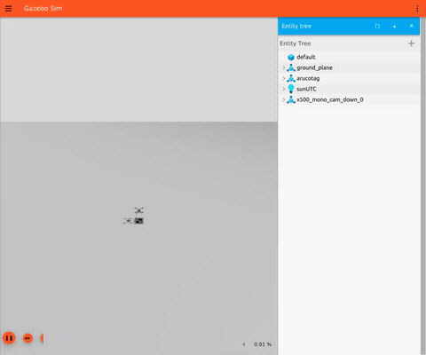
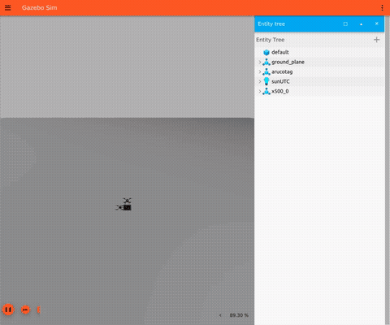
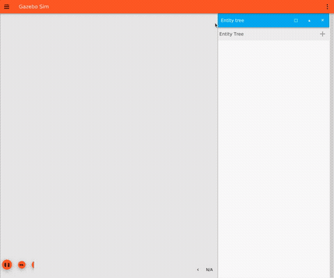
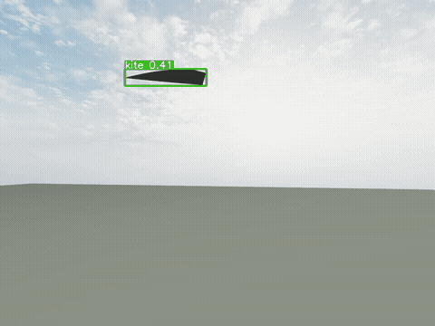
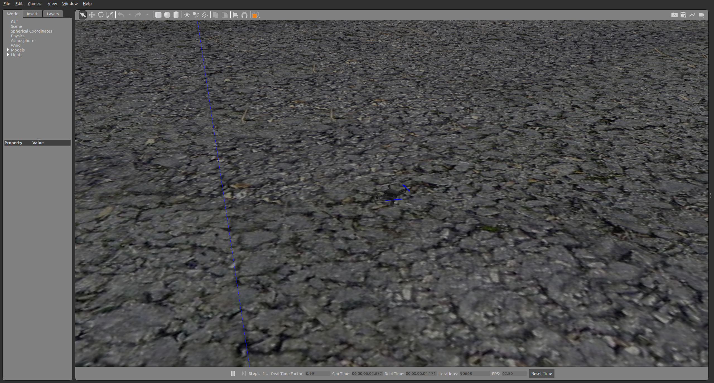

# Drone_ros2 — 仿真无人机开发项目

> 📖 **开源课程已上线**：[howe12.github.io/Drone_ros2](https://howe12.github.io/Drone_ros2/) —— L0 首飞 → L6 集群/VTOL 阶梯实验。课程源码在 [docs/](docs/README.md)。
>
> 🔄 **双平台同步**：本仓库同时托管在 [GitHub](https://github.com/howe12/Drone_ros2) 与 [Gitee](https://gitee.com/huo-haijie/Drone_ros2)，一次 `git push origin main` 双发；协作者请先读 [docs/GITEE_SYNC.md](docs/GITEE_SYNC.md)。
>
> ⚠️ **验证状态以本文档的[自动判定表](#验证状态与自动判分)为准**：12 个场景中 **9 个通过、3 个未达标**（集群、VTOL、VIO）。
> 所有结论都可用 `bash scripts/grade.sh` 复现，不依赖截图。

基于 **PX4 v1.15.4 + ROS2 Humble + Gazebo** 的无人机仿真开发工作区。

## 设备与环境

开发机配置（2026-11-25 实测验证）:

| 项目 | 配置 |
|---|---|
| CPU | Intel Core i7-9700F @ 3.00GHz（8 核 8 线程） |
| 内存 | 40 GB |
| GPU | NVIDIA GeForce RTX 2070 SUPER 8GB（驱动 580.126.09 / CUDA 13.0） |
| 磁盘 | 503 GB（工作区位于 `/develop`，剩余约 190 GB） |
| 系统 | Ubuntu 22.04.4 LTS（内核 5.19.0-38-generic，X11 桌面 `:0`） |
| ROS2 | Humble Hawksbill |
| 仿真器 | Gazebo Classic 11.10.2（另装有 Ignition Fortress；Harmonic 可选装，见下文） |
| 工具链 | CMake 3.22.1 / GCC 11.4.0 / Ninja 1.13.0 / Python 3.10 |
| 飞控 | PX4 v1.15.4 SITL（软件在环仿真） |

> 注: 编译使用 PATH 中的 Python 3.10 环境（本机为 miniconda，依赖用 pip 安装即可）；
> 编译 Micro-XRCE-DDS-Agent 时需避免 conda 头文件污染系统 spdlog/fmt，
> `scripts/setup_workspace.sh` 已内置干净 PATH 处理。

## 仓库内容

入库: `drone_sim` 开发包、脚本、本地适配补丁 (`patches/`)、验证截图 (`screenshots/`)。
第三方仓库 (PX4 / px4_msgs / px4_ros_com / px4-offboard / Micro-XRCE-DDS-Agent) **不入库**，
在新机器上一键复现:

```bash
bash scripts/setup_workspace.sh   # 按锁定版本克隆 + 应用补丁 + 全部编译
```

## 目录结构

```
Drone_ros2/
├── PX4-Autopilot/            # 飞控 + SITL 仿真 (tag v1.15.4, 浅克隆含子模块)
├── Micro-XRCE-DDS-Agent/     # uXRCE-DDS 代理 (main 分支, 安装到 ~/.local)
├── third_party/
│   └── XTDrone2/             # 可选仿真平台 (锁定 commit 15b2ef6, 不入库)
├── ros2_ws/                  # ROS2 工作区 (colcon, 双源空间: src + third_party/XTDrone2)
│   └── src/
│       ├── px4_msgs/         # PX4 消息 (release/1.15, 与飞控版本配套)
│       ├── px4_ros_com/      # 官方 ROS2 桥接示例 (release/1.15, C++)
│       ├── px4-offboard/     # Jaeyoung-Lim Python offboard 示例 (官方文档引用)
│       └── drone_sim/        # ★ 自己的开发包: offboard 演示 (起飞→画圆→降落)
└── scripts/
    ├── setup_workspace.sh    # 新机器一键复现 (克隆依赖+补丁+编译)
    ├── run_simulation.sh     # 一键启动仿真
    └── install_gz_harmonic.sh# [可选] 升级 Gazebo Harmonic (需 sudo)
```

## 数据链路

```
Gazebo 仿真 ↔ PX4 SITL ↔ MicroXRCEAgent (UDP 8888) ↔ ROS2 节点 (drone_sim / px4-offboard)
```

## 快速开始

以下命令均在**项目根目录** `/develop/IDEA/Drone_ros2` 下执行（注意 `cd` 层级）。

```bash
# 0. 编译 (已完成一次, 改动后重跑)
#    编译终端只 source humble, 不要 source 本工作空间, 否则 colcon 报 override 警告
source /opt/ros/humble/setup.bash
cd ros2_ws
colcon build --symlink-install --base-paths src ../third_party/XTDrone2  # 全量(含 xtd2 包)
# 只重编自己的包: colcon build --symlink-install --packages-select drone_sim
cd ..    # ★ 回到项目根目录, 否则下一步找不到 scripts/

# 1. 一键启动 (Agent + PX4 SITL + Gazebo GUI + 演示节点)
bash scripts/run_simulation.sh                  # classic 平台, iris 四旋翼
bash scripts/run_simulation.sh classic typhoon_h480   # 换六旋翼 (运行时参数, 无需分支)
bash scripts/run_simulation.sh xtd2             # XTDrone2 平台 (需先装 Gazebo Harmonic)
#    栈已在运行时勿重复启动 (端口冲突); 先停旧栈见 docs/OPERATIONS.md

# 或分步手动启动:
export LD_LIBRARY_PATH=$HOME/.local/lib:$LD_LIBRARY_PATH
MicroXRCEAgent udp4 -p 8888                          # 终端 1
cd PX4-Autopilot && make px4_sitl gazebo-classic     # 终端 2 (Gazebo Classic)
source /opt/ros/humble/setup.bash
source ros2_ws/install/setup.bash
ros2 launch drone_sim demo.launch.py                 # 终端 3
# 也可以跑官方示例: ros2 launch px4_offboard offboard_control.launch.py
```

> 常见小坑:
> - `bash: scripts/run_simulation.sh: No such file or directory` → 你在 `ros2_ws/` 里，`cd ..` 回根目录。
> - colcon 警告 `'px4_msgs' is in ... underlay` → 编译前 source 过本工作空间导致，无害；
>   按上面只 source humble 即可消除。
> - `setuptools EasyInstallDeprecationWarning` → Python 打包工具的正常告警，忽略。

## 手动控制（xtd2 平台键盘手飞）

先 source 工作空间（顺序: humble 底座 → 本项目 overlay，`cd` 到哪不重要，source 才重要）:

```bash
source /opt/ros/humble/setup.bash
source ros2_ws/install/setup.bash
```

启动键盘节点（**推荐带调参**，见下方说明）:

```bash
ros2 run xtd2_control multirotor_keyboard_control --model gz_x500 --id 0 --namespace x500_0 \
  --ros-args -p linear_velocity_step:=0.5 -p angular_velocity_step:=0.2 \
             -p max_linear_velocity:=5.0 -p max_angular_velocity:=1.5
```

**起飞三步曲（顺序重要）**: 先按 `b`（开启 OFFBOARD，否则速度指令全被丢弃）→ `t`（解锁）→ `v`（起飞）。

| 按键 | 作用 | 按键 | 作用 |
|---|---|---|---|
| `b` | 开启 Offboard（必须先按） | `w`/`x` | 前进/后退速度 +/− |
| `t` | 解锁 ARM | `a`/`d` | 左移/右移速度 +/− |
| `v` | 起飞 TAKEOFF | `i`/`,` | 上升/下降速度 +/− |
| `n` | 降落 LAND | `j`/`l` | 左旋/右旋速度 +/− |
| `y` | 上锁 DISARM | `s` | 悬停（速度清零） |
| `r` | 返航 RTL | `Ctrl-C` | 退出 |

**手感说明**: 速度是**累加式**的，每按一次加一个步进。上游默认 `linear_velocity_step=0.01`
（按 100 次才到 1 m/s，几乎感觉不动）——所以上面推荐 0.5 m/s 步进、限速 5 m/s。
按 `s` 随时清零悬停。若解锁被拒（Preflight 警告），等 10–20 s EKF 收敛后重试 `t`。

自动演示（起飞→画圆→降落）见「快速开始」；xtd2 平台下 `drone_sim` 需把 5 个 `/fmu/...`
话题重映射到 `/x500_0/fmu/...`（完整命令见 `docs/OPERATIONS.md`）。

## 仿真器说明

- 本机已装 **Gazebo Classic 11** (含开发头文件) 与 Ignition Fortress。
  PX4 v1.15 仍支持 Classic, 因此当前用 `make px4_sitl gazebo-classic`, **无需 sudo**。
- PX4 官方推荐的新仿真器是 **Gazebo Harmonic** (`make px4_sitl gz_x500`)。
  需要 sudo 安装: `bash scripts/install_gz_harmonic.sh` (不影响现有 Classic)。

## XTDrone2 集成（可选平台）

[XTDrone2](https://github.com/zuiyue52/XTDrone2)（北大团队，MIT 协议）= PX4 1.15 + ROS2 + Gazebo Ignition
的通用仿真平台，前身是 [XTDrone](https://gitee.com/robin_shaun/XTDrone)（ROS1，其
[中文手册](https://www.yuque.com/xtdrone/manual_cn) 可当算法参考）。

### 放置方式：`third_party/XTDrone2`（外部依赖，不入库）

**不用 git 分支、不另开仓库**，与 PX4 同一模式：setup 脚本按锁定 commit (`15b2ef6`) 克隆，
本地适配以 `patches/0003` 保存。理由：
- 分支适合"同一套代码的并行版本"；XTDrone2 是另一个完整平台（7 个 ROS2 包 + 自己的
  模型/世界），塞进分支会污染目录结构、无法干净跟进上游（它仍在频繁迭代，锁 commit 更安全）
- 它的包与我们的包**同工作区编译**（colcon 双源空间 `src + third_party/XTDrone2`），
  `drone_sim` 可以直接 import/调用它的话题与工具，开发时两边代码同时可见
- 它**复用我们已编译的 PX4**（`px4_launch --px4-dir` 指向本工作区，补丁 0003 已暴露该参数），
  不需要第二份 PX4

### 切换方式：运行时参数，不是分支

```bash
bash scripts/run_simulation.sh classic [机型]   # Gazebo Classic + drone_sim
bash scripts/run_simulation.sh xtd2 [模型]      # Gazebo Harmonic + XTDrone2 (gz_x500)
```

- **平台切换** = 换一套 launch（仿真器 + 节点组合），共用同一份 PX4 编译产物与 MicroXRCEAgent
- **机型切换** = 运行时参数：classic 平台支持 iris / typhoon_h480(六旋翼) / standard_vtol /
  plane / rover / boat 等（完整列表见 `sitl_targets_gazebo-classic.cmake`）；
  xtd2 平台目前支持 gz_x500 / gz_x500_depth（固定翼/无人车适配在其路线图上）
- 注意：ROS1 版 XTDrone 的算法不能直接混入本 Humble 工作区，需要时按包单独移植

### 当前状态与待办

| 项 | 状态 |
|---|---|
| XTDrone2 全部 7 包在 Humble 编译 | ✔ 已验证（共 11 包通过） |
| px4_msgs 重复冲突 | ✔ 已用 COLCON_IGNORE 处理 |
| px4_dir / model_name 参数化 | ✔ 补丁 0003 |
| Gazebo Harmonic | ✔ 已安装 8.15.0（diversion 会把 gz-tools2 的 gz 也改道为 /usr/bin/gz-classic，脚本已自动建 ~/.local/bin/gz 符号链接） |
| PX4 gz_bridge 模块 | ✔ 装 Harmonic 后已重配置重编（cmake -B + ninja） |
| ros_gz 源码编译 (GZ_VERSION=harmonic) | ✔ third_party/ros_gz (humble 分支)，桥接 pose/odometry + **相机/IMU/深度/点云/2D激光全实测** (E1, 补丁0007/0008) |
| ros_gz_bridge.launch.py 缺失 | ✔ 补丁 0006 改调 parameter_bridge（humble 支持新 yaml schema） |
| px4-offboard 误注册 visualize.rviz 包标记 | ✔ 补丁 0005（会炸 ros_gz humble 的 gz_sim.launch 遍历） |
| **xtd2 平台飞行验证** | ✔ gz_x500 起飞 5m → 半径 3m 画圆 → 降落上锁（截图 04–06） |

注意事项:
- `drone_sim` 是 ament_python 包，colcon 实际是**复制**而非符号链接源码——改完代码必须
  `colcon build --packages-select drone_sim` 再运行。
- x500 出生点有高度偏移（地面 z≈-0.85 而非 0），降落判定已改为以上锁为准。
- 多次 kill -9 后若出现 DDS 发现异常（新节点收不到话题），整栈重启即可恢复。
- 飞行控制复用 `drone_sim` 节点，把 5 个 `/fmu/...` 话题重映射到 `/x500_0/fmu/...` 即可
  （见 `logs/` 同级的运行记录；XTDrone2 的 `xtd2_communication` 也提供自己的指令话题）。

## 开发入口 (drone_sim)

`ros2_ws/src/drone_sim/drone_sim/offboard_demo.py` —— 中文注释的状态机示例:
INIT → 请求 Offboard+解锁 → TAKEOFF → CIRCLE → LAND → DONE。
参数: `takeoff_altitude` / `circle_radius` / `circle_speed` / `circle_duration`。
在此基础上加自己的任务逻辑 (航点、视觉、多机等)。

**写新节点请用统一接口** `drone_sim/px4_interface.py`：QoS、心跳、解锁、EKF 原点门控、
坐标系换算、VTOL 过渡都收敛在这一个文件里。历史上 8 个节点各写一份，直接造成过
"多机 2 号机无法解锁 / 与 Point-LIO 连不上 / 遇 GPS 漂移贴地爬行 / 飞反"等故障。

| 文件 | 用途 |
|---|---|
| [catalog/scenarios.yaml](catalog/scenarios.yaml) | 场景目录：机型 × 环境 × 应用 + 判定指标（机器可读）|
| [catalog/params.yaml](catalog/params.yaml) | 参数注册表：14 节点 / 86 参数（`python3 tools/gen_params.py` 自动生成）|
| [docs/PLATFORM_API.md](docs/PLATFORM_API.md) | 平台契约：接口速查、判定三铁律、新增节点三步 |

## 版本配套 (重要)

| 组件 | 版本/分支 |
|---|---|
| PX4-Autopilot | v1.15.4 |
| px4_msgs | release/1.15 |
| px4_ros_com | release/1.15 |
| Micro-XRCE-DDS-Agent | main (FastDDS 3.3.x; v2.4.2 的旧依赖已失效) |
| ROS2 | Humble |

## 验证状态与自动判分

判定不是靠看截图，而是可复现的命令：

```bash
bash scripts/grade.sh --list                                  # 列出全部场景
bash scripts/grade.sh --scenario ctrl.takeoff_hover_land --runs 3   # 跑判定
bash scripts/grade_video.sh vision.aruco_precision_landing    # 判定 + 录屏
bash scripts/grade_all.sh                                     # 批量跑全部
```

判定规则（写在 [docs/PLATFORM_API.md](docs/PLATFORM_API.md)）：
1. **指标化**：每个场景有明确阈值与取数方式，不看"看起来正常"
2. **N 次通过率**：单次成功不算 PASS，默认 N=3 且 **≥2/3** 才算通过
   （教训：曾把"单次跑通"记成"已完成"，复测时发现是运气）
3. **外部真值优先**：位置/精度用 Gazebo 世界系位姿，不用 PX4 局部坐标（EKF 会重置原点）

### 当前结果（2026-11-27 实测，单次运行）

| 场景 | 判定 | 实测指标 | 阈值 | 视频 |
|---|---|---|---|---|
| `ctrl.takeoff_hover_land` 起飞-悬停-降落 | ✅ **PASS** | 高度误差 0.21m / 32.5s / 正常上锁 | <0.4m / <75s | — |
| `ctrl.waypoint_square` 正方形航点 | ✅ **PASS** | 到点误差 **0.26m** / 命中 **4/4** / 正常上锁 | <0.5m / ≥4 | [▶](videos/ctrl.waypoint_square.mp4) |
| `vision.yolo_detect` YOLO 检测 | ✅ **PASS** | 实时检出 person 0.71~0.81 | — | [▶](videos/vision.yolo_detect.mp4) |
| `vision.aruco_precision_landing` 精准降落 | ✅ **PASS** | 落点偏差 **0.028–0.083m** / 正常上锁 | <0.15m | [▶](videos/vision.aruco_precision_landing.mp4) |
| `slam.lio_odometry` 3D 激光里程计 | ✅ **PASS** | 高度误差 **0.002m** / 9.4Hz / 跨度 3.6m | <0.2m / >5Hz / >2m | — |
| `plan.obstacle_avoidance` 障碍绕行 | ✅ **PASS** | 最近接近 **0.02m** / 障碍距离 0.99m | <0.8m / >0.8m | — |
| `mission.behavior_tree` 行为树 | ✅ **PASS** | **4/4** 航点 / 根节点 SUCCESS | ≥3 / SUCCESS | [▶](videos/mission.behavior_tree.mp4) |
| `safety.geofence` 地理围栏 | ✅ **PASS** | 围栏触发 / 0 误报 | 触发 | — |
| `multi.formation` 双机编队 | ✅ **PASS**（自报口径）| 队形误差 **0.02m** | <0.6m | — |
| `swarm.cross_3uav` 3 机集群交叉 | ❌ 1/2 | 最小间距 **1.2~1.35m** ✅ / **到达 0~1/3** ❌ | >1.0m / 3/3 | [▶](videos/swarm.cross_3uav.mp4) |
| `vtol.transition` VTOL 过渡 | ❌ 2/3 | 高度 19.1m ✅ / **固定翼段空速 2.9m/s** ❌ | >15m/s | [▶](videos/vtol.transition.mp4) |
| `vio.vins_mono` 视觉惯性里程计 | ❌ 未通过 | 里程计输出 **0 Hz**（算法初始化失败）| >5Hz | — |

**9 / 12 通过**。未达标的 3 项都是**真实功能问题**，不是判定口径问题（口径问题已在复测中逐个修正）：

| 未达标项 | 根因 | 状态 |
|---|---|---|
| 集群仅 0~1/3 到达 | `x500_0` 直线飞走（机体系速度→世界系方向映射错），与 ego-planner 同源 | Issue #9 已**重新打开** |
| VTOL 空速不足 | `vtol_demo` 的 FW_CRUISE 段只观察、不发前向速度指令 | Issue #11 已**重新打开** |
| VIO 无输出 | VINS 单目视觉惯性初始化失败 | Issue #6 保持 open |

> ⚠️ **自报口径说明**：`multi.formation` 的队形误差取自跟随节点自己打印的日志，
> 属于"自报指标"，尚未做独立几何校验（已在 `catalog/scenarios.yaml` 的 `how` 字段标注）。

### 录屏（页面内直接播放）

> GIF 是整段过程的时间压缩版，**页面内自动播放**；点击下方链接可看原速 MP4。
> 录制时已将 Gazebo 相机设置为**跟随被测无人机**。

**ArUco 精准降落**（实测落点偏差 0.077 m，阈值 <0.15 m）

[▶ 原速 MP4](videos/vision.aruco_precision_landing.mp4)

**行为树任务**（4/4 航点全部到达，根节点 SUCCESS）

[▶ 原速 MP4](videos/mission.behavior_tree.mp4)

**3D 激光 SLAM / 里程计**（Point-LIO：高度误差 0.015 m、8.7 Hz、轨迹跨度 3.5 m）

[▶ 原速 MP4](videos/slam.lio_odometry.mp4)

**局部规划避障**（自研反应式规划器：最近接近 ≈0.02 m，与障碍保持 >0.9 m）

[▶ 原速 MP4](videos/plan.obstacle_avoidance.mp4)

**正方形航点**（到点误差 0.24 m，4/4 命中）

[▶ 原速 MP4](videos/ctrl.waypoint_square.mp4)

**起飞-悬停-降落**（高度误差 0.36 m，19.3 s）

[▶ 原速 MP4](videos/ctrl.takeoff_hover_land.mp4)

**VTOL 过渡**（⚠️ 失败案例：固定翼段空速仅 2.8 m/s，飞机未真正进入固定翼巡航）

[▶ 原速 MP4](videos/vtol.transition.mp4)

**3 机集群交叉**（⚠️ 失败案例：最小间距 1.2 m 合格，但 0/3 到达目标）

[▶ 原速 MP4](videos/swarm.cross_3uav.mp4)

**YOLO 目标检测**（无人机飞行中实时检测；专用世界 `yolo_targets`：3 车 + 3 行人）

[▶ 原速 MP4](videos/vision.yolo_detect.mp4)

> 录制约束：脚本会等飞机 `armed && 高度>2m` 才开始录，否则**拒绝录制**。
> 早先一版没加这个判断，录到的是**地面静止画面**（首尾帧完全相同）——看起来像检测成功，
> 实际飞机根本没起飞。这类"假成功"必须靠硬性前置条件拦住。

**已知问题**（真实存在，未掩盖）：

| 现象 | 原因 |
|---|---|
| 远处物体被误检为 `airplane 0.5~0.8` | 最可能是**黑色剪影的树**（见下行）。<br>~~先前归因于螺旋桨入镜，经几何核算后**该说法不成立**~~：相机在机头 (x=+0.12)、水平 FOV 99.7°（半角 49.8°），而前旋翼中心在 ±69°/±75°、桨盘内缘 ±56°/±69°，**均超出视野**，不会入镜 |
| 树木检不出 / 被误检为 `airplane` | 这套仿真资产的树是**纯黑剪影**（材质未生效），CLIP 匹配不到 `tree`；需修资产材质或换带贴图的树 |

**开放词表（YOLO-World）支持**：节点可用任意文本类别，不局限 COCO 80 类

```bash
bash scripts/run_yolo.sh /x500_mono_cam_0/camera/image_raw \
     yolov8s-worldv2.pt "tree, person, car"
```

实测在有人/车的画面上检出 `person 0.90 / 0.87`（高于 COCO 的 0.81）；
依赖 CLIP（`pip install git+https://github.com/ultralytics/CLIP.git`）+ 338MB 权重。

### 运行截图

**① 起飞爬升**（遥测 z = -4.55 m，NED 坐标即高度 4.55 m）:


**② 半径 3 m 画圆轨迹**（遥测 x=1.96, y=2.38 → 实测半径 3.08 m）:


**③ 降落完成并自动上锁**（节点日志: `已降落并上锁, 演示完成 ✔`）:



### XTDrone2 平台运行截图（Gazebo Harmonic + gz_x500, aruco 世界）

**④ x500 起飞爬升**（遥测高度 4.78 m）:


**⑤ x500 画圆**（遥测半径 3.16 m, 高度 4.81 m）:


**⑥ x500 降落**（PX4 日志: Landing detected / Disarmed by landing）:


### 本地适配修改（无 sudo 环境）
1. `PX4-Autopilot/src/modules/simulation/simulator_mavlink/sitl_targets_gazebo-classic.cmake`:
   追加 `-DBUILD_GSTREAMER_PLUGIN=OFF`（本机无 GStreamer 开发包）
2. `sitl_gazebo-classic/CMakeLists.txt`: 补无条件 `find_package(Qt5 ...)`（上游 OFF 分支 bug）
3. `platforms/nuttx/NuttX/nuttx/.git` gitlink 已移除（SITL 不需要 NuttX；模块数据仍在 `.git/modules`，可恢复）
4. Agent 用 main 分支（v2.4.2 依赖的 FastDDS 2.12.x 分支已被上游删除）；安装于 `~/.local`，运行需 `LD_LIBRARY_PATH=$HOME/.local/lib`
5. 编译用 ninja 直调（make jobserver 在本环境报 fd 错误）：`ninja -C build/px4_sitl_default -j8`

## 运行安全注意（磁盘/日志，重要教训）

- **PX4 SITL 无 TTY 时交互控制台会 `pxh>` 重绘死循环**，曾把根分区 `/tmp` 写满 62G。
  `run_simulation.sh` 已设 `NO_PXH=1`（→ `px4 -d`）禁用交互控制台，Gazebo GUI 不受影响。
- 所有运行日志写 `logs/`（位于 `/develop` 大盘），经 `scripts/capped_log.sh` 限制大小
  （20–50MB 上限，达到后停止写盘但进程继续运行）。**不要把仿真日志重定向到根分区 `/tmp`**。
- 无人值守运行可加 `HEADLESS=1`（不启动 Gazebo GUI）。
- XTDrone2 的 `px4_launch` 上游已用 `-d` 运行 px4，无此问题。

## 参考

- [PX4 ROS2 Offboard 官方教程 (中文)](https://docs.px4.io/v1.15/zh/ros2/offboard_control)
- [Jaeyoung-Lim/px4-offboard](https://github.com/Jaeyoung-Lim/px4-offboard)
- [px4_ros2_interface_lib (新一代模式接口)](https://docs.px4.io/main/en/ros2/px4_ros2_control_interface.html)
- [XTDrone2 中文平台](https://github.com/zuiyue52/XTDrone2) / [crazyswarm2 集群](https://github.com/IMRCLab/crazyswarm2)
