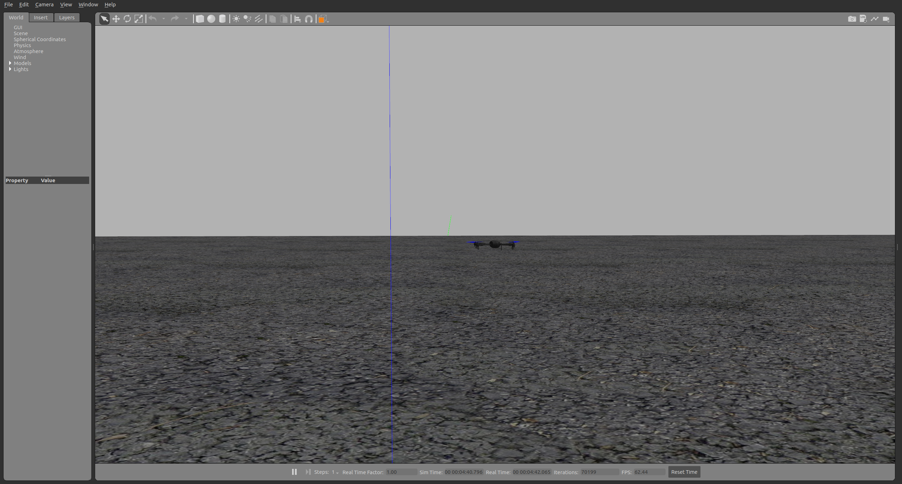

# Drone_ros2 — 仿真无人机开发项目

基于 **PX4 v1.15.4 + ROS2 Humble + Gazebo** 的无人机仿真开发工作区。

## 设备与环境

开发机配置（2026-11-25 实测验证）:

| 项目 | 配置 |
|---|---|
| CPU | Intel Core i7-9700F @ 3.00GHz（8 核 8 线程） |
| 内存 | 40 GB |
| GPU | NVIDIA GeForce RTX 2070 SUPER 8GB（驱动 580.126.09 / CUDA 13.0） |
| 磁盘 | 503 GB（工作区位于 `/develop`，剩余约 190 GB） |
| 系统 | Ubuntu 22.04.4 LTS（内核 5.19.0-38-generic，X11 桌面 `:0`） |
| ROS2 | Humble Hawksbill |
| 仿真器 | Gazebo Classic 11.10.2（另装有 Ignition Fortress；Harmonic 可选装，见下文） |
| 工具链 | CMake 3.22.1 / GCC 11.4.0 / Ninja 1.13.0 / Python 3.10 |
| 飞控 | PX4 v1.15.4 SITL（软件在环仿真） |

> 注: 编译使用 PATH 中的 Python 3.10 环境（本机为 miniconda，依赖用 pip 安装即可）；
> 编译 Micro-XRCE-DDS-Agent 时需避免 conda 头文件污染系统 spdlog/fmt，
> `scripts/setup_workspace.sh` 已内置干净 PATH 处理。

## 仓库内容

入库: `drone_sim` 开发包、脚本、本地适配补丁 (`patches/`)、验证截图 (`screenshots/`)。
第三方仓库 (PX4 / px4_msgs / px4_ros_com / px4-offboard / Micro-XRCE-DDS-Agent) **不入库**，
在新机器上一键复现:

```bash
bash scripts/setup_workspace.sh   # 按锁定版本克隆 + 应用补丁 + 全部编译
```

## 目录结构

```
Drone_ros2/
├── PX4-Autopilot/            # 飞控 + SITL 仿真 (tag v1.15.4, 浅克隆含子模块)
├── Micro-XRCE-DDS-Agent/     # uXRCE-DDS 代理 (main 分支, 安装到 ~/.local)
├── third_party/
│   └── XTDrone2/             # 可选仿真平台 (锁定 commit 15b2ef6, 不入库)
├── ros2_ws/                  # ROS2 工作区 (colcon, 双源空间: src + third_party/XTDrone2)
│   └── src/
│       ├── px4_msgs/         # PX4 消息 (release/1.15, 与飞控版本配套)
│       ├── px4_ros_com/      # 官方 ROS2 桥接示例 (release/1.15, C++)
│       ├── px4-offboard/     # Jaeyoung-Lim Python offboard 示例 (官方文档引用)
│       └── drone_sim/        # ★ 自己的开发包: offboard 演示 (起飞→画圆→降落)
└── scripts/
    ├── setup_workspace.sh    # 新机器一键复现 (克隆依赖+补丁+编译)
    ├── run_simulation.sh     # 一键启动仿真
    └── install_gz_harmonic.sh# [可选] 升级 Gazebo Harmonic (需 sudo)
```

## 数据链路

```
Gazebo 仿真 ↔ PX4 SITL ↔ MicroXRCEAgent (UDP 8888) ↔ ROS2 节点 (drone_sim / px4-offboard)
```

## 快速开始

```bash
# 0. 编译 (已完成一次, 改动后重跑)
cd ros2_ws && colcon build --symlink-install

# 1. 一键启动 (Agent + PX4 SITL + Gazebo GUI + 演示节点)
bash scripts/run_simulation.sh                  # classic 平台, iris 四旋翼
bash scripts/run_simulation.sh classic typhoon_h480   # 换六旋翼 (运行时参数, 无需分支)
bash scripts/run_simulation.sh xtd2             # XTDrone2 平台 (需先装 Gazebo Harmonic)

# 或分步手动启动:
export LD_LIBRARY_PATH=$HOME/.local/lib:$LD_LIBRARY_PATH
MicroXRCEAgent udp4 -p 8888                          # 终端 1
cd PX4-Autopilot && make px4_sitl gazebo-classic     # 终端 2 (Gazebo Classic)
source /opt/ros/humble/setup.bash
source ros2_ws/install/setup.bash
ros2 launch drone_sim demo.launch.py                 # 终端 3
# 也可以跑官方示例: ros2 launch px4_offboard offboard_control.launch.py
```

## 仿真器说明

- 本机已装 **Gazebo Classic 11** (含开发头文件) 与 Ignition Fortress。
  PX4 v1.15 仍支持 Classic, 因此当前用 `make px4_sitl gazebo-classic`, **无需 sudo**。
- PX4 官方推荐的新仿真器是 **Gazebo Harmonic** (`make px4_sitl gz_x500`)。
  需要 sudo 安装: `bash scripts/install_gz_harmonic.sh` (不影响现有 Classic)。

## XTDrone2 集成（可选平台）

[XTDrone2](https://github.com/zuiyue52/XTDrone2)（北大团队，MIT 协议）= PX4 1.15 + ROS2 + Gazebo Ignition
的通用仿真平台，前身是 [XTDrone](https://gitee.com/robin_shaun/XTDrone)（ROS1，其
[中文手册](https://www.yuque.com/xtdrone/manual_cn) 可当算法参考）。

### 放置方式：`third_party/XTDrone2`（外部依赖，不入库）

**不用 git 分支、不另开仓库**，与 PX4 同一模式：setup 脚本按锁定 commit (`15b2ef6`) 克隆，
本地适配以 `patches/0003` 保存。理由：
- 分支适合"同一套代码的并行版本"；XTDrone2 是另一个完整平台（7 个 ROS2 包 + 自己的
  模型/世界），塞进分支会污染目录结构、无法干净跟进上游（它仍在频繁迭代，锁 commit 更安全）
- 它的包与我们的包**同工作区编译**（colcon 双源空间 `src + third_party/XTDrone2`），
  `drone_sim` 可以直接 import/调用它的话题与工具，开发时两边代码同时可见
- 它**复用我们已编译的 PX4**（`px4_launch --px4-dir` 指向本工作区，补丁 0003 已暴露该参数），
  不需要第二份 PX4

### 切换方式：运行时参数，不是分支

```bash
bash scripts/run_simulation.sh classic [机型]   # Gazebo Classic + drone_sim
bash scripts/run_simulation.sh xtd2 [模型]      # Gazebo Harmonic + XTDrone2 (gz_x500)
```

- **平台切换** = 换一套 launch（仿真器 + 节点组合），共用同一份 PX4 编译产物与 MicroXRCEAgent
- **机型切换** = 运行时参数：classic 平台支持 iris / typhoon_h480(六旋翼) / standard_vtol /
  plane / rover / boat 等（完整列表见 `sitl_targets_gazebo-classic.cmake`）；
  xtd2 平台目前支持 gz_x500 / gz_x500_depth（固定翼/无人车适配在其路线图上）
- 注意：ROS1 版 XTDrone 的算法不能直接混入本 Humble 工作区，需要时按包单独移植

### 当前状态与待办

| 项 | 状态 |
|---|---|
| XTDrone2 全部 7 包在 Humble 编译 | ✔ 已验证（共 11 包通过） |
| px4_msgs 重复冲突 | ✔ 已用 COLCON_IGNORE 处理 |
| px4_dir / model_name 参数化 | ✔ 补丁 0003 |
| Gazebo Harmonic 运行时 | ⏳ 需 sudo 执行 `scripts/install_gz_harmonic.sh`（教程推荐 24.04+Jazzy+Harmonic，本机 22.04+Humble 代码层已验证兼容，仿真器需 Harmonic） |
| ros_gz_bridge Python actions | ⏳ Humble 二进制包无此模块（bridge_launch 节点会报错，不影响飞行主链路）；装 Harmonic 后需从源码编译 ros_gz（humble 分支, `GZ_VERSION=harmonic`）或改用 `parameter_bridge` + 其自带 yaml |

## 开发入口 (drone_sim)

`ros2_ws/src/drone_sim/drone_sim/offboard_demo.py` —— 中文注释的状态机示例:
INIT → 请求 Offboard+解锁 → TAKEOFF → CIRCLE → LAND → DONE。
参数: `takeoff_altitude` / `circle_radius` / `circle_speed` / `circle_duration`。
在此基础上加自己的任务逻辑 (航点、视觉、多机等)。

## 版本配套 (重要)

| 组件 | 版本/分支 |
|---|---|
| PX4-Autopilot | v1.15.4 |
| px4_msgs | release/1.15 |
| px4_ros_com | release/1.15 |
| Micro-XRCE-DDS-Agent | main (FastDDS 3.3.x; v2.4.2 的旧依赖已失效) |
| ROS2 | Humble |

## 已验证 (2026-11-25)

完整链路实测通过: `Gazebo Classic ↔ PX4 SITL ↔ MicroXRCEAgent ↔ drone_sim`
- 起飞至 5 m（实测 z=-4.55 m 爬升中）→ 半径 3 m 画圆 25 s（实测轨迹半径 3.08 m）→ 降落并上锁 ✔

### 运行截图

**① 起飞爬升**（遥测 z = -4.55 m，NED 坐标即高度 4.55 m）:



**② 半径 3 m 画圆轨迹**（遥测 x=1.96, y=2.38 → 实测半径 3.08 m）:


**③ 降落完成并自动上锁**（节点日志: `已降落并上锁, 演示完成 ✔`）:


### 本地适配修改（无 sudo 环境）
1. `PX4-Autopilot/src/modules/simulation/simulator_mavlink/sitl_targets_gazebo-classic.cmake`:
   追加 `-DBUILD_GSTREAMER_PLUGIN=OFF`（本机无 GStreamer 开发包）
2. `sitl_gazebo-classic/CMakeLists.txt`: 补无条件 `find_package(Qt5 ...)`（上游 OFF 分支 bug）
3. `platforms/nuttx/NuttX/nuttx/.git` gitlink 已移除（SITL 不需要 NuttX；模块数据仍在 `.git/modules`，可恢复）
4. Agent 用 main 分支（v2.4.2 依赖的 FastDDS 2.12.x 分支已被上游删除）；安装于 `~/.local`，运行需 `LD_LIBRARY_PATH=$HOME/.local/lib`
5. 编译用 ninja 直调（make jobserver 在本环境报 fd 错误）：`ninja -C build/px4_sitl_default -j8`

## 参考

- [PX4 ROS2 Offboard 官方教程 (中文)](https://docs.px4.io/v1.15/zh/ros2/offboard_control)
- [Jaeyoung-Lim/px4-offboard](https://github.com/Jaeyoung-Lim/px4-offboard)
- [px4_ros2_interface_lib (新一代模式接口)](https://docs.px4.io/main/en/ros2/px4_ros2_control_interface.html)
- [XTDrone2 中文平台](https://github.com/zuiyue52/XTDrone2) / [crazyswarm2 集群](https://github.com/IMRCLab/crazyswarm2)
