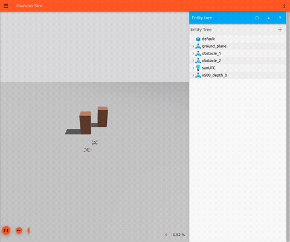
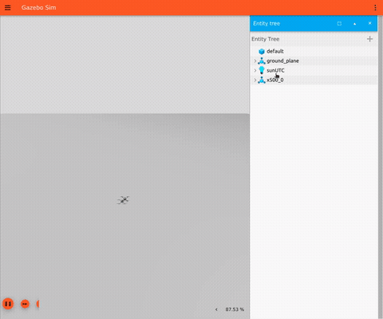
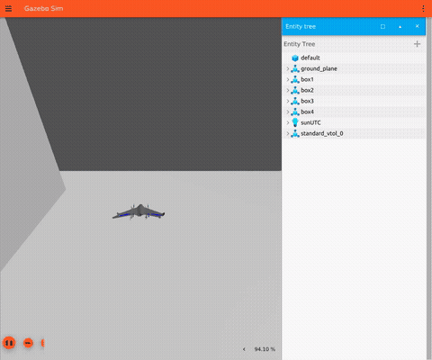
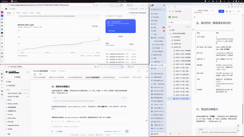
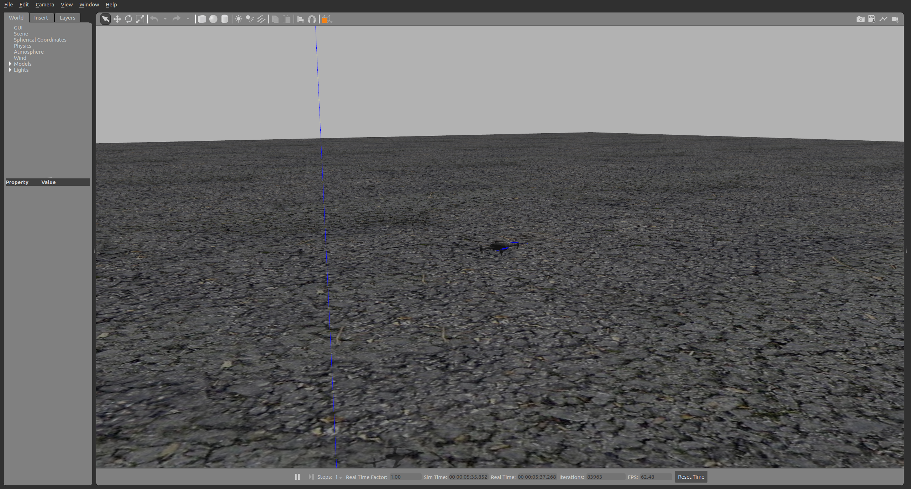

# Drone_ros2 — 仿真无人机开发项目

> 📖 **开源课程已上线**：[howe12.github.io/Drone_ros2](https://howe12.github.io/Drone_ros2/) —— L0 首飞 → L6 集群/VTOL 阶梯实验。课程源码在 [docs/](docs/README.md)。
>
> 🔄 **双平台同步**：本仓库同时托管在 [GitHub](https://github.com/howe12/Drone_ros2) 与 [Gitee](https://gitee.com/huo-haijie/Drone_ros2)，一次 `git push origin main` 双发；协作者请先读 [docs/GITEE_SYNC.md](docs/GITEE_SYNC.md)。
>
> ⚠️ **验证状态以本文档的[自动判定表](#验证状态与自动判分)为准**：12 个场景中 **9 个通过、3 个未达标**（集群、VTOL、VIO）。
> 所有结论都可用 `bash scripts/grade.sh` 复现，不依赖截图。
>
> 🙏 **本项目建立在 [PX4](https://github.com/PX4/PX4-Autopilot) 与 [XTDrone2](https://github.com/zuiyue52/XTDrone2) 之上**，
> 它们才是仿真、飞控与场景资产的真正来源。完整致谢与许可证见文末[致谢与引用](#致谢与引用)。

基于 **PX4 v1.15.4 + ROS2 Humble + Gazebo Harmonic** 的无人机仿真开发工作区。

## 设备与环境

开发机配置（2026-11-25 实测验证，**仅供参考**——本项目不要求同等配置，仅说明验证时的环境）:

| 项目 | 配置 |
|---|---|
| CPU | Intel Core i7-9700F @ 3.00GHz（8 核 8 线程） |
| 内存 | 40 GB |
| GPU | NVIDIA GeForce RTX 2070 SUPER 8GB（驱动 580.126.09 / CUDA 13.0） |
| 磁盘 | 503 GB（可用 ~190 GB；仿真日志较占空间，建议预留 20 GB 以上）|
| 系统 | Ubuntu 22.04.4 LTS（内核 5.19.0-38-generic，X11 桌面 `:0`） |
| ROS2 | Humble Hawksbill |
| 仿真器 | **Gazebo Harmonic 8.15.0**（`gz sim`）。Gazebo Classic 本机已不可用，见[仿真器说明](#仿真器说明) |
| 工具链 | CMake 3.22.1 / GCC 11.4.0 / Ninja 1.13.0 / Python 3.10 |
| 飞控 | PX4 v1.15.4 SITL（软件在环仿真） |

> 注: 编译使用 PATH 中的 Python 3.10 环境（本机为 miniconda，依赖用 pip 安装即可）；
> 编译 Micro-XRCE-DDS-Agent 时需避免 conda 头文件污染系统 spdlog/fmt，
> `scripts/setup_workspace.sh` 已内置干净 PATH 处理。

## 仓库内容

入库内容：`drone_sim` 开发包（16 个节点）、17 个脚本、18 个本地适配补丁（`patches/`）、
场景与参数目录（`catalog/`）、工具（`tools/`）、截图（`screenshots/`）与录屏（`videos/`）、
课程与文档（`docs/`）。
第三方仓库 (PX4 / px4_msgs / px4_ros_com / px4-offboard / Micro-XRCE-DDS-Agent) **不入库**，
在新机器上一键复现:

```bash
bash scripts/setup_workspace.sh   # 按锁定版本克隆 + 应用补丁 + 全部编译
```

## 目录结构

```
Drone_ros2/                      # ← 仓库根目录（下文命令都在这里执行，路径随你克隆到哪）
├── PX4-Autopilot/               # 飞控 + SITL（v1.15.4，setup 脚本克隆，不入库）
├── Micro-XRCE-DDS-Agent/        # uXRCE-DDS 代理（不入库，装到 ~/.local）
├── third_party/                 # 第三方依赖（全部不入库，由 setup 脚本按锁版本克隆）
│   ├── XTDrone2/                #   仿真平台：模型 / 世界 / launch（commit 15b2ef6）
│   ├── point_lio_ros2/          #   3D 激光惯性里程计（GPL-2.0）
│   ├── ego_planner_ros_humble/  #   局部规划（参考实现，见已知限制）
│   ├── vins_fusion_ros2/        #   VIO（GPL-3.0，当前未跑通）
│   ├── px4_ros2_interface/      #   PX4 模式接口库（BSD-3）
│   └── ros_gz/                  #   Gazebo↔ROS2 桥接（Apache-2.0）
├── patches/                     # ★ 对上游的本地适配（0001–0019，可复现的关键）
├── ros2_ws/
│   └── src/
│       ├── drone_sim/           # ★ 本项目开发包（16 节点 / 8 launch / 配置 / 模型）
│       ├── livox_ros_driver2_stub/  # 仅消息定义的桩包（免装 Livox SDK）
│       ├── px4_msgs/            # PX4 消息（release/1.15）
│       ├── px4_ros_com/         # 官方 C++ 示例
│       └── px4-offboard/        # Jaeyoung-Lim Python offboard 示例
├── catalog/                     # ★ 场景目录 + 参数注册表（机器可读，供课程/工具消费）
├── tools/                       # grade.py / gen_params.py / record_image_topic.py 等
├── scripts/                     # 17 个脚本：安装、启动、清理、判定、录屏、推送
├── docs/                        # 课程 + 运维 + 平台契约 + 场景画廊
├── screenshots/  videos/        # 验证截图与录屏
└── logs/                        # 运行日志（git 忽略）
```

## 数据链路

```
Gazebo 仿真 ↔ PX4 SITL ↔ MicroXRCEAgent (UDP 8888) ↔ ROS2 节点 (drone_sim / px4-offboard)
```

## 快速开始

以下命令都在**仓库根目录**执行（即 `git clone` 出来的目录，名称随你定）。
若提示 `scripts/xxx.sh: No such file or directory`，说明你在 `ros2_ws/` 里，`cd ..` 回根目录即可。

```bash
# 0. 一次性准备：克隆锁定版本的上游 + 打补丁 + 编译（首次约 20–40 分钟）
bash scripts/setup_workspace.sh

# 0.1 若要用 YOLO 场景，再补一次模型资产（人/车，来自 Gazebo Fuel）
bash scripts/fetch_fuel_models.sh

# 1. 编译（setup 已编过一次；改了代码后重跑）
source /opt/ros/humble/setup.bash
cd ros2_ws
colcon build --symlink-install --base-paths src ../third_party/XTDrone2
#   只重编自己的包：colcon build --symlink-install --packages-select drone_sim
cd ..                       # ★ 回到仓库根目录

# 2. 启动仿真（推荐 xtd2 平台：Gazebo Harmonic）
bash scripts/run_simulation.sh xtd2 gz_x500 aruco

# 3. 另开终端，跑任务示例
source /opt/ros/humble/setup.bash && source ros2_ws/install/setup.bash
ros2 launch drone_sim waypoint_mission.launch.py prefix:=/x500_0 mission:=square
```

**启动前必读**：
- `run_simulation.sh` 内置**单实例守卫**：检测到已有仿真在跑会直接拒绝启动（退出码 3）。
  需要先清理时执行 `bash scripts/clean_sim.sh`。
- 判定与录屏脚本（`grade*.sh`）会在每次运行前自动清理，不需要手动清。

```bash
# 自动验收（最推荐的入口）
bash scripts/grade.sh --list                     # 看有哪些场景
bash scripts/grade.sh --scenario ctrl.takeoff_hover_land --runs 3
bash scripts/grade_video.sh vision.aruco_precision_landing   # 判定 + 录屏
```

> 关于 Gazebo Classic：本项目的 Classic 路线**当前不可用**（机器上 `gazebo` 包已被移除）。
> 如需恢复详见[仿真器说明](#仿真器说明)。默认请使用 `xtd2` 平台。

## 手动控制（xtd2 平台键盘手飞）

先 source 工作空间（顺序: humble 底座 → 本项目 overlay，`cd` 到哪不重要，source 才重要）:

```bash
source /opt/ros/humble/setup.bash
source ros2_ws/install/setup.bash
```

启动键盘节点（**推荐带调参**，见下方说明）:

```bash
ros2 run xtd2_control multirotor_keyboard_control --model gz_x500 --id 0 --namespace x500_0 \
  --ros-args -p linear_velocity_step:=0.5 -p angular_velocity_step:=0.2 \
             -p max_linear_velocity:=5.0 -p max_angular_velocity:=1.5
```

**起飞三步曲（顺序重要）**: 先按 `b`（开启 OFFBOARD，否则速度指令全被丢弃）→ `t`（解锁）→ `v`（起飞）。

| 按键 | 作用 | 按键 | 作用 |
|---|---|---|---|
| `b` | 开启 Offboard（必须先按） | `w`/`x` | 前进/后退速度 +/− |
| `t` | 解锁 ARM | `a`/`d` | 左移/右移速度 +/− |
| `v` | 起飞 TAKEOFF | `i`/`,` | 上升/下降速度 +/− |
| `n` | 降落 LAND | `j`/`l` | 左旋/右旋速度 +/− |
| `y` | 上锁 DISARM | `s` | 悬停（速度清零） |
| `r` | 返航 RTL | `Ctrl-C` | 退出 |

**手感说明**: 速度是**累加式**的，每按一次加一个步进。上游默认 `linear_velocity_step=0.01`
（按 100 次才到 1 m/s，几乎感觉不动）——所以上面推荐 0.5 m/s 步进、限速 5 m/s。
按 `s` 随时清零悬停。若解锁被拒（Preflight 警告），等 10–20 s EKF 收敛后重试 `t`。

自动演示（起飞→画圆→降落）见「快速开始」。xtd2 平台下给节点指定命名空间即可，
不需要再手动重映射话题：

```bash
ros2 run drone_sim offboard_demo --ros-args -p px4_ns:=/x500_0
```

## 仿真器说明

| 平台 | 状态 | 说明 |
|---|---|---|
| **Gazebo Harmonic 8.15.0** | ✅ **当前默认** | `gz sim`；由 XTDrone2 的 launch 启动，机型 `gz_x500*` |
| Gazebo Classic 11 | ⚠️ **本机已不可用** | `gazebo` 包被外部移除（仅剩 libgazebo11）。恢复需 `sudo apt install gazebo` |

> Classic 路线的启动分支（`run_simulation.sh classic ...`）与补丁 0001/0002 仍保留在仓库里，
> 但在本机执行会失败。**默认请用 `bash scripts/run_simulation.sh xtd2 ...`**。
> 若你有 sudo 且想恢复 Classic：`sudo apt install gazebo`，之后 classic 分支即可用。

PX4 官方推荐的新仿真器就是 Harmonic（`make px4_sitl gz_x500`）。
若在另一台机器上需要安装：`bash scripts/install_gz_harmonic.sh`（需 sudo）。

## XTDrone2 集成（可选平台）

[XTDrone2](https://github.com/zuiyue52/XTDrone2)（北大团队，MIT 协议）= PX4 1.15 + ROS2 + Gazebo Ignition
的通用仿真平台，前身是 [XTDrone](https://gitee.com/robin_shaun/XTDrone)（ROS1，其
[中文手册](https://www.yuque.com/xtdrone/manual_cn) 可当算法参考）。

### 放置方式：`third_party/XTDrone2`（外部依赖，不入库）

**不用 git 分支、不另开仓库**，与 PX4 同一模式：setup 脚本按锁定 commit (`15b2ef6`) 克隆，
本地适配以 `patches/0003` 保存。理由：
- 分支适合"同一套代码的并行版本"；XTDrone2 是另一个完整平台（7 个 ROS2 包 + 自己的
  模型/世界），塞进分支会污染目录结构、无法干净跟进上游（它仍在频繁迭代，锁 commit 更安全）
- 它的包与我们的包**同工作区编译**（colcon 双源空间 `src + third_party/XTDrone2`），
  `drone_sim` 可以直接 import/调用它的话题与工具，开发时两边代码同时可见
- 它**复用我们已编译的 PX4**（`px4_launch --px4-dir` 指向本工作区，补丁 0003 已暴露该参数），
  不需要第二份 PX4

### 切换方式：运行时参数，不是分支

```bash
bash scripts/run_simulation.sh xtd2 [机型] [世界]    # Gazebo Harmonic + XTDrone2（默认推荐）
bash scripts/run_simulation.sh classic [机型] [世界] # Gazebo Classic（本机不可用，见仿真器说明）
```

- **平台切换** = 换一套 launch，共用同一份 PX4 编译产物与 MicroXRCEAgent
- **机型切换** = 运行时参数，已注册 **14 个 `gz_*` 机架**（`gz_x500` / `gz_x500_depth` /
  `gz_x500_lidar_2d` / `gz_x500_lidar_3d` / `gz_x500_mono_cam` / `gz_x500_mono_cam_down` /
  `gz_standard_vtol` / `gz_rc_cessna` / `gz_r1_rover` / `gz_px4vision` / `gz_omnicopter` …）
- **世界切换** = 第三个参数，可用 `aruco` / `walls` / `baylands` / `lawn` / `windy` /
  `e7_obstacles` / `yolo_targets` 等（完整清单见 [docs/SCENARIOS.md](docs/SCENARIOS.md)）
- 注意：ROS1 版 XTDrone 的算法不能直接混入本 Humble 工作区，需要时按包单独移植

### 集成时踩过的坑（已全部固化为补丁）

XTDrone2 在 Humble 下需要若干适配，**都已在 `patches/0003–0006` 中固化**，
正常使用无需再关心。这些包括：`px4_dir`/`model_name` 参数化、
`ros_gz_bridge.launch.py` 缺失（改调 `parameter_bridge`）、
px4-offboard 误注册 `visualize.rviz` 导致 ros_gz launch 遍历失败、`px4_msgs` 重名冲突等。

只想了解"为什么这么改"时再看补丁内容；日常使用直接按「快速开始」即可。

### 使用时容易踩的点

- `drone_sim` 是 ament_python 包，改完代码**必须** `colcon build --packages-select drone_sim` 再运行。
- x500 出生点有高度偏移（地面 z≈-0.85 而非 0），所以降落判定以**上锁**为准，而不是 z≈0。
- 若出现"新节点收不到话题"（多次强杀后的 DDS 发现异常），先 `bash scripts/clean_sim.sh` 再重启整栈。
- 飞行节点的命名空间用参数指定即可，**不再需要手动重映射 5 个话题**：
  `ros2 run drone_sim offboard_demo --ros-args -p px4_ns:=/x500_0`

## 开发入口 (drone_sim)

`ros2_ws/src/drone_sim/drone_sim/offboard_demo.py` —— 中文注释的状态机示例:
INIT → 请求 Offboard+解锁 → TAKEOFF → CIRCLE → LAND → DONE。
参数: `takeoff_altitude` / `circle_radius` / `circle_speed` / `circle_duration`。
在此基础上加自己的任务逻辑 (航点、视觉、多机等)。

**写新节点请用两个公共模块**：

| 模块 | 职责 |
|---|---|
| `drone_sim/px4_interface.py` | QoS、心跳、解锁、EKF 原点门控、坐标系换算、VTOL 过渡 |
| `drone_sim/paths.py` | 日志/路径解析（跟随仓库位置，**不要硬编码绝对路径**）|

历史上 8 个节点各写一份 PX4 接口，直接造成过"多机 2 号机无法解锁 / 与 Point-LIO 连不上 /
遇 GPS 漂移贴地爬行 / 飞反"等故障；早期还有 6 个节点把日志路径写死成开发机的绝对路径，
别人克隆到别处就跑不起来——这两类问题现在都有统一解法。

| 文件 | 用途 |
|---|---|
| [catalog/scenarios.yaml](catalog/scenarios.yaml) | 场景目录：机型 × 环境 × 应用 + 判定指标（机器可读）|
| [catalog/params.yaml](catalog/params.yaml) | 参数注册表：15 节点 / 88 参数（`python3 tools/gen_params.py` 自动生成）|
| [docs/PLATFORM_API.md](docs/PLATFORM_API.md) | 平台契约：接口速查、判定三铁律、新增节点三步 |

## 版本配套 (重要)

| 组件 | 版本/分支 |
|---|---|
| PX4-Autopilot | v1.15.4 |
| px4_msgs | release/1.15 |
| px4_ros_com | release/1.15 |
| Micro-XRCE-DDS-Agent | main (FastDDS 3.3.x; v2.4.2 的旧依赖已失效) |
| ROS2 | Humble |

## 验证状态与自动判分

判定不是靠看截图，而是可复现的命令：

```bash
bash scripts/grade.sh --list                                  # 列出全部场景
bash scripts/grade.sh --scenario ctrl.takeoff_hover_land --runs 3   # 跑判定
bash scripts/grade_video.sh vision.aruco_precision_landing    # 判定 + 录屏
bash scripts/grade_all.sh                                     # 批量跑全部
```

判定规则（写在 [docs/PLATFORM_API.md](docs/PLATFORM_API.md)）：
1. **指标化**：每个场景有明确阈值与取数方式，不看"看起来正常"
2. **N 次通过率**：单次成功不算 PASS，默认 N=3 且 **≥2/3** 才算通过
   （教训：曾把"单次跑通"记成"已完成"，复测时发现是运气）
3. **外部真值优先**：位置/精度用 Gazebo 世界系位姿，不用 PX4 局部坐标（EKF 会重置原点）

### 当前结果（2026-11-28 实测，单次运行；正式验收请用 `--runs 3`）

| 场景 | 判定 | 实测指标 | 阈值 | 视频 |
|---|---|---|---|---|
| `ctrl.takeoff_hover_land` 起飞-悬停-降落 | ✅ **PASS** | 高度误差 0.21m / 32.5s / 正常上锁 | <0.4m / <75s | — |
| `ctrl.waypoint_square` 正方形航点 | ✅ **PASS** | 到点误差 **0.26m** / 命中 **4/4** / 正常上锁 | <0.5m / ≥4 | [▶](videos/ctrl.waypoint_square.mp4) |
| `vision.yolo_detect` YOLO 检测 | ✅ **PASS** | 飞行中检出 person **48 次**（0.57~0.89）| — | [▶](videos/vision.yolo_detect.mp4) |
| `vision.aruco_precision_landing` 精准降落 | ✅ **PASS** | 落点偏差 **0.028–0.083m** / 正常上锁 | <0.15m | [▶](videos/vision.aruco_precision_landing.mp4) |
| `slam.lio_odometry` 3D 激光里程计 | ✅ **PASS** | 高度误差 **0.002~0.015m** / 8.7~9.4Hz / 跨度 3.5~3.6m | <0.2m / >5Hz / >2m | [▶](videos/slam.lio_odometry.mp4) |
| `plan.obstacle_avoidance` 障碍绕行 | ✅ **PASS** | 最近接近 **0.02m** / 障碍距离 0.99m | <0.8m / >0.8m | [▶](videos/plan.obstacle_avoidance.mp4) |
| `mission.behavior_tree` 行为树 | ✅ **PASS** | **4/4** 航点 / 根节点 SUCCESS | ≥3 / SUCCESS | [▶](videos/mission.behavior_tree.mp4) |
| `safety.geofence` 地理围栏 | ✅ **PASS** | 围栏触发 / 0 误报 | 触发 | — |
| `multi.formation` 双机编队 | ✅ **PASS**（自报口径）| 队形误差 **0.02m** | <0.6m | — |
| `swarm.cross_3uav` 3 机集群交叉 | ❌ 1/2 | 最小间距 **1.2~1.35m** ✅ / **到达 0~1/3** ❌ | >1.0m / 3/3 | [▶](videos/swarm.cross_3uav.mp4) |
| `vtol.transition` VTOL 过渡 | ❌ 2/3 | 高度 19.1m ✅ / **固定翼段空速 2.9m/s** ❌ | >15m/s | [▶](videos/vtol.transition.mp4) |
| `vio.vins_mono` 视觉惯性里程计 | ❌ 未通过 | 里程计输出 **0 Hz**（算法初始化失败）| >5Hz | — |

**9 / 12 通过**。未达标的 3 项都是**真实功能问题**，不是判定口径问题（口径问题已在复测中逐个修正）：

| 未达标项 | 根因 | 状态 |
|---|---|---|
| 集群仅 0~1/3 到达 | `x500_0` 直线飞走（机体系速度→世界系方向映射错），与 ego-planner 同源 | Issue #9 已**重新打开** |
| VTOL 空速不足 | `vtol_demo` 的 FW_CRUISE 段只观察、不发前向速度指令 | Issue #11 已**重新打开** |
| VIO 无输出 | VINS 单目视觉惯性初始化失败 | Issue #6 保持 open |

> ⚠️ **自报口径说明**：`multi.formation` 的队形误差取自跟随节点自己打印的日志，
> 属于"自报指标"，尚未做独立几何校验（已在 `catalog/scenarios.yaml` 的 `how` 字段标注）。

### 录屏（页面内直接播放）

> GIF 是整段过程的时间压缩版，**页面内自动播放**；点击下方链接可看原速 MP4。
> 录制时已将 Gazebo 相机设置为**跟随被测无人机**。

**ArUco 精准降落**（实测落点偏差 0.028~0.083 m，阈值 <0.15 m）

[▶ 原速 MP4](videos/vision.aruco_precision_landing.mp4)

**行为树任务**（4/4 航点全部到达，根节点 SUCCESS）

[▶ 原速 MP4](videos/mission.behavior_tree.mp4)

**3D 激光 SLAM / 里程计**（Point-LIO：高度误差 0.002~0.015 m、8.7~9.4 Hz、轨迹跨度 3.5~3.6 m）

[▶ 原速 MP4](videos/slam.lio_odometry.mp4)

**局部规划避障**（自研反应式规划器：最近接近 ≈0.02 m，与障碍保持 >0.9 m）

[▶ 原速 MP4](videos/plan.obstacle_avoidance.mp4)

**正方形航点**（到点误差 0.24~0.26 m，4/4 命中）

[▶ 原速 MP4](videos/ctrl.waypoint_square.mp4)

**起飞-悬停-降落**（高度误差 0.21~0.36 m，19.3~32.5 s）

[▶ 原速 MP4](videos/ctrl.takeoff_hover_land.mp4)

**VTOL 过渡**（⚠️ 失败案例：固定翼段空速仅 2.8~2.9 m/s，飞机未真正进入固定翼巡航）

[▶ 原速 MP4](videos/vtol.transition.mp4)

**3 机集群交叉**（⚠️ 失败案例：最小间距 1.2~1.35 m 合格，但 0~1/3 到达目标）

[▶ 原速 MP4](videos/swarm.cross_3uav.mp4)

**YOLO 目标检测**（无人机飞行中实时检测；专用世界 `yolo_targets`：3 车 + 3 行人）

[▶ 原速 MP4](videos/vision.yolo_detect.mp4)

> 本版改进：高度 2.5m、悬停在目标前方约 6m 处 14s、再以 0.7 m/s 慢速通过；
> 检测只保留 `person/car` 两类（YOLO-World），**因此不再出现 airplane 误检**。
> 实测 40s 内检出 **person 48 次**（置信度 0.57~0.89）。
>
> 录制约束：脚本会等飞机 `armed && 高度>2m` 才开始录，否则**拒绝录制**。
> 早先一版没加这个判断，录到的是**地面静止画面**（首尾帧完全相同）——看起来像检测成功，
> 实际飞机根本没起飞。这类"假成功"必须靠硬性前置条件拦住。

**已知问题**（真实存在，未掩盖）：

| 现象 | 原因 |
|---|---|
| 螺旋桨桨尖被误检为 `airplane 0.4~0.8`（**本页 YOLO 视频已用类别过滤规避**）| **已用量测确认**：桨叶直径 **0.293m**（STL 0.346m × 缩放 0.846），桨盘内缘相对相机在 **水平 −46.9° / 垂直 +36.3°**，而相机视野为 ±49.8° / ±41.6° —— 桨尖正好扫进画面上方两角；高速旋转形成拖影，YOLO 按形状判成 `airplane`。可用类别过滤或把相机前移/缩窄 FOV 规避 |
| 树木检不出 / 被误检为 `airplane` | 这套仿真资产的树是**纯黑剪影**（材质未生效），CLIP 匹配不到 `tree`；需修资产材质或换带贴图的树 |

**开放词表（YOLO-World）支持**：节点可用任意文本类别，不局限 COCO 80 类

```bash
bash scripts/run_yolo.sh /x500_mono_cam_0/camera/image_raw \
     yolov8s-worldv2.pt "tree, person, car"
```

实测在有人/车的画面上检出 `person 0.90 / 0.87`（高于 COCO 的 0.81）；
依赖 CLIP（`pip install git+https://github.com/ultralytics/CLIP.git`）+ 338MB 权重。

### 运行截图

**① 起飞爬升**（遥测 z = -4.55 m，NED 坐标即高度 4.55 m）:


**② 半径 3 m 画圆轨迹**（遥测 x=1.96, y=2.38 → 实测半径 3.08 m）:



**③ 降落完成并自动上锁**（节点日志: `已降落并上锁, 演示完成 ✔`）:


### XTDrone2 平台运行截图（Gazebo Harmonic + gz_x500, aruco 世界）

**④ x500 起飞爬升**（遥测高度 4.78 m）:


**⑤ x500 画圆**（遥测半径 3.16 m, 高度 4.81 m）:


**⑥ x500 降落**（PX4 日志: Landing detected / Disarmed by landing）:


### 对上游的本地适配（全部固化为补丁）

上游代码**不入库**，所有改动都以 `patches/0001–0019` 保存，由 `scripts/setup_workspace.sh`
按顺序应用，因此可复现。按主题分类：

| 主题 | 补丁 |
|---|---|
| Gazebo Classic 构建问题（无 GStreamer / Qt5）| 0001、0002 |
| XTDrone2 参数化与桥接修复 | 0003–0006 |
| 传感器桥接 + 自建机架（2D 激光、下视相机、3D 激光）| 0007、0008、0013、0015 |
| 世界参数化、多机独立工作目录、时钟与里程计插件 | 0009–0012 |
| E7 避障世界、VINS Ceres CPU-only、px4-ros2-interface 兼容 | 0016、0017、0018 |
| 目标检测世界（yolo_targets）| 0019 |

> 早期个别环境问题（NuttX gitlink 被移除、Agent 用 main 分支等）属于**一次性的本地处置**，
> 详见 `scripts/setup_workspace.sh` 内的注释；它们不是补丁，也不会影响其他开发者。

## 运行安全注意（磁盘/日志，重要教训）

- **PX4 SITL 无 TTY 时交互控制台会 `pxh>` 重绘死循环**（本仓库曾因此把 `/tmp` 写满 62 GB）。
  `run_simulation.sh` 已设 `NO_PXH=1`（→ `px4 -d`）禁用交互控制台，Gazebo GUI 不受影响。
- 所有运行日志写仓库内的 `logs/` 目录，经 `scripts/capped_log.sh` 限制大小
  （20–50MB 上限，达到后停止写盘但进程继续运行）。**不要把关卡日志重定向到 `/tmp` 或根分区**：
  PX4 的交互控制台在无 TTY 时会死循环写屏，曾把 `/tmp` 写满 62 GB。
- 无人值守运行可加 `HEADLESS=1`（不启动 Gazebo GUI）。
- XTDrone2 的 `px4_launch` 上游已用 `-d` 运行 px4，无此问题。

## 我们在上游之上做了什么

上游给了我们**仿真器、飞控、机体与场景资产**。我们在其之上做的，是把这些零件变成
"**能教、能测、能复现**"的工程。按方向分六类：

### ① 平台工程化（可复现 / 可移植）

| 工作 | 产出 |
|---|---|
| 锁定版本克隆 + 补丁固化，一键重建全部上游 | `scripts/setup_workspace.sh`、`patches/0001–0019` |
| 磁盘安全：禁用 PX4 交互控制台死循环、日志限幅 | `NO_PXH=1`、`scripts/capped_log.sh` |
| 单实例守卫：已有仿真在跑时拒绝启动（防"两个仿真抢话题"）| `scripts/run_simulation.sh`、`scripts/clean_sim.sh` |
| 统一 PX4 接口：把 8 份重复实现收敛为 1 个模块 | `drone_sim/px4_interface.py` |
| 可移植路径：日志跟随仓库位置，不写死绝对路径 | `drone_sim/paths.py` |
| 双远端同步（GitHub + Gitee）+ 交接文档 | `scripts/push_all.sh`、`docs/GITEE_SYNC.md` |

### ② 传感器接入与机型扩展

- 相机 / IMU / 深度 / 点云 / 2D 激光 / 3D 激光的 **Gazebo→ROS2 全链路桥接**（补丁 0007/0008）
- **自建三个 PX4 机架**：`4012_gz_x500_lidar_2d`、`4013_gz_x500_mono_cam_down`、`4014_gz_x500_lidar_3d`
- **自建 16 线 3D 激光模型** `lidar_3d_v1` + 机体 `x500_lidar_3d`（补丁 0015）
- `lidar3d_adapter`：给 gz 点云补 `ring`/`time` 字段、过滤 `inf`（否则会打崩 ikd-tree）

### ③ 飞行控制与任务层

| 节点 | 能力 |
|---|---|
| `offboard_demo` | 起飞→画圆→降落状态机（作为写新节点的参考实现）|
| `waypoint_mission` | YAML 航点 + 4 种轨迹（方形/圆形/螺旋/8 字）+ RViz 可视化 |
| `bt_mission` | py_trees 行为树：起飞/航点/悬停/降落/返航/应急，**XML 可配置** |
| `formation_follower` | leader-follower 编队跟随 |
| `swarm_agent` | 分布式势场避碰（无中心节点，机间广播位姿）|
| `safety_supervisor` | 地理围栏 / 限高 / 限速 / 倾角（四元数）/ 急停 → RTL 或 LAND |
| `vtol_demo` | VTOL 垂直起飞→过渡→转回→垂直降落 |

### ④ 感知与精准降落

- `aruco_precision_landing`：光心基准 + 偏航旋转补偿 + 高度自适应增益 + 5 s 滑窗居中统计，
  实测落点 **2.8–8.3 cm**（阈值 15 cm）
- `yolo_detector`：COCO 检测，另支持 **YOLO-World 开放词表**（可用任意文本类别，如 `tree`）
- 新增 `yolo_targets` 世界（3 车 + 3 行人，来自 Gazebo Fuel），让检测在仿真里有真实目标

### ⑤ SLAM 与规划

- **2D 激光 SLAM**：slam_toolbox + 里程计插件补丁（0012）+ `odom_to_tf`（补丁 0011 时钟）
- **3D 激光里程计**：集成 Point-LIO（Ceres CPU-only 补丁 0017），实测高度误差 2 mm
- **自研反应式规划器** `planner_reactive`：**启动自标定**机体系↔世界速度映射 + 深度相机避障，
  绕开了 ego-planner 在 PX4 局部系上的执行段问题（详见[已知限制](#验证状态与自动判分)）

### ⑥ 可执行评测体系（相对少见的部分）

| 组件 | 说明 |
|---|---|
| `catalog/scenarios.yaml` | 12 个场景：机型 × 环境 × 应用 + **判定指标与阈值**（机器可读）|
| `catalog/params.yaml` | 88 个参数注册表，由 `tools/gen_params.py` 从代码自动生成（可 CI 校验）|
| `tools/grade.py` | 可执行判定：跑仿真→采样→算指标→出 JSON/MD 报告，支持 N 次通过率 |
| `scripts/grade_video.sh` | 判定 + **只录 Gazebo 窗口** + 相机跟随 + 自动生成 GIF |
| `docs/PLATFORM_API.md` | 平台契约（接口速查、判定三铁律、新增节点三步）|

> 这套东西的价值不在"多做了几个 demo"，而在**每个结论都能被一条命令推翻或复现**。
> 本项目自己就靠它抓出过十多个"假成功"（详见各条 commit 与被撤回的结论）。

### 我们做失败 / 明确未完成的（不掩饰）

| 方向 | 现状 | 卡点 |
|---|---|---|
| ego-planner 闭环执行 | 规划输出正确，执行飞偏 | PX4 局部系随 EKF 重置旋转，4 种映射方案均未稳定 |
| VINS-Fusion 单目 VIO | 编译通过，初始化失败 | 该 ROS2 移植版在 gz 合成图像上 `misalign visual structure with IMU` |
| 集群到达率 | 0~1/3 | `x500_0` 速度方向映射错（与 ego-planner 同源）|
| VTOL 固定翼巡航 | 空速仅 2.8 m/s | `vtol_demo` 的 FW 段不发前向速度指令 |
| 树木目标检测 | 检不出 | 该资产树是纯黑剪影（材质未生效），与模型无关 |

### 可以继续做的方向

1. **修集群/规划的速度方向映射** —— 复用 E7 已验证的"启动自标定"方法，成功率高
2. **VTOL 前飞** —— FW 段改用 Offboard + 前向速度设定点（如 18 m/s）
3. **VIO** —— 换双目光流 / VINS-Mono 官方移植 / 走 `vehicle_visual_odometry` 外部里程计
4. **场景资产** —— 修复树材质或换带贴图资产；用 aws-robotics 室内世界补足 COCO 目标
5. **规模化** —— 集群从 3 机扩到 N 机、多机真实分布式（非单进程多实例）
6. **可移植性** —— 无 GPU 降级路径、`make smoke` 三分钟环境自检
7. **sim2real** —— 真机参数整定与传感器标定（E12，需硬件）

## 致谢与引用

本项目的价值**绝大部分来自上游开源工程**。我们做的主要是"把它们接起来、把坑填平、
把验证做实"。在此向下列项目与作者致谢 —— 如果你在课程/论文/作品中用到本项目，
**请一并引用这些上游项目**。

### 核心依赖

**PX4 Autopilot** — 飞控与 SITL 仿真的基础
- 项目：<https://github.com/PX4/PX4-Autopilot>（本仓库锁定 `v1.15.4`）
- 文档：<https://docs.px4.io/>
- 许可：**BSD 3-Clause**，Copyright (c) 2012–2023 PX4 Development Team
- 我们用到的：SITL 仿真器、uXRCE-DDS 桥接、机架（airframe）机制、`px4_msgs` 消息集

**XTDrone2** — 仿真平台、机体/传感器模型与场景世界
- 项目：<https://github.com/zuiyue52/XTDrone2>（本仓库锁定 commit `15b2ef6`）
- 前身：**XTDrone**（ROS1）<https://gitee.com/robin_shaun/XTDrone>，
  其中文手册 <https://www.yuque.com/xtdrone/manual_cn> 是很好的算法参考
- 许可：**MIT**，Copyright (c) 2025 XTDrone2
- 我们用到的：`x500` 系列机型与相机/激光/深度传感器模型、`aruco`/`walls`/`baylands` 等世界、
  `xtd2_launch` 启动体系、键盘控制包（`xtd2_control`）
- 说明：本项目的 `e7_obstacles`、`yolo_targets` 两个世界与 `lidar_3d_v1`/`x500_lidar_3d`
  模型是在其基础上**新增**的（见 `patches/0015/0016/0019`），并回馈在本文档中

### 算法与库

| 项目 | 用途 | 许可（已核对仓库内 LICENSE）| 链接 |
|---|---|---|---|
| Gazebo (gz-sim) | 物理引擎与渲染 | Apache-2.0 | <https://github.com/gazebosim/gz-sim> |
| ros_gz | Gazebo↔ROS2 桥接 | Apache-2.0 | <https://github.com/gazebosim/ros_gz> |
| Micro XRCE-DDS Agent | PX4↔ROS2 的 DDS 代理 | Apache-2.0（eProsima）| <https://github.com/eProsima/Micro-XRCE-DDS-Agent> |
| px4_msgs / px4_ros_com | PX4 消息与官方示例 | BSD-3-Clause | <https://github.com/PX4/px4_msgs> |
| px4-offboard (JaeyoungLim) | Python offboard 示例 | BSD-3-Clause | <https://github.com/Jaeyoung-Lim/px4-offboard> |
| Point-LIO (ROS2 移植) | 3D 激光惯性里程计 | **GPL-2.0** | <https://github.com/thamyis100/point_lio_ros2> |
| ego-planner (ROS2 移植) | 局部规划参考 | 上游无 LICENSE 文件（原版 ZJU-FAST-Lab 为 GPL-3.0）| <https://github.com/Kaede-Rukawa/ego_planner_ros_humble> |
| VINS-Fusion (ROS2 移植) | 视觉惯性里程计 | **GPL-3.0** | <https://github.com/fanhong-li/vins_fusion_ros2> |
| px4_ros2_interface_lib | 新一代 PX4 模式接口 | BSD-3-Clause | <https://github.com/Auterion/px4-ros2-interface-lib> |
| slam_toolbox | 2D 激光 SLAM | 见上游 | <https://github.com/SteveMacenski/slam_toolbox> |
| Ultralytics YOLOv8 | 目标检测 | **AGPL-3.0** ⚠️ | <https://github.com/ultralytics/ultralytics> |

### 场景资产（Gazebo Fuel）

`yolo_targets` 世界用到的模型来自 [Gazebo Fuel](https://app.gazebosim.org)，按需下载
（`scripts/fetch_fuel_models.sh`），**不入库**：

| 模型 | 作者 | 许可 |
|---|---|---|
| Standing person | OpenRobotics | Creative Commons Zero v1.0（CC0）|
| CITY_TAXI_POLICE_CAR | GoogleResearch | 见 Fuel 模型页 |
| Oak tree / Pine Tree | OpenRobotics | 见 Fuel 模型页 |

### 本项目的许可与合规提示

- 本仓库自身代码：**BSD 3-Clause**（见 [LICENSE](LICENSE)）。
- **上游依赖均不入库**（`PX4-Autopilot/`、`third_party/`、`Micro-XRCE-DDS-Agent/` 均在 `.gitignore` 中），
  由 `scripts/setup_workspace.sh` 按锁定版本克隆。因此它们的许可（含 GPL/LGPL）不会"传染"到本仓库，
  但**你分发基于这些组件的二进制/镜像时需要自行遵守对应许可**。
- ⚠️ **AGPL 提醒**：`ros2_ws/src/drone_sim/models/yolov8n.pt` 是 Ultralytics 的权重，
  其软件许可为 **AGPL-3.0**。若你计划商用或闭源分发，请先评估该许可，或改用自己训练的模型。
  仅学习/研究用途一般无碍。若希望本仓库移除该权重（改为首次运行时自动下载），可以提 issue。

## 参考

- [PX4 ROS2 Offboard 官方教程 (中文)](https://docs.px4.io/v1.15/zh/ros2/offboard_control)
- [Jaeyoung-Lim/px4-offboard](https://github.com/Jaeyoung-Lim/px4-offboard)
- [px4_ros2_interface_lib (新一代模式接口)](https://docs.px4.io/main/en/ros2/px4_ros2_control_interface.html)
- [XTDrone2 中文平台](https://github.com/zuiyue52/XTDrone2)（本项目的仿真平台与模型资产来源）
- [XTDrone 中文手册](https://www.yuque.com/xtdrone/manual_cn)（ROS1 版，算法讲解详尽）
- [PX4 User Guide](https://docs.px4.io/) / [PX4 ROS2 指南](https://docs.px4.io/main/en/ros2/user_guide)
- [crazyswarm2 集群](https://github.com/IMRCLab/crazyswarm2)
