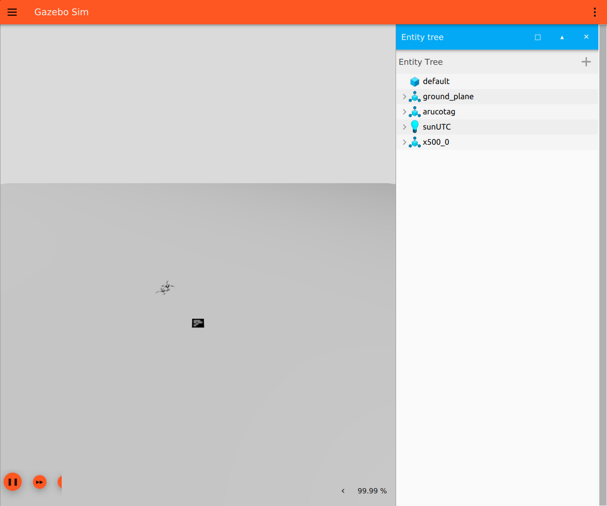

# 01 环境搭建与首飞

> 难度 L0 · 对应场景 `ctrl.takeoff_hover_land` · 预计 1–2 小时（含编译）

## 学习目标

- 一键复现课程环境（双仿真平台、PX4 SITL、ROS2 工作区）
- 理解数据链路：`Gazebo ↔ PX4 SITL ↔ MicroXRCEAgent ↔ ROS2 节点`
- 完成第一次自动飞行：起飞 5m → 悬停 → 降落，并看懂判分指标

## 1.1 前置要求

| 项 | 要求 |
|---|---|
| 系统 | Ubuntu 22.04 + ROS2 Humble（[安装指南](https://docs.ros.org/en/humble/Installation.html)） |
| 硬件 | 8 核 / 16G+ 内存 / OpenGL 显卡（开发机：i7-9700F / 40G / RTX 2070 SUPER） |
| 磁盘 | 20G+ 空闲（PX4 源码与编译产物） |
| Gazebo | Harmonic（脚本安装，需 sudo 一次） |

## 1.2 三条命令复现环境

```bash
git clone https://github.com/howe12/Drone_ros2.git && cd Drone_ros2
bash scripts/install_gz_harmonic.sh   # 装 Gazebo Harmonic（需 sudo；已处理 /usr/bin/gz 冲突）
bash scripts/setup_workspace.sh       # PX4 v1.15.4 + XTDrone2 + 补丁 + 全量编译
```

`setup_workspace.sh` 做的事（全部锁定版本，任何机器结果一致）：

1. 克隆 PX4 **v1.15.4**（含子模块）、px4_msgs / px4_ros_com（**release/1.15**）、px4-offboard
2. 克隆 XTDrone2（锁定 commit）与 ros_gz（humble 分支，按 Harmonic 编译）
3. 应用 18 个补丁——把踩过的坑固化（GStreamer/Qt5/QoS/多机工作目录…）
4. pip 装 Python 依赖 → 编译 Micro-XRCE-DDS-Agent → 编译 PX4 SITL + 全部 ROS2 包

> 💡 网络提示：GitHub 慢时脚本自动回退 Gitee/镜像；git 的 SHA 校验保证内容完整。

## 1.3 启动仿真

```bash
bash scripts/run_simulation.sh xtd2                 # 默认 gz_x500 + aruco 世界
bash scripts/run_simulation.sh xtd2 gz_x500 walls   # 换世界（第 4 章场景画廊）
```

一条命令拉起：Gazebo Harmonic GUI + MicroXRCEAgent(UDP 8888) + PX4 SITL + 通信/桥接节点。
看到日志 `Ready for takeoff!` 即就绪。

⚠️ **不要直接关 Gazebo 窗口**（会联动停机）；要停就在脚本终端 `Ctrl-C`，脚本会兜底清理全部进程。

## 1.4 第一次飞行

新开终端（每终端先做环境准备）：

```bash
source /opt/ros/humble/setup.bash
source ~/Drone_ros2/ros2_ws/install/setup.bash    # 换成你的仓库路径

ros2 run drone_sim offboard_demo --ros-args \
  -p px4_ns:=/x500_0 -p takeoff_altitude:=5.0 -p circle_duration:=0.0
```

飞机会：预流 setpoint → 请求 Offboard + 解锁 → 爬升到 5m → （circle_duration=0 跳过画圆）→ 降落上锁。



### 判分指标（本课程所有实验都有可执行标准）

| 指标 | 阈值 | 取数方式 |
|---|---|---|
| 起飞高度误差 | < 0.4 m | max(-z) 与目标高度之差 |
| 全程耗时 | < 75 s | 解锁到上锁 |
| 结束状态 | disarmed | arming_state == 1 |

自己跑一遍自动判分（第 16 章详解）：

```bash
python3 tools/grade.py --scenario ctrl.takeoff_hover_land --runs 1
```

## 1.5 键盘手飞（找手感）

```bash
ros2 run xtd2_control multirotor_keyboard_control --model gz_x500 --id 0 --namespace x500_0 \
  --ros-args -p linear_velocity_step:=0.5 -p angular_velocity_step:=0.2 \
             -p max_linear_velocity:=5.0 -p max_angular_velocity:=1.5
```

**起飞三步曲：`b`(开 Offboard) → `t`(解锁) → `v`(起飞)**；`w/x/a/d/i/,` 移动，`s` 悬停，`n` 降落。

> 为什么要调参？上游默认步进 0.01 m/s——按 100 次才 1 m/s，几乎感觉不动。
> 这是本课程"故障实验室"的第一个案例：**读默认参数，别假设手感**。

## 1.6 常见问题

| 症状 | 处理 |
|---|---|
| `gz: command not found` | `ln -sf /usr/bin/gz-classic ~/.local/bin/gz`（Harmonic 安装脚本已自动做） |
| Agent 报缺库 | `export LD_LIBRARY_PATH=$HOME/.local/lib:$LD_LIBRARY_PATH` |
| 端口 8888 被占 | 旧栈没停干净：`pkill -x MicroXRCEAgent` 后重启脚本 |
| 解锁被拒 | 等 10–20s EKF 收敛再试；看日志 Preflight 具体项 |
| 编译 override 警告 | 编译终端只 source humble，不要 source 本工作空间 |

## 练习

1. 把起飞高度改成 8m，观察耗时指标是否仍达标。
2. 用键盘飞到 (3, 0) 附近再降落，体会 NED 坐标（第 2 章讲为什么 z 是负的）。
3. 思考题：为什么关 Gazebo 窗口会停掉整个仿真栈？（提示：`on_exit_shutdown`）

[下一章：Offboard 控制与 PX4Interface →](course/02-offboard.md)
