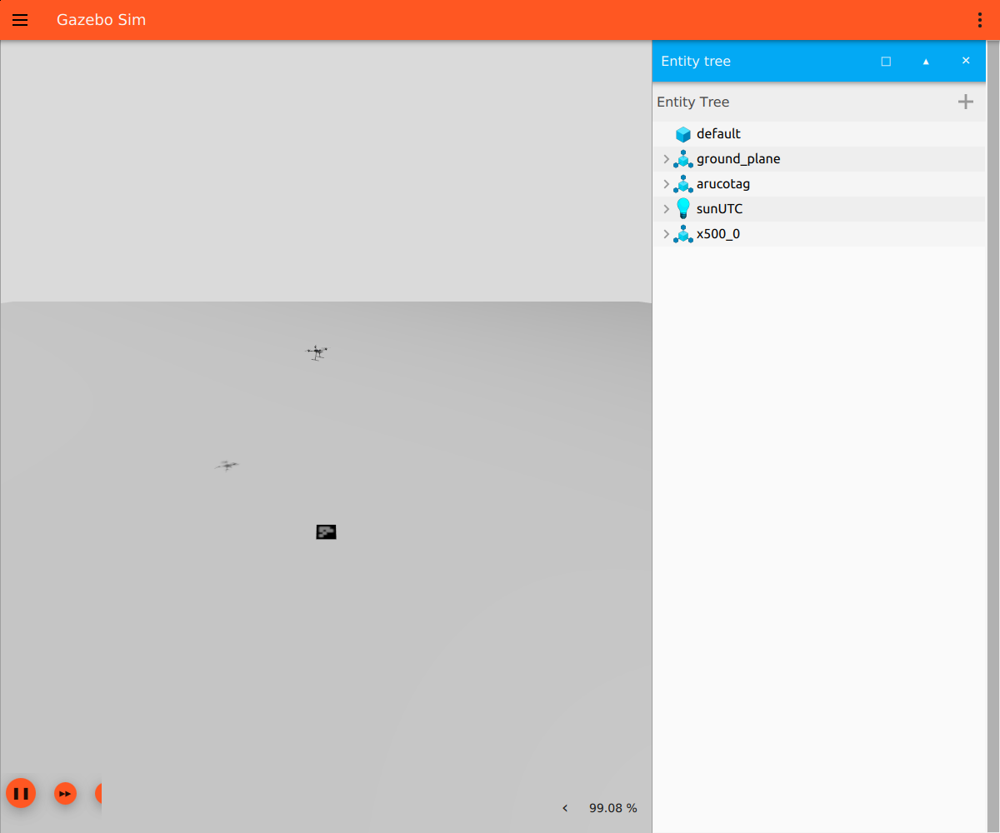

# 04 航点任务与场景画廊

> 难度 L1 · 对应实验 E2 / E13 · 场景 `ctrl.waypoint_square` · 预计 50 分钟

## 本章问题

第 2 章你写的 `hover_node` 是**硬编码**的：飞多高、飞多久，全写在代码里。想换个路线就得改代码、重编译。

真实任务不是这样。飞手拿到的是"航点表"：去 A，停 1 秒，再去 B……改任务应该改配置，不该改程序。

本章解决三件事：

1. 用一份 YAML 描述航点任务，飞出一个正方形。
2. 理解"场景"——为什么同一个任务要换不同的世界来飞。
3. 搞清一个会让飞机**贴地爬行**的坑：EKF 原点重置。

## 学习目标

| 维度 | 学习前 | 学习后 |
|---|---|---|
| 任务描述 | 只会改代码里的常量 | 能用 YAML 定义航点，一条参数切换四种轨迹 |
| 坐标表达 | 航点里的 `z: -5.0` 看成"负五米" | 知道 NED 下 z 负值代表高度 |
| 可视化 | 不知道任务飞得对不对 | 会用 RViz 看 Path/Marker 轨迹 |
| 场景意识 | 以为世界只是背景图 | 理解"场景—机型—指标"的对应契约 |
| 排障 | 遇到贴地爬行查不出原因 | 能用 EKF 重置计数器解释并修复 |

## 前置知识

需要会第 2 章的 `PX4Interface` 用法、第 3 章的 `ros2 topic hz`。不要求懂规划算法。

**先跑，再懂。** 第 1 节先飞一个现成的正方形任务，看到 RViz 里的轨迹；第 2 节才解释 YAML 结构和坐标系。

## 本章地图

| 步骤 | 你做什么 | 拿到的证据 |
|---|---|---|
| 1 | 跑 `mission:=square` | RViz 出现闭合轨迹 |
| 2 | 读 YAML，改航点自己飞 | 判分三项 PASS |
| 3 | 复现 EKF 重置导致的贴地爬行 | 能解释两套"真值" |

---

## 1. 先让它动起来（最小路径）

### 1.1 启动栈与任务

```bash
# 终端 A：栈（x500 + aruco 世界）
bash scripts/run_simulation.sh xtd2 gz_x500 aruco

# 终端 B：任务
source /opt/ros/humble/setup.bash
source <仓库路径>/ros2_ws/install/setup.bash
ros2 launch drone_sim waypoint_mission.launch.py prefix:=/x500_0 mission:=square speed:=1.0
```

飞机起飞到 5m，依次飞四个航点（每点悬停 1 秒），最后自动降落。

参数含义：`prefix` 是命名空间，`mission` 是轨迹名，`speed` 是巡航速度（m/s）。

### 1.2 看轨迹

打开 RViz（launch 会自动起），能看到一条闭合的方形轨迹和当前位置标记。



**RViz 里的方形轨迹和飞机当前位姿——飞完一圈能闭合，说明四个航点都到了。**

### 1.3 用判分确认

```bash
python3 tools/grade.py --scenario ctrl.waypoint_square --runs 3
```

| 指标 | 阈值 | 怎么取数 |
|---|---|---|
| 到点误差 | < 0.5 m | 各航点最小接近距离的最大值 |
| 命中航点数 | ≥ 4 | `min\|pos - wp\| < 0.5m` 的航点数 |
| 结束状态 | disarmed | `arming_state == 1` |

实测到点误差 **≤ 0.35 m**，三项全 PASS。

`--runs 3` 是跑三次取中位数——**单次成功可能是运气**，课程要求稳定通过。

---

## 2. 刚才发生了什么（回头理解原理）

### 2.1 任务文件长什么样

`ros2_ws/src/drone_sim/config/mission_square.yaml`：

```yaml
takeoff_altitude: 5.0
cruise_speed: 1.5
waypoints:                       # NED 坐标, z 负值 = 高度
  - {x: 3.0, y: 0.0, z: -5.0, hold: 1.0}
  - {x: 3.0, y: 3.0, z: -5.0, hold: 1.0}
  - {x: 0.0, y: 3.0, z: -5.0, hold: 1.0}
  - {x: 0.0, y: 0.0, z: -5.0, hold: 1.0}
```

**YAML** 是一种靠缩进表达层级的配置格式，读起来接近自然语言。这里的每个 `-` 是一个航点（waypoint，即"要飞到的目标点"）。

四个字段：

- `x` / `y` / `z`：**NED 坐标**（北-东-地）。z 向下为正，所以 5m 高度写成 `-5.0`。
- `hold`：到点后悬停几秒。**这个字段很重要**——不等一下，飞机可能只是"路过"该点，判分时算不算到点会有争议。
- `takeoff_altitude`：起飞高度。
- `cruise_speed`：巡航速度，影响耗时与到点误差。

### 2.2 四种轨迹，一个参数

内置四种：`square` / `circle` / `spiral` / `figure8`，用 `mission:=` 切换。

写自己的任务：复制一份 YAML 改航点，然后

```bash
ros2 launch drone_sim waypoint_mission.launch.py mission_file:=/path/to/your.yaml
```

<!-- IMAGE_PLACEHOLDER
id: fig-ch04-trajectories
caption: 图 4.1　四种内置轨迹：方形、圆形、螺旋、8 字
alt: 俯视图对比四种轨迹形状，方形四个角有悬停点，圆形无角点，螺旋半径递增，8 字交叉一次
prompt: |
  技术教材插图，白底，扁平化风格，中文标注，无真人无卡通无水印。2x2 四格，每格一个俯视轨迹：
  左上 "square 方形"（四个角画小圆点标航点，标 "每点悬停 1s"）；
  右上 "circle 圆形"（无角点）；
  左下 "spiral 螺旋"（半径由小到大，画箭头示方向）；
  右下 "figure8 8 字"（交叉一次，交叉点画虚线圈标 "注意：会经过同一点"）。
  每格左下角标起飞点小三角。坐标轴标 N（北，向上）与 E（东，向右）。配色蓝灰。
-->


**图 4.1　四种内置轨迹：方形有角点、圆形连续、螺旋外扩、8 字会自我交叉。**

### 2.3 为什么要换"世界"

`run_simulation.sh` 的第二个参数是世界（world）——仿真场景，决定有哪些地面、墙、障碍、靶标。

| 世界 | 特点 | 适用实验 | 状态 |
|---|---|---|---|
| `default` | 空场 | 控制入门/调试 | ✅ |
| `aruco` | 地面 ArUco 靶标 | 视觉降落/多机 | ✅ |
| `walls` | 结构化墙体 | SLAM/避障/围栏 | ✅ |
| `e7_obstacles` | 小方块障碍群 | 避障规划 | ✅ |
| `baylands` | 户外纹理地形 | VIO/视觉 | ✅ |
| `lawn` | 草地 | 视景多样性 | ✅ |
| `windy` | 风扰动 | 鲁棒性 | ⚠️ 未验证 |
| `indoor1` | 室内 | — | ❌ 已废弃（旧 Fuel 资产致 gz 崩溃，勿用） |


**walls 世界：结构化墙体，SLAM 和避障实验都用它。**

切换方式：`bash scripts/run_simulation.sh xtd2 <机型> <世界>`。

为什么要分这么细？因为**任务需要环境**：没有墙就没有可建图的结构，没有障碍就没有可避的东西，没有纹理 VIO 就没有可跟踪的特征。这就是课程说的"场景—机型—指标"契约：一个场景 = 一个世界 + 一个机型 + 一组可核验指标。

### 2.4 EKF 原点重置与"贴地爬行"

这是本章最重要的坑，第 5 章的 E5 实验里实测发现，之后全课程受益。

**现象**：飞机不起飞，贴着地面往前蹭。

**机理**：GPS 漂移会让 PX4 的 EKF **重置局部原点**（`xy_reset_counter` / `z_reset_counter` 跳变）。重置后局部坐标"瞬移"——原本地面是 z=0，重置后可能变成 z=-5。

如果任务代码用"局部 z < -1 就算已起飞"来判断，就会**在地面误判为已在空中**，于是继续执行后续航点——表现为贴地爬行。

**修复**（已固化进 `waypoint_mission` 与 `PX4Interface.ekf_stable`）：**重置计数器稳定 5 秒才允许解锁**。第 2 章讲过 `ekf_stable`，这里就是它存在的原因。

> **教训**：仿真的"真值"有两套——PX4 局部系（会重置、会骗人）和 gz 世界系（判分用它）。凡是要判定的地方，用世界系。

---

## 3. 扩展：案例与排障

### 案例 1：航点都"到"了但判分不过

**背景**：RViz 看轨迹是闭合的，但 `命中航点数` 只有 3。

**原因**：`hold` 太短或 `cruise_speed` 太大，飞机高速掠过航点，采样时最近距离略超 0.5m。

**修复**：降低 `cruise_speed` 到 1.0，或增大 `hold`。这属于**调参**而不是改代码。

### 案例 2：同一任务换世界后失败

**背景**：`aruco` 世界飞得好好的正方形，换到 `e7_obstacles` 就撞了。

**原因**：航点坐标没考虑障碍位置。世界变了，几何约束也变了。

**修复**：先在 RViz 里看障碍位置，再定航点；或直接用第 9 章的避障节点。

### 案例 3：`windy` 世界飞不稳

**背景**：切到 `windy` 后到点误差明显变大。

**说明**：该世界**未完成验证**（状态 ⚠️）。可以复现，但不要把结论写进实验报告当作已验证结果——这是课程对"未验证"的诚实标注。

---

## 你可能卡在这里

| 现象 | 最可能原因 | 先跑这条命令 |
|---|---|---|
| RViz 没有轨迹 | 没加 Path/Marker 显示项 | 检查 RViz 左侧 Displays |
| 飞机直奔地面 | NED 的 z 符号写反了 | 查 YAML 里 z 是否为负 |
| 判分"命中航点数"不足 | 速度太快掠过 | 降 `cruise_speed` 或加 `hold` |
| 起飞后贴地爬行 | EKF 原点重置 | `ros2 topic echo {ns}/fmu/out/vehicle_local_position --once` 看 reset_counter |
| `mission:=` 不生效 | 参数名拼错或被 `mission_file` 覆盖 | 看 launch 启动日志里的实参 |

---

## 任务卡

### 任务卡 1：写一个三角形任务

| 段 | 内容 |
|---|---|
| 1 要实现的功能 | 自建 YAML，飞一个三角形（三点，每点悬停 1s），判分 PASS |
| 2 通信骨架/前置 | 复制 `mission_square.yaml`；航点用 NED，z=-5 表示 5m 高 |
| 3 AI 提示 | **先自己写出三个坐标**，再让 AI 检查几何：<br>"我想让飞机在 5m 高飞一个边长 3m 的等边三角形，我算的三个航点是（贴坐标）。请只检查：是不是等边、方向对不对、z 符号对不对。**不要给我 YAML。**" |
| 4 执行步骤 | ① 复制 YAML ② 自己算三个点 ③ `mission_file:=` 指向它 ④ 看 RViz ⑤ 跑 grade.py<br>**验证 AI 的说法**：用 RViz 的网格量边长，别只信计算 |
| 5 验收标准 | □ 三个航点都命中 □ 轨迹近似等边 □ 结束状态 disarmed |
| 6 原理 + 扩学 | 教**任务即数据**。扩学：加第四个点形成风筝形，观察判分是否仍 PASS |

### 任务卡 2：速度与精度

| 段 | 内容 |
|---|---|
| 1 要实现的功能 | 测出 `cruise_speed` 与到点误差的关系 |
| 2 通信骨架/前置 | 同一份 YAML，只改 `speed`（1.0 / 2.0 / 3.0），各跑 3 次 |
| 3 AI 提示 | 先自己跑出数据，再让 AI 解释趋势：<br>"我在同一任务下测了三档速度的到点误差（贴数据表）。请解释为什么速度越高误差越大，以及这和采样周期有什么关系。**不要给我参数建议，我自己判断。**" |
| 4 执行步骤 | ① 三档各跑 3 次 grade.py ② 记录中位数 ③ 画个简单表格对比 |
| 5 验收标准 | □ 三档都有数据 □ 能说出趋势 □ 能解释"为什么"而不是只复述数字 |
| 6 原理 + 扩学 | 教**速度—精度—时间的三角权衡**。扩学：找出仍能 PASS 的最高速度 |

### 任务卡 3：复现贴地爬行（本章的"刺"）

| 段 | 内容 |
|---|---|
| 1 要实现的功能 | 亲手制造并解释"贴地爬行" |
| 2 通信骨架/前置 | **无 AI 区：本卡禁止使用 AI**。备份 `px4_interface.py`，把 `ekf_stable` 门控改成恒为 `True`（即不检查） |
| 3 AI 提示 | 本卡不使用 AI。卡住可查 [故障实验室](faq.md)、读 `px4_interface.py` 的 `_cb_pos` 与 `ekf_stable` 实现 |
| 4 执行步骤 | ① 改门控 ② 重编运行任务 ③ 观察飞机是否贴地移动 ④ 恢复门控再跑一次对比 |
| 5 验收标准 | □ 能复现贴地现象 □ 能指出是哪一行代码导致的 □ 能解释"两套真值"的区别 |
| 6 原理 + 扩学 | 教**EKF 重置与门控**。扩学：想一个别的会被重置计数器影响的判据 |

## ✅ 检查清单

- [ ] 我能说清 YAML 里每个字段的含义，包括 `hold`
- [ ] 我知道 NED 下 z 为负代表"向上"
- [ ] 我能改航点飞出不同形状，并用 RViz 验证
- [ ] 我能解释为什么换世界会改变任务结果
- [ ] 我能解释贴地爬行的机理，并指出对应的门控代码
- [ ] 我知道判分为什么用 gz 世界系真值而不是 PX4 局部系
- [ ] 我能关掉 AI，独立完成本章实验并回答追问

> AI 可以帮你检查坐标几何、解释速度与误差的关系，但**不替你写任务**；任务卡 3 为无 AI 区。
> 规则见 [AI 使用指南](AI_GUIDE.md)。

## 小结与下一步

现在任务描述从代码里搬到了 YAML 里：改任务 = 改配置，还能换场景复用同一套逻辑。你也第一次看见"仿真的真值会骗人"这件反直觉的事。

下一步开始做感知：让飞机用相机认出画面里的物体。这是第 5 章的内容。

[上一章](course/03-sensors.md) · [下一章：YOLO 目标检测与跟踪 →](course/05-yolo.md)
