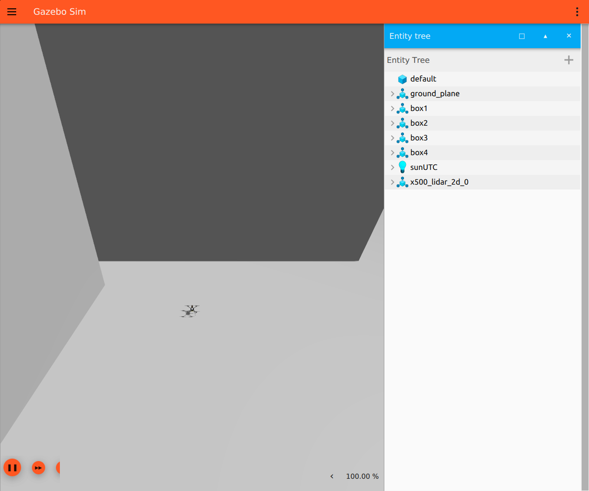

# 04 航点任务与场景画廊

> 难度 L1 · 对应实验 E2 / E13（Issue #2 #13，已完成）· 场景 `ctrl.waypoint_square`

## 学习目标

- 用 YAML 定义航点任务，4 种轨迹模式一键切换
- RViz 可视化任务轨迹
- 学会按实验选世界（场景画廊），理解"场景-机型-指标"契约

## 4.1 跑一个正方形任务

```bash
# 栈: gz_x500 + aruco 世界
bash scripts/run_simulation.sh xtd2 gz_x500 aruco

# 任务（新终端）:
ros2 launch drone_sim waypoint_mission.launch.py prefix:=/x500_0 mission:=square speed:=1.0
```

飞机起飞 5m → 依次飞 4 个航点（每点悬停 1s）→ 自动降落。RViz 里能看到 Path/Marker 轨迹。


### 判分指标

| 指标 | 阈值 | 取数 |
|---|---|---|
| 到点误差 | < 0.5 m | 各航点最小接近距离的最大值 |
| 命中航点数 | ≥ 4 | min\|pos-wp\| < 0.5m 的航点数 |
| 结束状态 | disarmed | arming_state == 1 |

实测到点误差 ≤0.35m。自动判分：`python3 tools/grade.py --scenario ctrl.waypoint_square --runs 3`

## 4.2 任务文件：YAML 航点

`ros2_ws/src/drone_sim/config/mission_square.yaml`：

```yaml
takeoff_altitude: 5.0
cruise_speed: 1.5
waypoints:                       # NED 坐标, z 负值=高度
  - {x: 3.0, y: 0.0, z: -5.0, hold: 1.0}
  - {x: 3.0, y: 3.0, z: -5.0, hold: 1.0}
  - {x: 0.0, y: 3.0, z: -5.0, hold: 1.0}
  - {x: 0.0, y: 0.0, z: -5.0, hold: 1.0}
```

内置 4 种模式：`square` / `circle` / `spiral` / `figure8`（`mission:=` 参数切换）。
写自己的任务 = 复制一份 YAML 改航点，`mission_file:=/path/to/your.yaml`。

## 4.3 场景画廊（E13）

| 世界 | 特点 | 适用实验 | 状态 |
|---|---|---|---|
| `default` | 空场 | 控制入门/调试 | ✅ |
| `aruco` | 地面 ArUco 靶标 | 视觉降落/多机 | ✅ |
| `walls` | 结构化墙体 | SLAM/避障/围栏 | ✅ |
| `e7_obstacles` | 小方块障碍群 | 避障规划 | ✅ |
| `baylands` | 户外纹理地形 | VIO/视觉 | ✅ |
| `lawn` | 草地 | 视景多样性 | ✅ |
| `windy` | 风扰动 | 鲁棒性 | ⚠️ 未验证 |
| `indoor1` | 室内 | — | ❌ broken（旧 Fuel 资产致 gz 崩溃，勿用） |



切换：`bash scripts/run_simulation.sh xtd2 <机型> <世界>`（补丁 0009 参数化）。
完整画廊见[场景文档](SCENARIOS.md)。

## 4.4 故障实验室：EKF 原点重置与"贴地爬行"

本章最重要的坑（E5 实验中发现，全课程受益）：

- GPS 漂移会让 PX4 EKF **重置局部原点**（`xy_reset_counter` 跳变）
- 重置后局部 z 突变——若任务用"局部 z < -1 就算已起飞"，会在地面误判起飞，飞机**贴地爬行**
- 修复（已固化进 `waypoint_mission` 与 `PX4Interface.ekf_stable`）：**重置计数器稳定 5s 才允许解锁**

> 教训：仿真的"真值"也有两套——PX4 局部系（会重置、会骗人）与 gz 世界系（判分用它）。

## 练习

1. 写一个三角形任务 YAML 并飞通，用 grade.py 的指标自评。
2. 把 `cruise_speed` 从 1.5 调到 3.0，观察到点误差如何变化（调参练习素材来自 `catalog/params.yaml`）。
3. 在 walls 世界跑正方形，想想为什么 SLAM 实验都选它。

[上一章](course/03-sensors.md) · [下一章：YOLO 目标检测 →](course/05-yolo.md)
