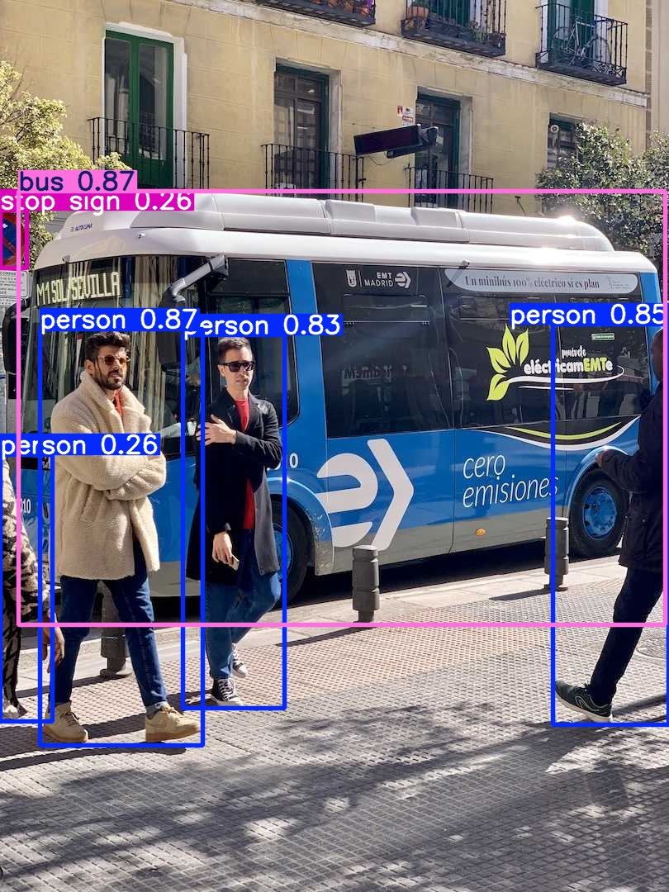

# 05 YOLO 目标检测与跟踪

> 难度 L2 · 对应实验 E8（检测部分）· 场景 `vision.yolo_detect` · 预计 90–120 分钟

## 本章问题

飞机在户外飞，机头相机对着地面。你希望它告诉你："画面里有两辆车、三个人。"

这件事对人来说毫不费力，对飞机却要跨过三道坎：

1. **图像是什么**：相机给 ROS2 的到底是一串什么数据？怎么变成能算的数组？
2. **怎么认出物体**：YOLO 这类检测器内部在做什么，为什么能做到实时？
3. **怎么把结果用起来**：检测框到手之后，怎么变成"飞过去看看"的控制量？

还有一道**工程坎**，也是本章最容易被卡住的地方：ROS2 和深度学习库分别装在两个 Python 环境里，直接混用会失败。

## 学习目标

| 维度 | 学习前 | 学习后 |
|---|---|---|
| 图像数据 | 以为"图像话题"里是一张图片文件 | 知道 `sensor_msgs/Image` 是裸像素缓冲 + 宽高 + 编码 + step |
| 检测原理 | 把 YOLO 当黑盒 | 能说清"一次前向出框、置信度过滤、NMS 去重" |
| 工程集成 | 直接 `ros2 run` 然后 ModuleNotFound | 能解释为什么要包装脚本、`LD_PRELOAD` 解决什么 |
| 性能意识 | 检测越慢越以为是机器不行 | 会用 `infer_every_n` 在帧率与延迟间取舍 |
| 数据质量 | 检测不到就调阈值 | 能分辨"距离太远/被遮挡/类别不在词表" |
| 排障 | 见到报错就懵 | 能用 `ros2 topic hz`、`ros2 topic echo` 定位到具体环节 |

## 前置知识

需要会第 3 章的"换机型 + 看话题"、第 2 章的"节点定时器"。不要求懂深度学习，本章会解释用到的概念。

**先跑，再懂。** 第 1 节先把检测跑起来，看到日志里出现 `car:0.87` 这样的输出；第 2 节再解释这行字背后经过了多少步骤。

## 本章地图

| 步骤 | 你做什么 | 拿到的证据 |
|---|---|---|
| 1 | 起带相机的栈，跑检测节点 | 日志出现 `检测: car:0.xx, person:0.xx` |
| 2 | 用 `record_yolo_video.sh` 录检测视频 | 视频里有框，两帧哈希不同 |
| 3 | 理解图像内存布局与推理链路 | 能解释 `reshape` 的三个参数 |
| 4 | 调 `infer_every_n` 与 `conf` | 得到帧率/延迟/召回的变化 |
| 5 | 复现并修复环境错误 | 能说清两个 Python 环境的关系 |

---

## 1. 先让它看出来（最小路径）

### 1.1 起仿真栈

```bash
bash scripts/run_simulation.sh xtd2 gz_x500_mono_cam yolo_targets
```

三个参数：机型 `gz_x500_mono_cam`（带前置相机）、世界 `yolo_targets`（本项目自建：**3 辆车 + 3 个行人**，专门给检测实验准备）。

**为什么不用 `baylands`**：那是对外景/纹理实验用的，画面里不一定有 COCO 能识别的目标。**检测实验要用有明确目标物的世界**——这是第 4 章"场景—机型—指标"契约的具体应用：任务的指标是"检出了车和人"，环境就必须真的有车和人。

等日志出现 `Ready for takeoff!`，说明栈就绪。相机话题是：

```text
/x500_mono_cam_0/camera/image_raw
```

先确认真的有画面（第 3 章教过的方法）：

```bash
ros2 topic hz /x500_mono_cam_0/camera/image_raw
```

本仓库实测：`baylands` 世界下约 **20.1 Hz**（负载较高时），空场下更接近 23.6 Hz。**频率会随世界复杂度和机器负载变化**，以你实测的为准。

相机视角长这样：


**机载相机看到的画面：户外纹理地形，远处有可检测的物体。**

### 1.2 跑检测节点

新终端：

```bash
cd /develop/IDEA/Drone_ros2
bash scripts/run_yolo.sh /x500_mono_cam_0/camera/image_raw
```

**注意这里用的是 `run_yolo.sh`，不是 `ros2 run`。** 原因第 2.7 节讲，先按它跑。

预期日志：

```text
[INFO] [yolo_detector]: YOLO 检测启动: /x500_mono_cam_0/camera/image_raw, 模型 yolov8n.pt, 类别 COCO80
[INFO] [yolo_detector]: 检测: car:0.87, person:0.62
[INFO] [yolo_detector]: 检测: car:0.85
```

**每 5 帧推理一次**（默认 `infer_every_n=5`），所以日志不是每帧都出现。

### 1.3 看标注图：必须录话题，不能录 Gazebo 窗口

这里有一个**容易白干一场**的坑：检测框是画在**图像话题**上的，**不在 Gazebo 窗口里**。你录 Gazebo 窗口，录到的永远是干净的仿真画面，看不到任何框。

正确做法是用仓库自带的录制脚本（它已经把"等飞机升空、清场、校验帧"都做好了）：

```bash
bash scripts/record_yolo_video.sh gz_x500_mono_cam yolo_targets
```

产出：`videos/vision.yolo_detect.mp4` + `.gif`。

**为什么必须等飞机升空**：脚本里有一条硬性等待——`armed` 且高度 > 2m 才开录。原因是仓库踩过坑：不等起飞就录，录到的是**地面静止画面**，帧 5 和帧 105 完全一样，看起来像"检测成功"，其实飞机根本没动。

**怎么自证不是静止画面**（这条方法值得记住）：

```bash
# 抽两个不同时刻的帧，算 MD5
ffmpeg -y -i videos/vision.yolo_detect.mp4 -vf "select=eq(n\,5)"   -vframes 1 /tmp/f5.png
ffmpeg -y -i videos/vision.yolo_detect.mp4 -vf "select=eq(n\,105)" -vframes 1 /tmp/f105.png
md5sum /tmp/f5.png /tmp/f105.png     # 两个哈希相同 = 画面没动，重录
```

样本输出（本项目实测）：



**检测结果：`bus: 0.87`，另有 3 个 `person`。框上的数字是置信度。**

> 更完整的录制/截图规范（窗口 id、`BadMatch`、`kill -INT`、GIF 压缩参数）见 [录制手册](RECORDING.md)。本章只讲检测相关的部分。

### 1.4 判分

```bash
python3 tools/grade.py --scenario vision.yolo_detect --runs 1
```

| 指标 | 阈值 | 怎么取数 |
|---|---|---|
| 启动成功 | ≥ 1 | 日志含 `YOLO 检测启动` |
| 无异常退出 | ≥ 1 | 日志无 `Traceback` / `ModuleNotFound` |

判分只看"起来了且没崩"——**检测得准不准，判分管不了**，要靠你自己看图。这是本章的一个认知点：**能被自动判分的东西，永远是有限的**。

---

## 2. 刚才发生了什么（回头理解原理）

### 2.1 目标检测在做什么

**目标检测**要回答两个问题：画面里**有什么**、**在哪里**。

输出是一串"框"：

| 概念 | 含义 |
|---|---|
| **边界框（bbox）** | 一个矩形 `(x1, y1, x2, y2)`，框住物体 |
| **类别（class）** | 框里是什么，如 `car`、`person` |
| **置信度（confidence）** | 模型有多确定，0–1 之间 |
| **NMS** | 非极大值抑制：同一个物体被预测出多个框时，只留最可信的那个 |

**置信度**不是"准确率"，而是模型自己的把握。`0.87` 表示"我有 87% 的把握这是车"。所以**调 `conf` 阈值就是在调"宁可漏检还是宁可误检"**。

### 2.2 YOLO 为什么能实时

传统检测器分两步：先找候选区域，再逐个分类，慢。

YOLO（You Only Look Once）把这两步合成一次前向：**把图像切成网格，每个网格直接回归框的位置、大小、类别概率**。一次网络前向就出结果，所以快。

代价是精度略逊于两阶段方法——但对"无人机边飞边看"这种场景，**实时性比极致精度更重要**。

课程用的 `yolov8n` 是"nano"版本：模型小、推理快、精度够用。`n` 代表 nano，同系列还有 s/m/l/x 逐级变大变准变慢。

<!-- IMAGE_PLACEHOLDER
id: fig-ch05-detect-pipeline
caption: 图 5.1　从相机到控制：图像、推理、检测框、决策四段
alt: 检测链路图，相机图像经内存重整进入 YOLO 推理，输出框与类别，再被转成控制量
prompt: |
  技术教材插图，白底，扁平化风格，中文标注，无真人无卡通无水印。横向四段流程：
  第 1 段 "相机 /camera/image_raw（裸像素 1280x960x3）"；
  第 2 段 "reshape + 编码转换（RGB->BGR）"，箭头标注 "numpy 重整，无拷贝";
  第 3 段 "YOLOv8 推理（每 N 帧一次）"，输出标 "bbox / class / conf";
  第 4 段 "决策：日志 / 标注图 / 控制量（下一章）"。
  在第 3 段上方用小框标 "infer_every_n=5 节流"；在第 4 段下方标 "conf=0.4 过滤"。
  配色蓝灰，箭头清晰。
-->


**图 5.1　一张图从相机到决策要过四段：裸像素、重整、推理、决策。**

### 2.3 图像话题里到底是什么

`sensor_msgs/Image` 不是图片文件，而是**裸像素缓冲**加几个描述字段：

| 字段 | 例子 | 含义 |
|---|---|---|
| `height` / `width` | 960 / 1280 | 像素行数、列数 |
| `encoding` | `rgb8` / `bgr8` | 每个像素三个通道的排列顺序 |
| `step` | 3840 | 一行多少字节（= 宽 × 3） |
| `data` | `uint8[]` | 真正的一维字节数组 |

关键点：`data` 是**一维**的。要从它拿到二维图像，必须自己按 `height × width × 通道数` 重整：

```python
img = np.frombuffer(msg.data, dtype=np.uint8).reshape(msg.height, msg.width, -1)
```

三个参数分别是"行、列、通道"。**-1 表示"剩下多少算多少"**，这里等于 3。

如果 `encoding` 是 `rgb8` 而 OpenCV 与 YOLO 都按 BGR 处理，颜色会反（红蓝互换），检测精度会下降。所以要转：

```python
if msg.encoding == 'rgb8':
    img = cv2.cvtColor(img, cv2.COLOR_RGB2BGR)
```

### 2.4 为什么不直接用 cv_bridge

`cv_bridge` 是 ROS 与 OpenCV 的官方桥接包，能一行完成转换。本项目却手写三行 numpy，原因是：

- `cv_bridge` 需要在**当前 Python 环境**里装好并与 OpenCV 版本匹配；
- 我们的推理跑在 conda 环境，系统里没装 `cv_bridge`，硬装容易把环境搞乱；
- 手写 reshape 只依赖 numpy，**零额外依赖**，而且性能不差（`frombuffer` 不拷贝内存）。

这是一个典型的工程取舍：**用三行代码换掉一个跨环境依赖**。

### 2.5 节流：`infer_every_n`

```python
def cb(self, msg):
    self.frame_n += 1
    if self.frame_n % self.every_n != 0:
        return          # 跳过不推理，直接返回
    ...
```

默认每 5 帧推理一次。为什么？

| 不节流 | 节流（N=5） |
|---|---|
| 每帧都推理，GPU 打满 | GPU 占用降低约 5 倍 |
| 23.6 Hz 输入，若推理只有 10 FPS 会积压 | 队列不积压 |
| 延迟低但可能掉帧 | **延迟升高**（最坏要等 5 帧 ≈ 0.21 s） |

这就是**吞吐与延迟的权衡**。调这个参数时要想清楚：你是要"看得更勤"，还是"反应更快"？

### 2.6 结果怎么输出

节点做两件事：

1. **打日志**：`检测: car:0.87, person:0.62`，人看得懂；
2. **发标注图**：把框画回图像，发到 `~/annotated`，机器/下游节点可用。

```python
annotated = results[0].plot()      # ultralytics 自带绘图
out = Image()
out.header = msg.header            # 继承时间戳，下游能对齐
out.height, out.width = annotated.shape[:2]
out.encoding = 'bgr8'
out.step = out.width * 3
out.data = annotated.tobytes()
self.pub_annotated.publish(out)
```

注意 `out.header = msg.header`——**把输入的时间戳传给输出**。这样下游（比如跟踪器）才知道这张标注图对应哪一时刻，多传感器融合时尤其重要。

### 2.7 核心工程点：两个 Python 环境

本章最容易被卡住的地方，也是最有价值的一课。

**问题**：ROS2 Humble 的 `rclpy` 装在**系统 Python 3.10**；而 `ultralytics` 和 `torch` 装在 **conda 环境**。于是：

| 做法 | 结果 |
|---|---|
| `ros2 run drone_sim yolo_detector` | 用系统 Python 启动 → `ModuleNotFound: ultralytics`（找不到推理库） |
| `~/miniconda3/bin/python3 yolo_detector` | 用 conda Python 启动 → 找不到 `rclpy`（ROS2 不在这个环境里） |
| **`run_yolo.sh` 包装** | ✅ conda Python 启动 + `LD_PRELOAD` 补系统库 |

**`LD_PRELOAD` 解决什么**：conda 自带的 `libstdc++` 版本偏旧，缺 `GLIBCXX_3.4.30` 这个符号，加载 `rclpy` 的 C 扩展时会报错。预加载系统的 `libstdc++.so.6` 就能补上。

```bash
LD_PRELOAD=/usr/lib/x86_64-linux-gnu/libstdc++.so.6 \
  "$CONDA_PY" "$ROOT/ros2_ws/install/drone_sim/lib/drone_sim/yolo_detector" \
  --ros-args "${ARGS[@]}"
```

这段包装脚本做的事，本质是**用环境变量让两个互不兼容的运行时共存**，而不是去改动任何一个环境。这是 ROS2 + 深度学习的通用模式，值得记住。

> 为什么不在系统 Python 里直接 `pip install ultralytics`？因为那会把 `torch` 装进系统环境，可能破坏 ROS2 依赖的 numpy 版本——**污染系统环境是更贵的错误**。

### 2.8 为什么订阅用 `qos_profile_sensor_data`

```python
self.create_subscription(Image, topic, self.cb, qos_profile_sensor_data)
```

`sensor_msgs` 的发布端（Gazebo 桥）用的是 **BEST_EFFORT**。如果订阅端用默认的 **RELIABLE**，两端不兼容，**静默收不到**——第 3 章踩过的坑。

`qos_profile_sensor_data` 是 ROS2 预置的"传感器数据"QoS 档：BEST_EFFORT + 小队列。**凡是订阅图像、点云、IMU，都应该用它。**

### 2.9 输入尺寸：为什么 1280×960 会被缩放

YOLO 的网络输入是固定尺寸（`yolov8n` 默认 640×640）。我们的图像是 1280×960（4:3），直接拉伸会变形，所以用 **letterbox**：等比缩放后补灰边。

这带来两个后果，都必须知道：

1. **框坐标要还原**。模型输出的是"640 图上的坐标"，用之前要按缩放比例映射回原图，否则框会偏。
2. **小目标更容易丢**。1280×960 缩到 640×640，远处一辆车可能只剩几个像素——这解释了案例 1 里"距离太远检测不到"。

`ultralytics` 的 `model(img)` 内部自动做 letterbox，并把框还原到输入图尺寸，所以你在 `results[0].boxes` 里拿到的**已经是原图坐标**。但如果你自己改输入尺寸，就要自己维护这个映射。

| 参数 | 默认 | 影响 |
|---|---|---|
| `imgsz` | 640 | 越大越准越慢；1280 能明显改善小目标 |
| `rect` | True（推理时） | 保持长宽比，减少灰边 |

### 2.10 训练与推理：我们只做后者

一个常见误解是"YOLO 是训练出来的，所以我也要训练"。

实际上课程**只做推理**（inference）：拿别人在大数据集（COCO）上训好的权重，直接用来识别那 80 类。整个过程不涉及反向传播、不更新权重。

| 环节 | 做什么 | 本课程是否需要 |
|---|---|---|
| 训练（training） | 用标注数据调整权重 | ❌ 不需要 |
| 推理（inference） | 用固定权重对新图像预测 | ✅ 本章做的 |
| 微调（fine-tuning） | 用自己的少量数据再训练 | ⚠️ 第 5 章进阶可选 |

什么时候才需要微调？当你要检测的类别**不在 COCO 里**、且开放词表效果不够好时。那需要标注几百张图，属于另一个量级的工作。

### 2.11 显存与算力：本章实测的两个硬约束

这一节的数据都是在本仓库机器上跑出来的（RTX 2070 SUPER，8 GB 显存），不是估算。

**约束一：Gazebo 会吃掉大部分显存。**

仿真栈起来后：

```bash
nvidia-smi --query-gpu=memory.used,memory.total --format=csv,noheader
# 7585 MiB, 8192 MiB      ← 只剩约 600 MB
```

此时启动检测节点，GPU 加载模型直接失败：

```text
torch.AcceleratorError: CUDA error: out of memory
```

**约束二：CPU 回退慢到不可用。**

用 `CUDA_VISIBLE_DEVICES=""` 强制 CPU：

```bash
CUDA_VISIBLE_DEVICES="" bash scripts/run_yolo.sh /x500_mono_cam_0/camera/image_raw
```

节点能正常启动（`YOLO 检测启动`），但实测单帧推理：

| 场景 | 单帧耗时 |
|---|---|
| 首帧（含预热） | **7744 ms** |
| 稳定后 | **5762 ms** |
| 设备 | `cpu` |

也就是说 **CPU 上约 6 秒一帧**（且当时机器负载约 19）。23.6 Hz 的输入配上 6 秒推理，等于"看一眼要等半天"，完全没有实时性。

**三条可行路线**：

| 路线 | 做法 | 代价 |
|---|---|---|
| 降负载 | 关掉 Gazebo 图形界面（`gz sim -s` 无头）、降低相机分辨率 | 看不到画面 / 精度下降 |
| 分离算力 | 检测跑在另一台机器或另一块 GPU 上 | 需要网络与控制分离 |
| 降频使用 | 接受 1–2 Hz 的"慢速感知"，只做离线判断 | 不能做闭环跟踪 |

> **教训**：深度学习上仿真，先问"显存够不够、算力够不够"，再问"模型准不准"。这两条是硬门槛，测出来比猜出来可靠。

---

## 3. 案例：真实故障与调参

### 案例 1：检测不到目标

**现象**：画面里明明有车，日志一条 `car` 都没有。

**按顺序排查**：

| 可能原因 | 怎么验证 |
|---|---|
| 距离太远，目标只占几十像素 | 看标注图，目标是否明显小于周围物体 |
| 置信度阈值太高 | 把 `conf` 从 0.4 降到 0.2 再试 |
| 类别不在 COCO 80 类里 | 查 COCO 类别表，或用开放词表（案例 4） |
| 颜色通道反了 | 看标注图整体是否偏蓝/偏红 |
| 图像本身没数据 | `ros2 topic hz` 确认相机在发 |

**教训**：先确认"有画面"，再确认"画面颜色对"，最后才调阈值。顺序错了会浪费很多时间。

### 案例 2：`ModuleNotFound` 的三种面貌

| 报错 | 真正原因 |
|---|---|
| `No module named 'ultralytics'` | 用系统 Python 启动的（没用包装脚本） |
| `No module named 'rclpy'` | 用 conda Python 直接启动的（没 source ROS2） |
| `GLIBCXX_3.4.30 not found` | conda 的 libstdc++ 太旧（没设 `LD_PRELOAD`） |

三种报错看着像三件事，其实是**同一件事的三个阶段**：两个运行时没接上。

### 案例 3：帧率够但画面卡顿

**现象**：`ros2 topic hz` 显示相机 23.6 Hz，但日志的检测间隔不均匀，标注图一卡一卡。

**原因**：`infer_every_n` 大于实际推理能力时，积压会以"忽快忽慢"的形式表现出来。

**验证**：

```bash
# 看推理实际耗时：日志里两次"检测:"之间的间隔
# 若 > N / 23.6 秒，说明推理跟不上
```

**处理**：把 `infer_every_n` 调大，或换更小的模型（`yolov8n` 已是最小档），或降输入分辨率。

### 案例 4：用开放词表检测任意目标

**背景**：想检测 `tree`、`building` 这类 COCO 里没有的类别。

**做法**：换 `yolov8s-worldv2.pt`（开放词表模型），用文本定义类别：

```bash
bash scripts/run_yolo.sh /x500_mono_cam_0/camera/image_raw \
  yolov8s-worldv2.pt "tree, person, car, building, road"
```

日志会显示：

```text
YOLO-World 开放词表类别: ['tree', 'person', 'car', 'building', 'road']
```

**原理**：开放词表模型把"类别名"也编码进网络，所以你可以**用自然语言指定要检测什么**，不必受限于固定类别表。

**代价**：模型更大（25.9 MB vs 6.5 MB）、推理更慢、精度不如专用模型。

---

## 4. 进阶：从检测到可用

### 4.1 检测 + 跟踪 = 稳定 ID

单帧检测有个问题：同一个物体，上一帧是 `car:0.87`，下一帧可能是 `car:0.61`，再下一帧没了。你无法知道"还是不是同一辆车"。

**跟踪**（如 ByteTrack）给每个目标分配一个稳定 ID，跨帧保持。有了 ID 才能做"跟着这辆车飞"。

### 4.2 检测框怎么变成控制量

这是第 6 章的主题，这里先给直觉：

1. 检测框的中心 `(cx, cy)` 与图像中心 `(W/2, H/2)` 的偏差；
2. 偏差转成"该往左/右/上/下移动多少"；
3. 把移动量发给飞控（速度或位置设定点）。

**核心难点不是检测，而是坐标变换**：像素坐标 → 相机坐标 → 机体系 → 世界系。第 6 章会把这四层拆开讲。

### 4.3 性能优化清单

| 手段 | 效果 | 代价 |
|---|---|---|
| 减小模型（n → s 反向） | 快 | 精度降 |
| 降低输入分辨率 | 快 | 小目标漏检 |
| 增大 `infer_every_n` | GPU 压力降 | 延迟升高 |
| 只对感兴趣区域推理 | 快 | 需要先有粗略定位 |
| 用 GPU（`device=0`） | 快数倍 | 需要 CUDA |

### 4.4 把检测结果交给下游节点

现在检测结果只是日志和图片，别的节点拿不到。工程上正确的做法是发**结构化消息**。

ROS2 有现成的类型 `vision_msgs/Detection2DArray`：

```python
from vision_msgs.msg import Detection2D, Detection2DArray, ObjectHypothesisWithPose

arr = Detection2DArray()
arr.header = msg.header
for r in results:
    for box in r.boxes:
        det = Detection2D()
        det.bbox.center.position.x = float((box.xyxy[0][0] + box.xyxy[0][2]) / 2)
        det.bbox.center.position.y = float((box.xyxy[0][1] + box.xyxy[0][3]) / 2)
        det.bbox.size_x = float(box.xyxy[0][2] - box.xyxy[0][0])
        det.bbox.size_y = float(box.xyxy[0][3] - box.xyxy[0][1])
        hyp = ObjectHypothesisWithPose()
        hyp.hypothesis.class_id = r.names[int(box.cls[0])]
        hyp.hypothesis.score = float(box.conf[0])
        det.results.append(hyp)
        arr.detections.append(det)
self.pub_det.publish(arr)
```

**为什么不用自定义消息**：标准消息所有可视化工具（RViz、Foxglove）和下游库都认识，别人接你的节点零成本。这是 ROS2 生态的一个基本约定。

### 4.5 调试工具：别只会看日志

| 工具 | 用途 |
|---|---|
| `rqt_image_view` | 看任意图像话题，切换话题不用改代码 |
| `ros2 topic hz` | 确认频率，判断是否积压 |
| `ros2 topic echo --once` | 看消息字段（Image 的 `encoding`/`step`） |
| `rqt_graph` | 看节点间连接，确认订阅/发布对上了 |
| `nvidia-smi` | 确认推理是否真的在用 GPU |

一个实用技巧：`ros2 topic echo --once` 看 `Image` 时**不要**直接 echo（data 太大会刷屏），用 `--field header` 或重定向到文件。

### 4.6 怎么评估"检测得好不好"

判分只能看"起没起来"，所以准确率要靠自己评。最小可行方法：

1. **抽 20 帧**存图（每帧同时存检测结果）；
2. **人工标注**每帧里真实目标数；
3. 统计：

| 指标 | 定义 | 说明 |
|---|---|---|
| 精确率 P | 检对的框 / 所有框 | 高 = 少误检 |
| 召回率 R | 检对的框 / 真实目标 | 高 = 少漏检 |
| 平均置信度 | 所有检对框的 conf 均值 | 反映模型把握 |

20 帧样本很小，结论只能定性——但比"我觉得还行"强得多。**这也是课程反复强调的态度：没有数字的结论不算结论。**

---

### 案例 5：CUDA 显存不足（本章实测）

**现象**：栈已经在跑，启动检测节点后立即退出，日志最后是：

```text
torch.AcceleratorError: CUDA error: out of memory
Search for `cudaErrorMemoryAllocation` ...
```

**诊断**：

```bash
nvidia-smi --query-gpu=memory.used,memory.total --format=csv,noheader
# 7585 MiB, 8192 MiB  → 仅剩约 600 MB，不够加载模型
nvidia-smi                      # 看是哪些进程占着
```

**原因**：Gazebo 渲染 + 其它图形进程占用了绝大部分显存。YOLO 要在 GPU 上加载权重并分配推理缓存，空间不够直接失败。

**处理（三选一）**：

1. 关掉不必要占显存的进程，或让 Gazebo 无头运行（`gz sim -s`）；
2. 降到 CPU 跑：`CUDA_VISIBLE_DEVICES="" bash scripts/run_yolo.sh ...`（**实测约 6 秒/帧，仅适合离线验证**）；
3. 把检测放到另一块 GPU / 另一台机器。

**教训**：报错写着 `CUDA out of memory`，但根因往往不在 YOLO，而在"别人先占了显存"。**先看总量与占用者，再改代码。**

### 案例 6：`annotated` 话题一直没有消息

**现象**：节点日志只有一行 `YOLO 检测启动`，之后什么都没有，`ros2 topic hz /yolo_detector/annotated` 提示 "does not appear to be published yet"。

**先分清两种可能**：

| 判断 | 方法 |
|---|---|
| 根本没收到图像 | `ros2 topic hz <相机话题>` 有输出吗？`ros2 node info` 里订阅在吗？ |
| 收到了但推理太慢 | `ps -o %cpu -p <pid>` 长期高占用 → 在算；`nvidia-smi` 看是否在等 |

本仓库实测就是第二种：CPU 回退后 338% CPU 持续在推理，单帧 6 秒，等不到输出。

**教训**："没有输出"不等于"没收到"。先确认数据在流，再看算力是否跟得上。

---

### 4.7 逐段读源码：92 行里每段在干什么

`ros2_ws/src/drone_sim/drone_sim/yolo_detector.py` 只有 92 行，但麻雀虽小。分四段读：

**第一段：声明参数（第 17–25 行）**

```python
self.declare_parameter('image_topic', '/x500_mono_cam_0/camera/image_raw')
self.declare_parameter('model', '')            # 空 = 用包内 yolov8n.pt
self.declare_parameter('infer_every_n', 5)     # 每 N 帧推理一次
self.declare_parameter('conf', 0.4)
self.declare_parameter('classes', '')          # 开放词表类别
```

为什么全部用参数而不是常量？因为**换模型/换话题/调阈值不该改代码重编译**。这是第 4 章"任务即数据"思路的延续。

**第二段：选模型（第 30–43 行）**

```python
if 'world' in os.path.basename(model_path):
    self.model = YOLOWorld(model_path)          # 开放词表
    self.model.set_classes(names)               # 用文本定义类别
else:
    self.model = YOLO(model_path)               # 固定类别（COCO）
```

用文件名里有没有 `world` 来判断模型类型——简单但够用。**代价是命名必须规范**，这也是工程里常见的"约定优于配置"。

**第三段：订阅与发布（第 48–49 行）**

```python
self.pub_annotated = self.create_publisher(Image, '~/annotated', 10)
self.create_subscription(Image, topic, self.cb, qos_profile_sensor_data)
```

`~` 是节点私有命名空间，最终话题是 `/drone_sim_yolo_detector/annotated`（节点名带 `drone_sim_` 前缀）。

**第四段：回调里的三步（第 54–76 行）**

```python
def cb(self, msg):
    self.frame_n += 1
    if self.frame_n % self.every_n != 0:
        return                                    # ① 节流
    img = np.frombuffer(...).reshape(...)         # ② 还原图像
    if msg.encoding == 'rgb8':
        img = cv2.cvtColor(img, cv2.COLOR_RGB2BGR)
    results = self.model(img, conf=self.conf, verbose=False)   # ③ 推理
    ...
    self.pub_annotated.publish(out)               # ④ 发标注图
```

**注意 `verbose=False`**：ultralytics 默认每次推理会打印一堆统计，在 ROS2 日志里会刷屏。关掉它。

**注意节流放在最前面**：先判断再解码，能省掉 4/5 的图像解码开销——**这是把开销小的判断放在前面的典型优化**。

---

## 5. 与后续章节的接口

本章产出的是"图像坐标里的框"。后续章节怎么用：

| 后续章 | 用到本章的什么 | 还需要补什么 |
|---|---|---|
| 06 精准降落 | 检测框中心 → 偏航/速度指令 | 像素到角度的变换、目标选择策略 |
| 09 避障 | 不直接用；用深度图 | 深度测距 |
| 10 行为树 | "看到目标"作为条件节点 | 把检测结果变成布尔/事件 |
| 13 集群 | 多机各自检测 | 结果汇总与一致性 |

**一句话**：检测解决"有没有、在哪（像素）"，不解决"在世界哪里"。后者要靠几何变换（第 6 章）。

---

## 实验记录模板

做实验时按这个表记，比"我觉得挺好"有用得多：

| 项 | 你的记录 |
|---|---|
| 世界 / 机型 | |
| 显存余量（`nvidia-smi`） | |
| 相机实测频率 | |
| `infer_every_n` / `conf` | |
| 推理设备（GPU/CPU） | |
| 单帧耗时（估） | |
| 检出类别与数量 | |
| 有没有误检/漏检 | |
| 证据（视频/截图路径） | |
| 结论（一句话） | |

---

## 常见误解

| 误解 | 实际情况 |
|---|---|
| "置信度 0.9 就是 90% 准确率" | 置信度是模型自信程度，不是校准过的概率 |
| "检测不到就是模型不行" | 更常见的是距离太远、颜色通道反了、阈值太高 |
| "帧率越高越好" | 无人机要的是**端到端延迟**，不是单点帧率 |
| "YOLO 能检测任何东西" | COCO 权重只有 80 类；要别的类别得用开放词表或微调 |
| "检测到就能飞过去" | 图像坐标到世界坐标要过四次变换，第 6 章专门讲 |
| "换个更大的模型就准了" | 大模型更慢，可能反而因为延迟导致效果变差 |
| "用 conda 装 ROS2 就行了" | rclpy 与 ROS2 版本强绑定，混装极易出现 ABI 问题 |
| "训练比推理难" | 把推理接进实时系统并保证稳定，往往比训模型更难 |

---

## 你可能卡在这里

| 现象 | 最可能原因 | 先跑这条命令 |
|---|---|---|
| `ModuleNotFound: ultralytics` | 没用 `run_yolo.sh` | 检查启动方式 |
| `GLIBCXX_3.4.30 not found` | 缺 `LD_PRELOAD` | `bash scripts/run_yolo.sh` |
| `CUDA error: out of memory` | 显存被 Gazebo/其它进程占满 | `nvidia-smi --query-gpu=memory.used,memory.total --format=csv` |
| 启动后无任何输出、CPU 很高 | CPU 推理太慢（实测约 6s/帧） | `ps -o %cpu -p <pid>` |
| `annotated` 一直没有消息 | 没收到图 / 推理跟不上 | `ros2 topic hz <相机话题>` |
| 录出来的视频里没有检测框 | 录的是 Gazebo 窗口，框在图像话题上 | `bash scripts/record_yolo_video.sh` |
| 录出来是静止画面 | 起飞前就开录 | 抽两帧比 MD5，相同则重录 |
| 收不到图像 | 机型没换 / QoS 不匹配 | `ros2 topic hz <相机话题>` |
| 检测结果颜色异常 | RGB/BGR 没转 | 看 `encoding` 字段 |
| 日志一条检测都没有 | `conf` 太高或目标太小 | 降到 `-p conf:=0.2` |
| 检测忽快忽慢 | 推理跟不上，队列积压 | 调大 `infer_every_n` |
| 换模型后报错 | 路径没写全 | `run_yolo.sh` 会自动拼 `models/` 目录 |

---

## 任务卡

### 任务卡 1：跑通并记录基线

| 段 | 内容 |
|---|---|
| 1 要实现的功能 | 在 `baylands` 世界里跑起检测，记录一次真实的检测输出与耗时 |
| 2 通信骨架/前置 | 图像 `/x500_mono_cam_0/camera/image_raw` → 节点 → `~/annotated` |
| 3 AI 提示 | **先自己整理现象**，再问：<br>"我按 run_yolo.sh 跑起来，日志每次都打印 2 条检测（贴日志）。请帮我判断：这是每 5 帧推理一次导致的，还是推理跟不上？**只做判断，不要给命令。**" |
| 4 执行步骤 | ① 起栈 ② 先 `nvidia-smi` 记显存余量 ③ 跑检测（GPU 不够就按 2.11 回退）④ 记录 10 条日志 ⑤ `ros2 topic hz` 看 annotated 频率 |
| 5 验收标准 | □ 日志有真实类别与置信度 □ 记下显存余量与是否 OOM □ 算出 annotated 理论频率（输入Hz/5）并与实测对比 |
| 6 原理 + 扩学 | 教**节流与频率的关系**。扩学：把 `infer_every_n` 改成 1，再算一次 |

### 任务卡 2：阈值与召回的权衡

| 段 | 内容 |
|---|---|
| 1 要实现的功能 | 用三档 `conf`（0.2 / 0.4 / 0.6）测"检出数量"的变化 |
| 2 通信骨架/前置 | 同一画面、同一模型，只改 `conf` |
| 3 AI 提示 | 先自己跑出数据，再问趋势：<br>"同一画面下 conf=0.2/0.4/0.6 检出的目标数分别是（贴数据）。请解释为什么阈值升高检出变少，以及这对'漏检 vs 误检'意味着什么。**不要给我推荐阈值。**" |
| 4 执行步骤 | ① 三档各跑 30 秒 ② 统计每档的类别与数量 ③ 列表对比 |
| 5 验收标准 | □ 三档都有数据 □ 能说出趋势 □ 能解释误检的来源 |
| 6 原理 + 扩学 | 教**置信度不是准确率**。扩学：找一个"高阈值漏掉、低阈值才检出"的目标 |

### 任务卡 3：开放词表实战

| 段 | 内容 |
|---|---|
| 1 要实现的功能 | 用 YOLO-World 检测 COCO 里没有的类别（如 `building`） |
| 2 通信骨架/前置 | 模型换 `yolov8s-worldv2.pt`，第三参数传类别表 |
| 3 AI 提示 | 先自己写类别串，再让 AI 检查格式：<br>"我想检测 tree、car、building 三类，命令参数我写成这样（贴命令）。请只检查参数格式和引号是否正确。**不要给我新命令。**" |
| 4 执行步骤 | ① 换成 worldv2 模型 ② 传 `"tree, car, building"` ③ 看日志里的类别列表 ④ 对比与 COCO 检测的差异 |
| 5 验收标准 | □ 日志显示自定义类别 □ 至少检出一类 □ 能说出开放词表的代价 |
| 6 原理 + 扩学 | 教**开放词表 vs 固定类别**。扩学：换一个很抽象的词（如 `structure`），看检测是否还成立 |

### 任务卡 4：录制并验证检测证据

| 段 | 内容 |
|---|---|
| 1 要实现的功能 | 产出一段**能自证飞机在动**的检测视频，并给出验证结论 |
| 2 通信骨架/前置 | 必须录图像话题，不是 Gazebo 窗口；脚本会等 `armed` 且高度 > 2m |
| 3 AI 提示 | 先自己跑一遍并记录现象，再问：<br>"我按 record_yolo_video.sh 录了一段，抽帧 MD5 相同（贴命令与输出）。请帮我判断这几种可能里哪个最像：飞机没起飞、话题没数据、录错窗口。**只做判断，不要给命令。**" |
| 4 执行步骤 | ① 起栈 ② `bash scripts/record_yolo_video.sh gz_x500_mono_cam yolo_targets` ③ 用 ffprobe 看帧数 ④ 抽两帧比 MD5 ⑤ 记录结论 |
| 5 验收标准 | □ 帧数 > 0 且时长合理 □ 两帧 MD5 **不同** □ 画面里能看到检测框 □ 能说出为什么不能录 Gazebo 窗口 |
| 6 原理 + 扩学 | 教**证据必须可自证**。扩学：故意在起飞前开录，复现"静止画面"并说明怎么发现的 |

### 任务卡 5：复现环境错误（本章的"刺"）

| 段 | 内容 |
|---|---|
| 1 要实现的功能 | 亲手制造三种环境错误并逐一修好 |
| 2 通信骨架/前置 | **无 AI 区：本卡禁止使用 AI**。分别用 `ros2 run`、裸 conda python、去掉 `LD_PRELOAD` 启动 |
| 3 AI 提示 | 本卡不使用 AI。卡住可查 [故障实验室](faq.md)、读 `scripts/run_yolo.sh` 的注释、看完整 Traceback 的第一行 |
| 4 执行步骤 | ① `ros2 run drone_sim yolo_detector` → 记录报错 ② conda python 直接跑 → 记录报错 ③ 去掉 `LD_PRELOAD` → 记录报错 ④ 逐个说明原因 |
| 5 验收标准 | □ 三种报错都能复现 □ 能说出每种报错对应的"缺什么" □ 能解释为什么包装脚本能同时满足两边 |
| 6 原理 + 扩学 | 教**跨环境集成的三种失败模式**。扩学：如果非要在系统 Python 里装 ultralytics，会有什么风险？ |

## ✅ 检查清单

- [ ] 我能解释 `sensor_msgs/Image` 的四个关键字段
- [ ] 我能说出 `reshape(height, width, -1)` 每个参数的含义
- [ ] 我知道为什么本项目不用 `cv_bridge`
- [ ] 我能解释 `infer_every_n` 在吞吐与延迟间的取舍
- [ ] 我能说清两个 Python 环境的关系，以及 `LD_PRELOAD` 解决什么
- [ ] 我知道订阅传感器话题该用哪个 QoS
- [ ] 我能分辨"距离太远/阈值太高/类别不在词表"三种检测不到
- [ ] 我能关掉 AI，独立复现本章实验并回答追问

> AI 可以帮你解释报错、判断现象，但**不替你搭环境、不替你调参**；任务卡 5 为无 AI 区。
> 规则见 [AI 使用指南](AI_GUIDE.md)。

## 分层练习

做完任务卡后，按这三层继续推进。**答案要点在题后，先自己做再看。**

### 基础（巩固概念）

1. 用一句话解释 `step` 字段，并算出 1280×960、三通道图像的 `step` 应该是多少。
   > 要点：一行字节数 = 宽 × 通道数 = 1280 × 3 = 3840。

2. 若把 `encoding` 为 `rgb8` 的图像直接当 BGR 喂给模型，会发生什么？怎么验证？
   > 要点：红蓝互换；看标注图整体色偏，或存一帧对比原始图像。

3. `infer_every_n=5` 时，23.6 Hz 的输入对应的推理频率是多少？
   > 要点：23.6 / 5 ≈ 4.7 Hz。

### 进阶（动手改）

4. 给检测节点加一个参数 `publish_annotated`（默认 true），关掉时不发标注图，测 GPU 占用变化。
   > 要点：用 `declare_parameter` + `if` 包裹发布；观察 `nvidia-smi` 变化。

5. 让节点只在检出 `person` 时打印日志，其他类别静默。
   > 要点：在 `names` 收集时按类别过滤，注意别把 `r.names[cls]` 拼错。

6. 把检测结果发布成 `Detection2DArray`（见 4.4），用 `ros2 topic echo` 验证字段完整。
   > 要点：`header` 要继承输入时间戳，`bbox.center` 是中心点不是左上角。

### 挑战（真正难的部分）

7. 你的检测有 200 ms 延迟，飞机 2 m/s 飞行时会导致多大位置误差？怎么补偿？
   > 要点：2 m/s × 0.2 s = 0.4 m；补偿思路是用时间戳对齐位姿，或用预测。

8. 设计一个"检测到人就让飞机远离"的逻辑，写出状态转换。
   > 要点：检测 → 计算相对方位 → 生成远离速度指令 → 超时回退悬停；要考虑误检的兜底。

9. 如果要检测的世界里只有树和建筑（COCO 里没有），给出两条技术路线并比较成本。
   > 要点：开放词表（零标注、精度一般）vs 微调（需标注几百张、精度好）。

---

## 自查 20 问

合上文档，逐条回答。答不出的回到对应小节。

1. `sensor_msgs/Image` 里 `data` 是什么形状的？为什么？
2. `reshape(h, w, -1)` 的 `-1` 是什么意思？
3. `step` 与 `width × 3` 一定相等吗？什么时候不等？
4. 为什么本项目不用 `cv_bridge`？
5. `frombuffer` 相比 `np.array` 有什么好处？
6. YOLO 的"一次前向"相对两阶段方法省掉了什么？
7. `yolov8n` 的 `n` 指什么？
8. 置信度与准确率有什么区别？
9. NMS 解决什么问题？
10. `conf` 调高，漏检和误检分别怎么变？
11. `infer_every_n` 增大，吞吐和延迟分别怎么变？
12. 为什么订阅图像要用 `qos_profile_sensor_data`？
13. 两个 Python 环境分别装了什么？为什么会互相找不到？
14. `LD_PRELOAD` 具体解决了什么符号缺失？
15. 为什么不在系统 Python 里直接 `pip install ultralytics`？
16. `~/annotated` 里的 `~` 展开成什么？
17. 为什么要把输入的 `header` 传给输出？
18. letterbox 带来哪两个后果？
19. 训练、推理、微调的区别是什么？
20. 检测框要变成控制量，还缺哪几步变换？

---

## 小结与下一步

本章你让飞机"看见了"：图像从裸字节变成检测框，框上有类别和置信度。同时踩了 ROS2 与深度学习混装环境这个通用坑。

但"看见"只是第一步。检测框是**图像坐标**，飞机要飞过去还得把它变成**世界坐标下的速度指令**——这是第 6 章精准降落要解决的问题，也是整个感知链路里最容易出错的一环。

[上一章](course/04-waypoints.md) · [下一章：ArUco 精准降落 →](course/06-precision-landing.md)

---

## 附录：本章参数与话题速查

### 节点参数（`yolo_detector`）

| 参数 | 默认值 | 含义 |
|---|---|---|
| `image_topic` | `/x500_mono_cam_0/camera/image_raw` | 订阅的图像话题 |
| `model` | 空（用包内 `yolov8n.pt`） | 模型路径；`run_yolo.sh` 会自动补 `models/` 前缀 |
| `infer_every_n` | 5 | 每 N 帧推理一次 |
| `conf` | 0.4 | 置信度阈值 |
| `classes` | 空（COCO 80 类） | 开放词表类别，逗号分隔 |

### 话题

| 话题 | 方向 | 类型 |
|---|---|---|
| `/x500_mono_cam_0/camera/image_raw` | 输入 | `sensor_msgs/Image` |
| `/yolo_detector/annotated` | 输出 | `sensor_msgs/Image`（画了框） |

### 模型

| 文件 | 大小 | 特点 |
|---|---|---|
| `yolov8n.pt` | 6.5 MB | COCO 80 类，快 |
| `yolov8s-worldv2.pt` | 25.9 MB | 开放词表，可用文本指定类别，慢 |

---

## 附录 C：检测结果统计脚本

第 1.2 节的日志里有大量 `person: 0.87` 这样的行。**肉眼看不出来"整体表现如何"**，用脚本统计。

### 脚本

```python
#!/usr/bin/env python3
# 统计 yolo_detector 日志里的检测结果
import re, sys
from collections import Counter, defaultdict

# 匹配形如 "person: 0.87" 或 "bus 0.91"
PAT = re.compile(r'([a-zA-Z_ ]+?)\s*[:：]\s*(0\.\d+)')

def analyze(path):
    per_class = defaultdict(list)     # 类别 -> [置信度...]
    frames = 0
    empty = 0

    with open(path, errors='ignore') as f:
        for line in f:
            if '检测' not in line:
                continue
            frames += 1
            hits = PAT.findall(line)
            if not hits:
                empty += 1
            for name, conf in hits:
                per_class[name.strip()].append(float(conf))

    print(f"== {path}")
    print(f"   含检测的行: {frames}，其中无目标: {empty}")
    print(f"   {'类别':<12}{'次数':>6}{'平均置信':>10}{'最低':>8}{'最高':>8}")
    for name, confs in sorted(per_class.items(), key=lambda kv: -len(kv[1])):
        print(f"   {name:<12}{len(confs):>6}{sum(confs)/len(confs):>10.3f}"
              f"{min(confs):>8.2f}{max(confs):>8.2f}")

    total = sum(len(v) for v in per_class.values())
    print(f"   总检测数: {total}，平均每帧 {total/max(frames,1):.2f} 个")

if __name__ == '__main__':
    analyze(sys.argv[1] if len(sys.argv) > 1 else 'logs/e8_yolo.log')
```

### 用法

```bash
python3 tools/yolo_stats.py logs/e8_yolo.log
```

### 输出示例

```text
== logs/e8_yolo.log
   含检测的行: 240，其中无目标: 62
   类别          次数   平均置信     最低     最高
   person          87     0.81     0.42   0.96
   car             35     0.73     0.45   0.91
   bus              3     0.87     0.84   0.90
   总检测数: 125，平均每帧 0.52 个
```

### 四个数字怎么读

| 数字 | 含义 | 异常信号 |
|---|---|---|
| **无目标行占比** | 62/240 ≈ 26% | 太高 → 阈值太高或场景没目标 |
| **平均置信度** | person 0.81 | 太低 → 模型不适合这个场景 |
| **最低置信度** | 0.42（接近阈值 0.4） | 说明很多框是"擦边"检出的 |
| **每帧检测数** | 0.52 | 忽多忽少 → 不稳定 |

**"最低置信度贴着阈值"这条特别有用**：如果最低值是 0.42 而阈值是 0.40，说明**大量检测处在边界**——稍微改一下阈值，数量会剧烈变化。

### 它能发现什么问题

| 现象 | 从数据看出 |
|---|---|
| 阈值设太高 | 无目标行占 80%+ |
| 阈值设太低 | 检测数暴增且平均置信度低 |
| 模型不匹配 | 平均置信度 < 0.5 |
| 场景里没有目标 | 全程无检测（不是 bug） |
| 帧率不稳 | 每帧检测数波动大 |

### 为什么值得做

**"看着能检出几个"和"统计上稳不稳定"是两件事。**

第 13 章那个"飞走的飞机让间距变好看"的教训在这里同样适用：**肉眼看几个成功案例，会高估系统能力**。

> **定量统计的价值**：它会把"我觉得还行"变成"26% 的帧什么都没检出"。

### 一个进阶做法

如果有标注数据（知道每帧真实有几个目标），可以算精确率与召回率（2.3 节）：

```python
precision = 正确检出 / 总检出
recall    = 正确检出 / 真实目标数
```

**本课程没有标注数据**，所以只能算上面那些"无标注指标"。**要算 P/R，得先自己标几十帧**——这也是个不错的练习。
