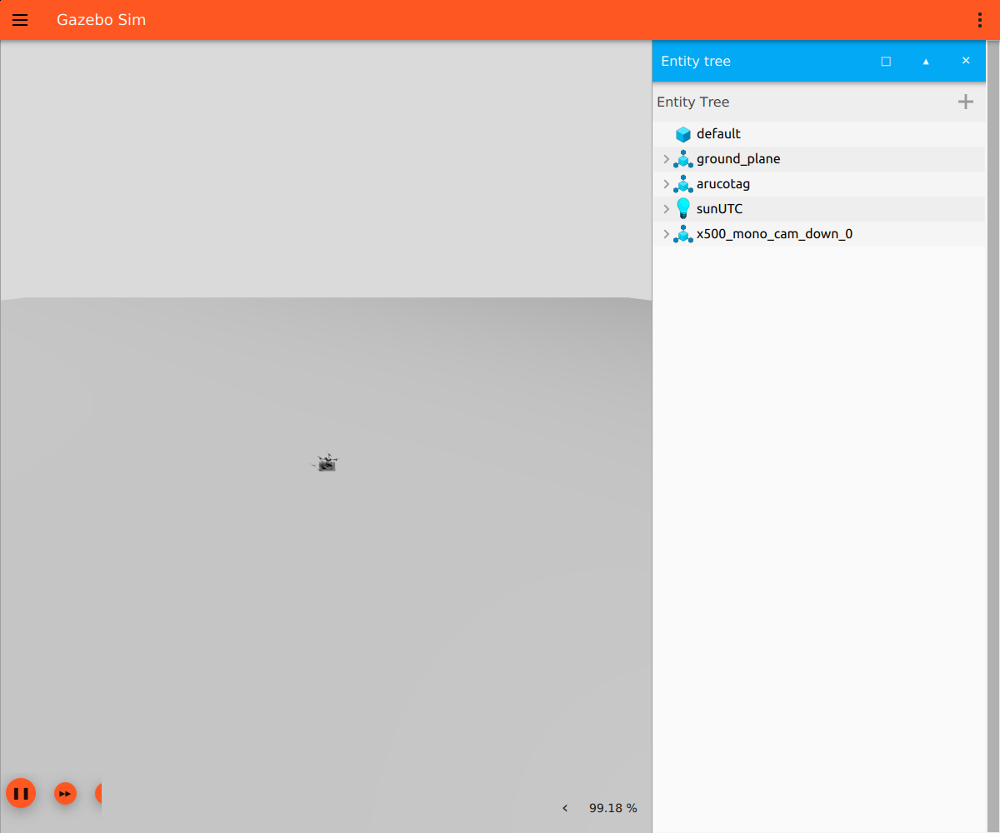

# 06 ArUco 精准降落

> 难度 L3 · 对应实验 E8（降落部分）· 场景 `vision.aruco_precision_landing`
> **实测落点距靶标中心 0.052 m**（0.5m 靶标）

## 学习目标

- 视觉伺服闭环：图像误差 → 速度指令 → 落点厘米级
- 理解为什么精度验证必须用世界系真值（EKF 原点重置的又一次现身）

## 6.1 跑起来

```bash
# 栈: 下视相机机型 + aruco 世界（地面有标准 ArUco ID42 靶标）
bash scripts/run_simulation.sh xtd2 gz_x500_mono_cam_down aruco

# 精准降落（新终端）:
ros2 run drone_sim aruco_precision_landing --ros-args -p camera_ns:=/x500_mono_cam_down_0
```

飞机起飞 → 搜索/识别靶标 → 视觉伺服对准 → 下降 → 统计居中判定 → 落地上锁。




### 判分指标

| 指标 | 阈值 | 取数 |
|---|---|---|
| 落点偏差 | < 0.15 m | 结束时水平位置与靶标(世界原点)距离 |
| 最终对齐 | ≥1 | 日志"最终对齐完成/统计居中达标" |
| 结束状态 | disarmed | arming_state == 1 |

```bash
python3 tools/grade.py --scenario vision.aruco_precision_landing --runs 3
```

## 6.2 伺服律设计（代码导读 `aruco_precision_landing.py`）

1. **以图像光心为基准**：误差 = 靶标像素中心 − 光心。与局部坐标原点无关（天然免疫 EKF 重置）
2. **偏航旋转**：图像系误差按当前航向旋到世界系再发速度（否则飞机会画圈追靶）
3. **高度自适应增益**：越高增益越大（同样像素误差对应更大物理偏移）
4. **统计居中判定**：连续 N 帧误差小于阈值才判定"对准"，抗单帧抖动
5. 低空防极限环：接近地面时限制修正幅度，避免来回振荡

## 6.3 故障实验室（本章坑最多，都是真实调试记录）

| 坑 | 现象 | 修复 |
|---|---|---|
| 图像→世界映射符号 | 飞机越修越远 | 光心系←机体系←世界系逐级推导符号 |
| 偏航未旋转 | 绕靶画圈不收敛 | 误差按 heading 旋转 |
| EKF 原点重置 | "落点精度"数字漂亮但实际偏 | **用 gz 世界系位姿验证落点** |
| 低空极限环 | 落地前左右振荡 | 高度自适应增益 + 统计判定 |

> 本章是"外部真值优先"铁律的最佳案例：局部坐标说落在靶心，世界系真值说偏了 1m——信谁？

## 练习

1. 把靶标换成 ArUco ID 其它值（改世界纹理），验证识别仍工作。
2. 调伺服增益 ±50%，观察收敛时间与极限环倾向。
3. 思考：为什么下视相机机架要自建（4013）而不是用现成模型？

[上一章](course/05-yolo.md) · [下一章：激光 SLAM →](course/07-slam.md)
