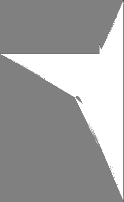
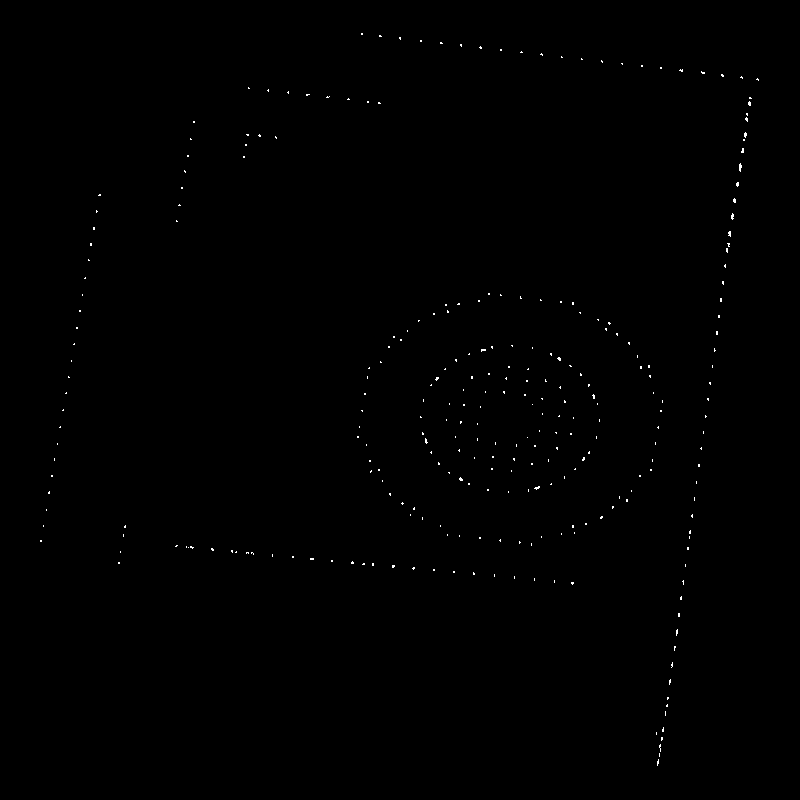

# 07 激光 SLAM：2D 建图与 3D 里程计

> 难度 L4 · 对应实验 E4 / E5（Issue #4 #5，已完成）· 场景 `slam.lio_odometry`

## 学习目标

- 2D：slam_toolbox 边飞边建图，产出 nav2 格式栅格地图
- 3D：Point-LIO 激光惯性里程计，高度误差厘米级
- 掌握 SLAM 全链路的时间/坐标/QoS 三件套（本章坑最密集）

## 7.1 2D 激光 SLAM（E4）

```bash
# 栈: 2D 激光机型 + walls 世界
bash scripts/run_simulation.sh xtd2 gz_x500_lidar_2d walls

# SLAM（新终端）:
ros2 launch drone_sim slam_2d.launch.py
# 再开一个终端飞航点，边飞边建图:
ros2 launch drone_sim waypoint_mission.launch.py prefix:=/x500_lidar_2d_0 mission:=square
```

实测成果：**252×410 栅格 @0.05m，631 个障碍格**，地图存 `maps/e4_walls_map.pgm+yaml`（nav2 可直接用）。




### 让 slam_toolbox 跑起来的四件事（补丁 0011/0012）

1. `/clock` 桥接 + 全链路 `use_sim_time:=true`（否则 TF 时间戳对不上，静默不建图）
2. **带协方差的里程计**桥接（slam_toolbox 要 covariance）
3. x500_base 模型补 `OdometryPublisher` 插件（上游只有 x500_vision 有）
4. `odom_to_tf` 节点 + `base_link→lidar` 静态 TF（TF 树缺一环都不行）

## 7.2 3D 激光惯性里程计（E5）

```bash
# 栈: 16线3D激光机型 + walls
bash scripts/run_simulation.sh xtd2 gz_x500_lidar_3d walls

# Point-LIO（新终端）:
ros2 launch drone_sim point_lio.launch.py
```

[Point-LIO](https://github.com/thamyis100/point_lio_ros2)（FAST-LIO2 后继）实测：
`/odom` 8Hz，**高度误差 9cm**（LIO 4.87m vs 真值 4.96m），3m 正方形轨迹完整复现，
配准点云 43808 点覆盖 walls 场景（`maps/e5_registered_cloud.npy`）。




### 判分指标（slam.lio_odometry）

| 指标 | 阈值 | 取数 |
|---|---|---|
| 高度误差 | < 0.2 m | LIO z 与 gz 真值 z 的中位偏差 |
| 里程计频率 | > 5 Hz | odom 消息数/时长 |
| 轨迹跨度 | > 2 m | 真值轨迹水平包络 |

### 自建 16 线激光与适配器

- 自建模型 `lidar_3d_v1` + 机型 `x500_lidar_3d` + 机架 4014（补丁 0008/0015）
- `lidar3d_adapter.py`：gz 点云**补 ring/time 字段** + **过滤 inf**（无回波点会破坏 ikd-tree 直接发散）
- livox_ros_driver2 用**消息桩包**满足依赖（无需 Livox SDK）

## 7.3 故障实验室

| 坑 | 现象 | 修复 |
|---|---|---|
| 点云含 inf | LIO 发散 | adapter 过滤 |
| 缺 ring/time | LIO 拒收/退化 | adapter 补齐 |
| QoS BEST_EFFORT | 订阅端 RELIABLE 静默连不上 | 统一 BEST_EFFORT |
| 无 /clock 或 TF 断链 | slam_toolbox 不建图不报错 | 四件套逐项检查 |
| **EKF z 原点重置** | 地面变成"local z=-5"，任务误判已起飞→贴地爬行 | 重置计数器稳定 5s 才解锁（已固化） |

## 练习

1. 在 walls 飞完正方形后保存地图，数一数障碍格数量级是否合理。
2. 把 LIO 高度与 `{ns}/pose` 真值逐时刻对比，画出误差曲线（中位偏差应 <0.2m）。
3. 思考：为什么 3D LIO 不需要建图也能给出高精度里程计？

[上一章](course/06-precision-landing.md) · [下一章：VIO 失败案例 →](course/08-vio.md)
