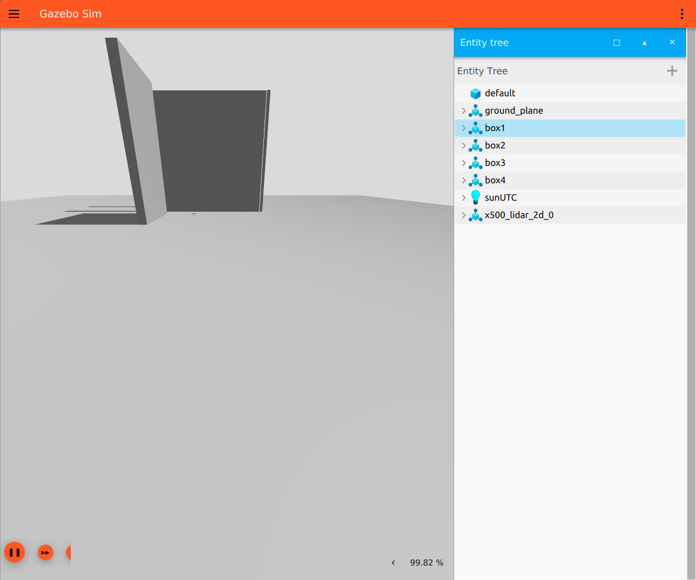
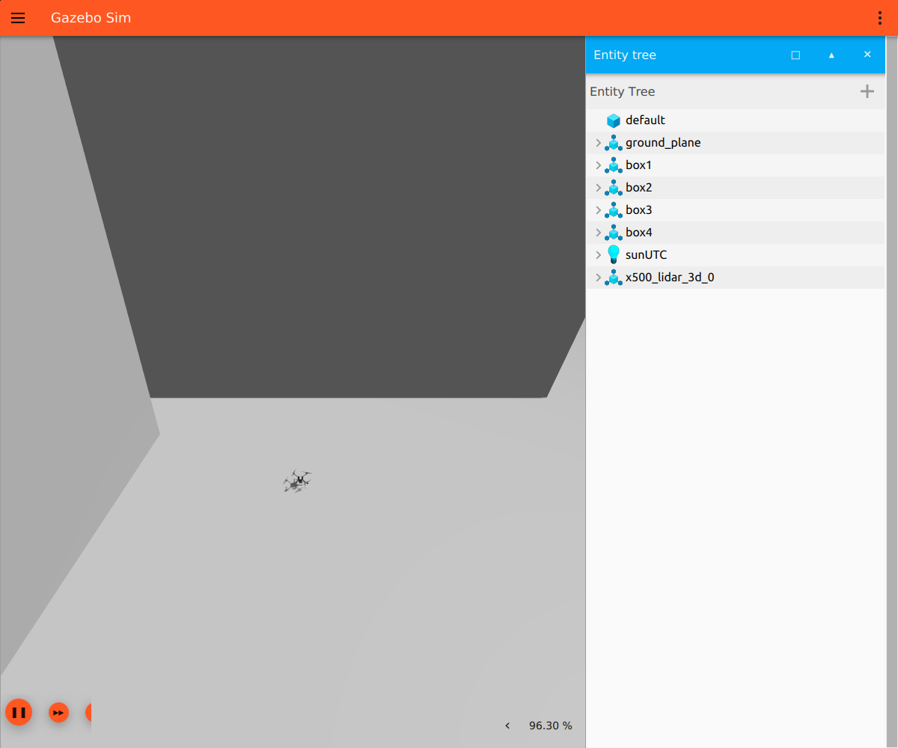

# 07 激光 SLAM：2D 建图与 3D 里程计

> 难度 L4 · 对应实验 E4 / E5 · 场景 `slam.lio_odometry` · 预计 150–180 分钟
> **本章坑最密集**——几乎每一个都不是"报错"，而是"静默不工作"

## 本章问题

前六章飞机一直知道自己在哪：室外有 GPS（仿真里是完美的），EKF 直接给出位置。

但室内没有 GPS。飞机飞进一栋楼，**它不知道自己在哪里**，也不知道墙在哪。

人类进黑屋子会怎么办？摸墙、记住摸过的位置、慢慢拼出房间形状。SLAM（Simultaneous Localization and Mapping，同时定位与建图）做的就是这件事：**边飞边建图，同时用刚建的图来确定自己在哪**。

这一章要解决四件事：

1. 2D 激光怎么变成一张能用的地图（栅格地图）。
2. 3D 激光怎么给出高精度里程计（不建图也能定位）。
3. 为什么这套系统**四个环节缺一个就静默不工作**，而且不报错。
4. 怎么判断"地图建得好不好"——不是看图好看，是看数字。

第 3 点最折磨人：你会遇到"启动了、没报错、就是没地图"。这一章把四个必要条件一次讲清。

## 学习目标

| 维度 | 学习前 | 学习后 |
|---|---|---|
| SLAM 概念 | 以为建图和定位是两件事 | 理解两者互为前提，是个"鸡生蛋"问题 |
| 2D 建图 | 只会看地图好不好看 | 能说清栅格分辨率、障碍格、nav2 格式 |
| TF 树 | 不知道 TF 是什么 | 能画出 `map → odom → base_link → lidar` |
| 3D 里程计 | 以为 LIO 是"更高级的 2D" | 理解点云配准 + IMU 融合，且不依赖地图 |
| 数据质量 | 不知道点云会有坏点 | 能说清 `inf` 如何破坏 ikd-tree、为何要补 `ring/time` |
| 排障 | 没地图就重装环境 | 能按"时间→TF→QoS→数据"四步定位 |

## 前置知识

需要会第 3 章的传感器话题、第 4 章的航点任务。**这一章会大量用到 `ros2 topic hz`、`ros2 topic echo`、`ros2 run tf2_tools view_frames`**，不熟的话先回第 3 章。

**先跑，再懂。** 第 1 节先跑通 2D 建图，看到地图文件生成；第 2 节再解释"为什么少了任何一环就静默失败"。

## 本章地图

| 步骤 | 你做什么 | 拿到的证据 |
|---|---|---|
| 1 | 起 2D 激光机型，跑 slam_toolbox | RViz 出现逐渐扩展的地图 |
| 2 | 飞一圈正方形，保存地图 | `maps/e4_walls_map.pgm` 生成 |
| 3 | 看地图尺寸与障碍格数 | 252×410 @0.05m、631 格 |
| 4 | 跑 Point-LIO，对比真值 | `/odom` 8Hz，高度误差 9cm |
| 5 | 理解四件套与点云适配 | 能解释每个"静默失败"的成因 |

---

## 1. 先让它建一张图（最小路径）

### 1.1 起 2D 激光栈

```bash
bash scripts/run_simulation.sh xtd2 gz_x500_lidar_2d walls
```

机型 `gz_x500_lidar_2d`（自建机架 4012，带 2D 激光），世界 `walls`（结构化墙体——**没有墙就没有可建的结构**）。

确认激光在出数据：

```bash
ros2 topic hz /x500_lidar_2d_0/scan
# 实测约 30.4 Hz，270° 视场，量程 30m
```

### 1.2 启动 SLAM

新终端：

```bash
source /opt/ros/humble/setup.bash
source <仓库路径>/ros2_ws/install/setup.bash
ros2 launch drone_sim slam_2d.launch.py
```

这个 launch 做了三件事：起 `slam_toolbox`、起 `odom_to_tf`（把里程计转成 TF）、加载参数。

### 1.3 飞一圈，边飞边建

再开一个终端：

```bash
ros2 launch drone_sim waypoint_mission.launch.py prefix:=/x500_lidar_2d_0 mission:=square
```

飞机飞正方形的同时，RViz 里的地图会一点点长出来。


**建出来的地图：白色是空闲、黑色是墙、灰色是未知区域。**

飞行中的画面：



**飞机沿正方形飞行，激光扫过墙体，地图随之扩展。**

### 1.4 保存并检查

```bash
ros2 run nav2_map_server map_saver_cli -f maps/e4_walls_map
```

产出 `maps/e4_walls_map.pgm` + `.yaml`（**nav2 直接能用**）。

本仓库实测结果：

| 指标 | 数值 |
|---|---|
| 地图尺寸 | **252 × 410** 栅格 |
| 分辨率 | **0.05 m/格**（即每格 5cm） |
| 障碍格数 | **631** 个 |

换算一下：252 × 0.05 = 12.6 m，410 × 0.05 = 20.5 m——和 `walls` 世界的实际尺寸吻合。

**这一步的意义**：地图不是"看起来像"，而是**有尺寸、有分辨率、有格数**的数据。后面 SLAM 的所有评估都建立在这种可核对性上。

### 1.5 换 3D：不建图也能定位

2D 用一圈激光；3D 用 16 线激光点云 + IMU，做**激光惯性里程计**（LIO）。

```bash
# 栈: 3D 激光机型
bash scripts/run_simulation.sh xtd2 gz_x500_lidar_3d walls

# Point-LIO（新终端）
ros2 launch drone_sim point_lio.launch.py
```

[Point-LIO](https://github.com/thamyis100/point_lio_ros2) 是 FAST-LIO2 的后续工作。本仓库实测：

| 指标 | 数值 |
|---|---|
| `/odom` 频率 | **8 Hz** |
| 高度误差 | **9 cm**（LIO 4.87 m vs 真值 4.96 m） |
| 轨迹 | 3m 正方形完整复现 |
| 配准点云 | **43808 点**，覆盖 walls 场景 |


**3D LIO 输出的点云地图：墙体被逐层拼出来。**

3D 激光看到的场景：



**16 线激光扫过墙体——和 2D 的"一圈线"不同，这是立体的点。**

### 1.6 判分

```bash
python3 tools/grade.py --scenario slam.lio_odometry --runs 3
```

| 指标 | 阈值 | 怎么取数 |
|---|---|---|
| 高度误差 | < 0.2 m | LIO 的 z 与 gz 真值的 z 的中位偏差 |
| 里程计频率 | > 5 Hz | odom 消息数 ÷ 时长 |
| 轨迹跨度 | > 2 m | 真值轨迹的水平包络 |

**注意第一条用"中位偏差"而不是"最大偏差"**——里程计偶发跳变是正常的，中位数才能反映整体精度。

---

## 2. 刚才发生了什么（回头理解原理）

### 2.1 SLAM 到底在解决什么

一个直觉上的死循环：

- 要**建图**，得先知道"我在哪"（否则不知道这帧点云该贴到地图的哪个位置）；
- 要**定位**，得先有地图（否则不知道自己在图的哪里）。

SLAM 的解法是**同时估计**：把"位姿"和"地图"当成一个联合问题，用观测数据一起优化。这也是它名字的由来。

两种典型路线：

| 路线 | 做法 | 代表 |
|---|---|---|
| **滤波类** | 递推估计当前位姿，地图增量式拼接 | EKF-SLAM、FastSLAM |
| **优化类** | 攒一段轨迹后统一优化（图优化） | slam_toolbox、Cartographer |

课程用的 `slam_toolbox` 是优化类，Point-LIO 是滤波类（紧耦合 IMU）。

### 2.2 2D 激光与栅格地图

**激光扫描（LaserScan）**给的是一圈距离读数：

```text
ranges[i] = 第 i 个角度方向上，到最近障碍的距离（米）
```

`walls` 世界是 270° 视场、30m 量程、约 30 Hz。

**栅格地图（occupancy grid）**把平面切成小方格，每格三种状态：

| 值 | 含义 |
|---|---|
| 0 | 空闲（激光穿过了） |
| 100 | 占用（激光打到了） |
| -1 | 未知（没扫到过） |

**分辨率 0.05 m/格**意味着每个格子代表 5cm×5cm 的地面。分辨率越细，地图越精确但内存与计算越大。

**为什么存成 pgm + yaml**：pgm 是灰度图（0/254/205 对应占用/空闲/未知），yaml 存分辨率、原点、阈值。nav2 读这两个文件就能做路径规划——**地图不只是给人看的，是给规划器用的数据结构**。

### 2.3 slam_toolbox 为什么"静默失败"

这是本章的核心：**它不工作的时候不报错**。

要让 `slam_toolbox` 真正建图，需要四个条件同时满足（课程补丁 0011/0012 就是补这些）：

| # | 条件 | 缺了会怎样 |
|---|---|---|
| 1 | `/clock` 桥接 + 全链路 `use_sim_time:=true` | 时间戳对不上，**不建图**，无报错 |
| 2 | 带协方差的里程计桥接 | 订阅端等不到有效协方差，**不建图** |
| 3 | 模型补 `OdometryPublisher` 插件 | 没有里程计源（上游只有 `x500_vision` 有） |
| 4 | `odom_to_tf` + `base_link→lidar` 静态 TF | TF 树断链，**不建图** |

**四个条件对应四类"沉默"**。这也是为什么本章排障不能靠看报错，只能靠**逐个验证**。

### 2.4 TF 树：谁在谁的坐标系里

**TF** 是 ROS2 的坐标变换系统：一棵树，每个节点是一个坐标系，边是"变换关系"。

建图需要的链：

```text
map ──(slam_toolbox 发布)──> odom ──(odom_to_tf 发布)──> base_link ──(静态)──> lidar
```

| 坐标系 | 含义 | 谁发布 |
|---|---|---|
| `map` | 地图原点（全局） | slam_toolbox |
| `odom` | 里程计原点（连续、会漂） | odom_to_tf |
| `base_link` | 机体中心 | odom_to_tf |
| `lidar` | 激光安装位置 | 静态 TF |

**为什么要有两层 `map` 与 `odom`**：`odom` 连续但不准（会漂），`map` 准但会跳（回环时修正）。分两层可以让"跳变"发生在 `map→odom` 这条边上，`odom→base_link` 保持连续——这样控制不会因为回环修正而抖。

检查 TF 树：

```bash
ros2 run tf2_tools view_frames        # 生成 frames.pdf
ros2 run tf2_ros tf2_echo map base_link   # 实时看变换
```

**`tf2_echo` 无输出 = TF 断了**，这是最快的诊断手段。

### 2.5 3D LIO：配准 + IMU

3D 激光给的是点云（几十万个三维点）。LIO 的思路：

1. **配准（registration）**：把这一帧点云和地图（或上一帧）对齐，求出相对位移；
2. **IMU 辅助**：两帧之间用 IMU 积分提供初值，并做运动畸变补偿（扫描 0.1s 内飞机在动，点云会扭曲）；
3. **紧耦合**：把配准残差和 IMU 残差放进同一个优化问题一起解。

**为什么 LIO 不需要"建图"也能定位**：它每次只需要"和最近的局部地图对齐"，不需要全局一致性。所以室内、无 GPS 也能给出高精度里程计——**代价是会漂**（没有回环修正，飞久了就偏）。

Point-LIO 的一个特点是**逐点更新**（point-by-point），对高动态更鲁棒。本仓库实测 8 Hz、高度误差 9cm。

### 2.6 点云字段：为什么必须补 `ring` 和 `time`

Gazebo 产出的点云只有 `x/y/z/intensity`。但 Point-LIO 的 velodyne handler 需要 **`PointXYZIRT`**：

| 字段 | 含义 | 为什么需要 |
|---|---|---|
| `ring` | 这个点属于第几条线（0–15） | 按线做运动补偿 |
| `time` | 这个点在本次扫描内的相对时间（0–0.1s） | 扫描期间飞机在动，要按点补偿 |

`lidar3d_adapter.py` 干的就是补这两个字段：

```python
# ring: 垂直角量化到最近波束 (16 线均布 ±15°)
ring = np.clip(np.round((vert + self.vfov / 2) / (self.vfov / (self.lines - 1))).astype(np.uint16), 0, self.lines - 1)

# time: 方位角 [-π, π] → [0, period)
time = (azimuth + np.pi) / (2 * np.pi) * self.period
```

**思路**：用点的几何位置**反推**它属于哪条线、在扫描的哪个时刻。虽然是"猜"的，但对均匀旋转的机械式激光足够准。

重建后的点云布局（每点 24 字节）：

```text
x(4) y(4) z(4) intensity(4) ring(2) time(4)  ← 共 22，对齐到 24
```

### 2.7 `inf` 点为什么会把 LIO 搞崩

激光打不到东西时（超量程、天空），距离是无穷大，Gazebo 会把它写成 `inf`。

**后果**：Point-LIO 内部用 **ikd-tree**（增量式 k-d 树）做最近邻搜索。`inf` 坐标会污染树的划分，导致：

- 最近邻搜到 `inf` 点，配准残差变成 `inf`；
- 优化器拿到 `inf` 梯度，位姿直接**发散**（飞出去）。

**所以适配器第一件事就是过滤**：

```python
valid = np.isfinite(xyz).all(axis=1) & (r > 0.3) & (r < 60.0)
```

三重过滤：**非 inf/nan** + **不太近**（<0.3m 可能是自身遮挡）+ **不太远**（>60m 超出有效量程）。

> 这一条是"数据清洗决定算法生死"的典型例子：不是算法不好，是喂了它吃不了的东西。

### 2.8 QoS 与仿真时间：两个静默杀手

**QoS**：传感器话题是 BEST_EFFORT。若订阅端用 RELIABLE，静默收不到（第 3、5 章都踩过）。SLAM 里同样的坑出现在点云与扫描订阅上。

**仿真时间**：`use_sim_time:=true` 让节点用 `/clock`。如果某个节点没设：

- 它用自己的系统时间戳，和其它节点差了几十年；
- TF 会拒绝"来自未来或过去太久"的变换；
- 表现为"节点在跑、TF 在发、就是没地图"。

**检查**：

```bash
ros2 param get /slam_toolbox use_sim_time        # 应为 True
ros2 topic hz /clock                              # 应有数据
```

### 2.9 逐个看 slam_toolbox 的配置

`config/slam_toolbox_2d.yaml` 里的每一项都不是随手写的。挑九个关键项：

| 参数 | 值 | 为什么是这个值 |
|---|---|---|
| `odom_frame` | `odom` | TF 树中间层 |
| `map_frame` | `map` | 全局地图系 |
| `base_frame` | `base_link` | 机体 |
| `scan_topic` | `/x500_lidar_2d_0/scan` | **写死了命名空间** |
| `mode` | `mapping` | 建图模式（不是定位模式） |
| `resolution` | `0.05` | 5cm/格，与实测 252×410 对应 |
| `max_laser_range` | `25.0` | 传感器 30m，但**配置截到 25m** |
| `map_update_interval` | `2.0` | 每 2 秒更新一次地图 |
| `transform_publish_period` | `0.02` | 50 Hz 发布 TF |

**三个值得注意的点**：

**第一，`scan_topic` 写死了命名空间。** 这意味着换机型或换实例号就必须改 yaml——这也是为什么课程的多机实验要单独配。**更好的做法是用 launch 参数传入**，但当前实现是硬编码。

**第二，`max_laser_range = 25` 而传感器量程是 30。** 为什么截掉 5 米？因为远距离激光点噪声大、角度误差大，纳入建图反而会拉低精度。**这是"主动丢弃数据"换取质量的典型取舍。**

**第三，`map_update_interval = 2.0`。** 地图不是实时刷新的，每 2 秒更新一次。你第一次看 RViz 时觉得"地图长得慢"，就是这个原因——不是建图慢，是**发布慢**。

**求解器配置**：

```text
solver_plugin: solver_plugins::CeresSolver
ceres_linear_solver: SPARSE_NORMAL_CHOLESKY
ceres_preconditioner: SCHUR_JACOBI
ceres_trust_strategy: LEVENBERG_MARQUARDT
```

这是标准的**图优化**配置：Ceres 求解稀疏正规方程，SCHUR 预处理利用"位姿-地图"的块结构，LM 策略保证收敛稳定。**你不需要改它，但要知道它是"优化类 SLAM"而不是"滤波类"。**

**TF 时间参数**：

| 参数 | 值 | 作用 |
|---|---|---|
| `transform_timeout` | 0.5 s | 等待某帧 TF 的最长时间 |
| `tf_buffer_duration` | 30.0 s | TF 缓存多长历史 |

**`tf_buffer_duration = 30` 的含义**：如果某帧数据的时间戳比"现在"早超过 30 秒，TF 就查不到了。这解释了为什么"节点卡住一段时间后恢复"会失败——中间那段 TF 已经过期。

### 2.10 回环与 `map→odom` 的跳变

**回环检测（loop closure）**是 SLAM 的关键能力：飞机绕一圈回到起点，算法认出"这里我来过"，于是修正累积漂移。

**修正发生在哪**：`map→odom` 这条 TF 边上。

```text
map ──(会跳)──> odom ──(连续)──> base_link
```

| 边 | 特性 | 为什么 |
|---|---|---|
| `map → odom` | **会跳变** | 回环修正直接改这里 |
| `odom → base_link` | **保持连续** | 由里程计给出，保证控制平滑 |

**这个设计的巧妙之处**：修正被"隔离"在最外层，机体自己的运动估计保持连续。所以控制器不会因为一次回环修正而突变。

**怎么观察**：

```bash
ros2 run tf2_ros tf2_echo map odom      # 回环时这个变换会突然变化
ros2 run tf2_ros tf2_echo odom base_link # 这个应该平滑
```

**事务性提醒**：如果你在飞控里直接用 `map` 系做控制，回环跳变会让飞机"抖一下"。**正确做法是用 `odom` 系做控制，用 `map` 系做任务规划。**

---

## 3. 案例：五个静默故障

### 案例 1：启动了、没报错、地图不出现

**现象**：`slam_toolbox` 起来了，RViz 加了 Map 显示项，但一直是空的。

**按顺序查四件事**（对应 2.3 节）：

```bash
ros2 topic hz /clock                                   # ① 时钟有没有
ros2 param get /slam_toolbox use_sim_time              # ① 用的是不是仿真时间
ros2 topic echo /x500_lidar_2d_0/odometry --once       # ② 里程计有没有、协方差在不在
ros2 run tf2_ros tf2_echo map base_link                # ③ TF 通不通
```

**九成情况**是 ① 或 ③。这就是"静默失败"的典型——**没有错误可查，只能逐个验证条件**。

### 案例 2：LIO 跑着跑着飞出去

**现象**：`/odom` 前几秒正常，然后数值突然暴涨到几百米，点云地图散成一团。

**原因**：点云里有 `inf` 或极端离群点，配准发散。

**验证**：

```bash
ros2 topic echo /x500_lidar_3d_0/lidar_3d/points --once --field width
# 再检查是否有异常大的坐标
```

**修复**：走 `lidar3d_adapter.py`（滤 `inf`、限半径）。**不要直接把原始点云喂给 LIO。**

### 案例 3：LIO 直接报"缺少字段"

**现象**：启动就退出，日志提到 `ring` 或 `PointXYZIRT`。

**原因**：用了原始 gz 点云（只有 xyz），没走适配器。

**修复**：确认 launch 里起的是适配器链路，话题名对得上（`lidar_3d/points` → 适配后 → `lidar_3d/points_irt` 之类）。

### 案例 4：TF 断在某一环

**现象**：`tf2_echo map base_link` 无输出，但 `tf2_echo odom base_link` 有。

**原因**：`map→odom` 没人发布——通常因为 slam_toolbox 没真正开始工作（回到案例 1）。

**诊断技巧**：用 `view_frames` 生成 PDF，看树里缺哪个节点，比逐个 echo 快。

### 案例 5：地图建出来了，但尺寸不对

**现象**：地图只有 3×3 米，实际场景 12×20 米。

**原因**：飞机没飞远（航点没执行）、或激光量程被限制、或分辨率参数不是 0.05。

**验证**：把地图尺寸 × 分辨率，与场景实际尺寸对比；再确认航点轨迹跨度 > 2m（判分指标之一）。

### 案例 6：回环修正让飞机"抖一下"

**现象**：飞机飞完一圈回到起点附近，位置指令突然被修正，飞机有一次明显抖动。

**原因**：控制环里用了 `map` 系，而回环修正直接改 `map→odom`（2.10 节）。

**诊断**：

```bash
ros2 run tf2_ros tf2_echo map odom     # 在回环时刻看是否有跳变
```

**修复**：控制用 `odom` 系，任务规划用 `map` 系。这是分层设计的本意。

### 案例 7：换机型后 SLAM 完全不工作

**现象**：换成 `gz_x500_lidar_3d` 后跑 `slam_2d.launch.py`，什么都不出。

**原因**：`slam_toolbox_2d.yaml` 里 `scan_topic` **写死了** `/x500_lidar_2d_0/scan`（2.9 节）。3D 机型没有这个话题。

**验证**：

```bash
ros2 topic list | grep scan     # 看实际话题名
```

**处理**：改 yaml 里的 `scan_topic`，或用 launch 参数覆盖。**这是硬编码留下的债。**

---

## 4. 进阶

### 4.1 地图怎么评估质量

"地图看起来像"不够。可量化的指标：

| 指标 | 怎么算 | 合格线 |
|---|---|---|
| **尺寸一致性** | 地图尺寸×分辨率 vs 场景实测 | 误差 < 10% |
| **障碍格数** | pgm 里值为 100 的格数 | 与场景物体数量匹配 |
| **空洞率** | 未知格占比 | 越低越好（扫得全） |
| **重影** | 同一面墙出现两条 | 无（说明配准准） |

**"重影"是最直观的质量指标**：如果一面墙在地图上变成两条平行线，说明位姿估计有漂移。

### 4.2 2D 与 3D 怎么选

| 需求 | 选 2D | 选 3D |
|---|---|---|
| 室内平面导航 | ✅ | 过度 |
| 需要避障高度 | ❌ | ✅ |
| 算力受限 | ✅ | ❌ |
| 需要高精度里程计 | 一般 | ✅（LIO 9cm） |

**课程两条都做了，因为它们的用途不同**：2D 给 nav2 做路径规划，3D 给状态估计。

### 4.3 逐段读 `slam_2d.launch.py`

这个 launch 只有 51 行，做三件事：

**第一件：里程计转 TF**

```python
odom_tf = Node(
    executable='odom_to_tf',
    parameters=[{'odom_topic': [LaunchConfiguration('ns'), '/odometry']}],
)
```

**注意 `ns` 是 launch 参数**——这是比 yaml 硬编码更好的做法（对比案例 7）。

**第二件：静态 TF（激光安装位置）**

```python
# 静态 TF: base_link -> 激光坐标系
# 安装位姿来自 x500_lidar_2d/model.sdf: .12 0 .26
```

激光装在机体 `(0.12, 0, 0.26)` 处——**前方 12cm、上方 26cm**。这个值必须与 SDF 里的实际安装位置一致，否则地图会系统性偏移。

**第三件：起 slam_toolbox**

```python
'slam_params_file': slam_params,
```

**这三件事的顺序有意义**：先有 TF，再有 SLAM。TF 缺一环，SLAM 就静默不工作（2.3 节）。

### 4.4 逐段读 `odom_to_tf.py`：53 行里最关键的一行

这个节点只干一件事：把 `nav_msgs/Odometry` 转成 TF 广播。

```python
def cb(self, msg):
    t = TransformStamped()
    t.header.stamp = msg.header.stamp     # ← 关键
    t.header.frame_id = self.odom_frame
    t.child_frame_id = self.base_frame
    t.transform.translation.x = msg.pose.pose.position.x
    ...
    self.br.sendTransform(t)
```

**为什么 `msg.header.stamp` 是关键**

如果写成 `self.get_clock().now()`，TF 的时间戳就变成"发布时刻"，而激光扫描的时间戳是"采集时刻"。两者差几毫秒到几十毫秒。

**后果**：

| 现象 | 原因 |
|---|---|
| `Lookup would require extrapolation into the future` | TF 比 scan 晚 |
| `Lookup would require extrapolation into the past` | TF 比 scan 早太多 |
| 建图"抖动"或墙变厚 | 每个 scan 用了略微错位的位姿 |

**根因**：`slam_toolbox` 要按 scan 的时间戳去查 TF。**时间戳必须描述"这个位姿对应哪个时刻"，而不是"我什么时候算出来"。**

**这条规则适用于所有 TF 广播**：

> **时间戳来自数据，不来自时钟。**

**第二个细节：QoS**

```python
self.create_subscription(Odometry, topic, self.cb, qos_profile_sensor_data)
```

用传感器 QoS（BEST_EFFORT）。如果桥接端发的是 BEST_EFFORT 而这个节点订阅 RELIABLE，就会静默收不到（第 3 章的坑）。

**第三个细节：TF 不带协方差**

`TransformStamped` 里没有协方差字段。但 `slam_toolbox` 需要它——这就是为什么第 2.3 节的"四件套"里有一条是"**带协方差的里程计桥接**"。

**换句话说**：

```text
Odometry 消息  →  带协方差, 给 slam_toolbox 用
同一份数据     →  转成 TF, 给坐标查询用
```

**两条路都要通**，少一条就不工作。

---

## 常见误解

| 误解 | 实际情况 |
|---|---|
| "SLAM 是建图，定位是另一件事" | 两者必须同时解，否则是死循环 |
| "没地图就是环境没装好" | 九成是时间/TF/QoS 三个静默条件之一 |
| "LIO 也需要先建图" | LIO 只要局部配准，不需要全局地图 |
| "点云越密越好" | 含 `inf`/离群点会直接让算法发散 |
| "地图好看就是建得好" | 要看尺寸、分辨率、障碍格数是否与场景吻合 |
| "TF 只是个调试工具" | TF 断了，多传感器融合全废 |
| "里程计频率越高越准" | 频率与精度是两个维度；8Hz 也能 9cm 精度 |

---

## 你可能卡在这里

| 现象 | 最可能原因 | 先跑这条命令 |
|---|---|---|
| 地图不出现、无报错 | `/clock` 或 `use_sim_time` 不对 | `ros2 topic hz /clock` |
| 地图不出现、时钟正常 | TF 断链 | `ros2 run tf2_ros tf2_echo map base_link` |
| 激光话题没数据 | 机型不对（用了 `gz_x500`） | `ros2 topic list \| grep scan` |
| 点云订阅不到 | QoS 不匹配 | `ros2 topic info -v <点云话题>` |
| LIO 发散飞走 | 点云含 `inf` | 检查是否走了 adapter |
| LIO 启动即退 | 缺 `ring`/`time` 字段 | 看日志是否提到 `PointXYZIRT` |
| 地图尺寸对不上 | 航点没飞完 / 分辨率参数错 | 查地图 yaml 的 `resolution` |
| 保存地图失败 | 目录不存在 | `mkdir -p maps` |
| 回环后位置跳变 | `map→odom` 修正（正常现象） | 看 `tf2_echo map odom` 是否跳 |

---

## 任务卡

### 任务卡 1：跑通 2D 建图并核对地图参数

| 段 | 内容 |
|---|---|
| 1 要实现的功能 | 建出 walls 的地图，核对尺寸/分辨率/障碍格数是否与场景吻合 |
| 2 通信骨架/前置 | `gz_x500_lidar_2d` + `walls`；地图存 `maps/` |
| 3 AI 提示 | 先自己算出预期尺寸，再问：<br>"walls 场景大约 12×20 米，地图 252×410 格。我算的分辨率是（贴计算）。请只检查我的换算对不对，**不要告诉我答案**。" |
| 4 执行步骤 | ① 起栈 ② 跑 `slam_2d.launch.py` ③ 飞正方形 ④ 保存地图 ⑤ 读 yaml 的 resolution ⑥ 核对尺寸 |
| 5 验收标准 | □ 地图文件生成 □ 尺寸×分辨率 ≈ 场景尺寸 □ 障碍格数在数百量级 |
| 6 原理 + 扩学 | 教**地图是可核对的数据**。扩学：把分辨率改成 0.1，看文件大小与格数怎么变 |

### 任务卡 2：画出 TF 树并解释每一环

| 段 | 内容 |
|---|---|
| 1 要实现的功能 | 导出 TF 树，标出每一环由谁发布、作用是什么 |
| 2 通信骨架/前置 | `map / odom / base_link / lidar` 四个坐标系 |
| 3 AI 提示 | 先自己画，再问：<br>"我的 TF 树是（贴结构）。请只指出：如果 `odom→base_link` 缺了，会有什么症状？**只回答症状，不要给修复步骤。**" |
| 4 执行步骤 | ① `ros2 run tf2_tools view_frames` ② 打开 frames.pdf ③ 标注每一环的发布者 ④ 用 `tf2_echo` 验证存在 |
| 5 验收标准 | □ 四个坐标系都在 □ 能说出每环谁发 □ 能解释 map 与 odom 为何分两层 |
| 6 原理 + 扩学 | 教**TF 是多传感器融合的骨架**。扩学：断电重启后哪一环会先消失？ |

### 任务卡 3：让 LIO 精度达标并对比真值

| 段 | 内容 |
|---|---|
| 1 要实现的功能 | 跑 Point-LIO，记录 `/odom` 频率与高度误差，与真值对比 |
| 2 通信骨架/前置 | `gz_x500_lidar_3d` + `walls`；真值 `{ns}/pose` |
| 3 AI 提示 | 先收数据，再问口径：<br>"我想比较 LIO 高度与真值高度，是用最大偏差还是中位偏差？为什么？**只回答方法选择，不要替我算。**" |
| 4 执行步骤 | ① 起栈 ② 跑 `point_lio.launch.py` ③ 记 `/odom` 频率 ④ 同时 echo odom 与 pose ⑤ 算中位偏差 |
| 5 验收标准 | □ 频率 > 5Hz □ 高度中位偏差 < 0.2m □ 能解释为什么不用最大偏差 |
| 6 原理 + 扩学 | 教**精度评估的统计口径**。扩学：算标准差，看抖动分布 |

### 任务卡 4：验证适配器做了什么

| 段 | 内容 |
|---|---|
| 1 要实现的功能 | 对比适配前后的点云，确认 `inf` 被滤、字段被补 |
| 2 通信骨架/前置 | 原始点云话题 vs 适配后话题 |
| 3 AI 提示 | 先自己观察，再问：<br>"适配后点数比原始少（贴数字），我想确认这是过滤造成的。请列出三种能证明'少的是 inf 点'的方法。**只列方法。**" |
| 4 执行步骤 | ① 记原始 `width` ② 记适配后 `width` ③ 用 `ros2 topic echo --field fields` 看新字段 ④ 对比 |
| 5 验收标准 | □ 能看到 `ring`/`time` 字段 □ 点数变化合理 □ 能解释三重过滤的作用 |
| 6 原理 + 扩学 | 教**数据适配层**。扩学：如果把 `r < 60` 改成 `r < 200` 会怎样？ |

### 任务卡 5：复现"静默不建图"（本章的"刺"）

| 段 | 内容 |
|---|---|
| 1 要实现的功能 | 亲手制造"启动了但不建图"，并用四步法定位 |
| 2 通信骨架/前置 | **无 AI 区：本卡禁止使用 AI**。把 `use_sim_time` 改成 false，或停掉 `/clock` 桥接 |
| 3 AI 提示 | 本卡不使用 AI。卡住可查 [故障实验室](faq.md)、按 2.3 节四个条件逐个验证 |
| 4 执行步骤 | ① 制造故障 ② 观察"无报错但无地图" ③ 用四步法定位到具体条件 ④ 修复 ⑤ 再建一次图 |
| 5 验收标准 | □ 能复现静默失败 □ 能用命令定位到具体原因 □ 能说出四个必要条件的名字 |
| 6 原理 + 扩学 | 教**静默失败的排查方法论**：把"应该发生的现象"逐条验证，而不是等报错 |

## ✅ 检查清单

- [ ] 我能解释 SLAM 里"定位与建图互为前提"的循环
- [ ] 我能说清栅格地图的三态与分辨率含义
- [ ] 我能画出 `map→odom→base_link→lidar` 并说明每环发布者
- [ ] 我知道 slam_toolbox 需要哪四个条件，缺了为什么静默
- [ ] 我能解释 LIO 为什么不需要全局地图就能定位
- [ ] 我能说清 `ring`/`time` 字段的用途与补算思路
- [ ] 我知道 `inf` 点为什么会破坏 ikd-tree
- [ ] 我能关掉 AI，独立复现本章实验并回答追问

> AI 可以帮你解释原理、核对换算，但**不替你排查静默故障**；任务卡 5 为无 AI 区。
> 规则见 [AI 使用指南](AI_GUIDE.md)。

## 分层练习

**基础**

1. 地图 252×410 格、分辨率 0.05 m，算出实际覆盖面积。
   > 要点：(252×0.05) × (410×0.05) = 12.6 × 20.5 ≈ 258 m²。

2. 为什么栅格地图要存成 pgm + yaml 两个文件？
   > 要点：pgm 存占用状态，yaml 存分辨率/原点/阈值等元数据。

3. `map` 与 `odom` 两层坐标系各自解决什么问题？
   > 要点：odom 连续但漂；map 准但会跳；分层让跳变不影响控制连续性。

**进阶**

4. 把 `walls` 换成 `indoor_hall`（有天花板），2D 激光还能建图吗？为什么？
   > 要点：2D 激光只扫一个平面，天花板不影响；但家具会形成更多结构。

5. 让 LIO 在正方形轨迹上跑两圈，观察回环前后 `/odom` 是否连续。
   > 要点：LIO 无回环，会累积漂移；两圈后误差应比一圈大。

6. 对比 2D 建图与 3D LIO 的产物差异（栅格 vs 点云），各自适合什么任务。

**挑战**

7. 如果要在没有墙的开阔场地建图，会发生什么？给出至少两条补救思路。
   > 要点：缺结构特征 → 配准退化；可加人工标记、融合视觉、或限制使用场景。

8. 设计一个"地图质量自检"脚本：输入 pgm+yaml，输出尺寸、障碍率、最大空洞。

---

## 自查 15 问

1. SLAM 的"鸡生蛋"问题是什么？
2. 栅格地图的三个取值分别代表什么？
3. `0.05 m/格` 的含义是什么？
4. slam_toolbox 需要的四个条件是哪四个？
5. `use_sim_time=false` 会表现成什么现象？
6. TF 树的四个坐标系谁发布谁？
7. 为什么 `odom→base_link` 要保持连续？
8. LIO 的两大输入是什么？
9. 为什么扫描期间要做运动畸变补偿？
10. `ring` 字段表示什么？
11. `time` 字段怎么算出来？
12. `inf` 点为什么会破坏 ikd-tree？
13. 适配器的三重过滤分别防什么？
14. 为什么精度评估用中位偏差而不是最大偏差？
15. 判分的三项指标各自说明什么？

---

## 小结与下一步

本章你做成了两件不同的事：

- **2D 建图**：把一圈激光变成 nav2 能用的栅格地图（12.6×20.5 m，631 个障碍格）；
- **3D 里程计**：用点云配准 + IMU 在无地图情况下定位（8 Hz，高度误差 9cm）。

更重要的是你踩透了"静默失败"这一类问题：**不报错，但就是不工作**。对付它的唯一办法是把"应该发生的现象"拆成可验证的条件，逐个排除——这也是第 16 章自动判分的思想基础。

下一步换个方向：如果相机是唯一的传感器，还能定位吗？第 8 章讲一个**没成功**的尝试，以及从失败里能学到什么。

[上一章](course/06-precision-landing.md) · [下一章：VIO 失败案例 →](course/08-vio.md)

---

## 附录：本章参数与话题速查

### 2D 建图

| 项 | 值 |
|---|---|
| 机型 | `gz_x500_lidar_2d`（机架 4012） |
| 激光话题 | `{ns}/scan`（30.4 Hz，270°，30m） |
| 地图输出 | `maps/e4_walls_map.pgm` + `.yaml` |
| 实测尺寸 | 252 × 410 @ 0.05 m |
| 实测障碍格 | 631 |

### 3D 里程计

| 项 | 值 |
|---|---|
| 机型 | `gz_x500_lidar_3d`（机架 4014，16 线） |
| 点云话题 | `{ns}/lidar_3d/points` |
| 输出 | `/odom` 8 Hz |
| 实测高度误差 | 9 cm |
| 配准点数 | 43808 |

### 关键补丁

| 补丁 | 内容 |
|---|---|
| 0011 | `/clock` + 带协方差里程计桥接 |
| 0012 | slam_toolbox 参数与 TF |
| 0008 / 0015 | 16 线激光模型、机架 4014 |
