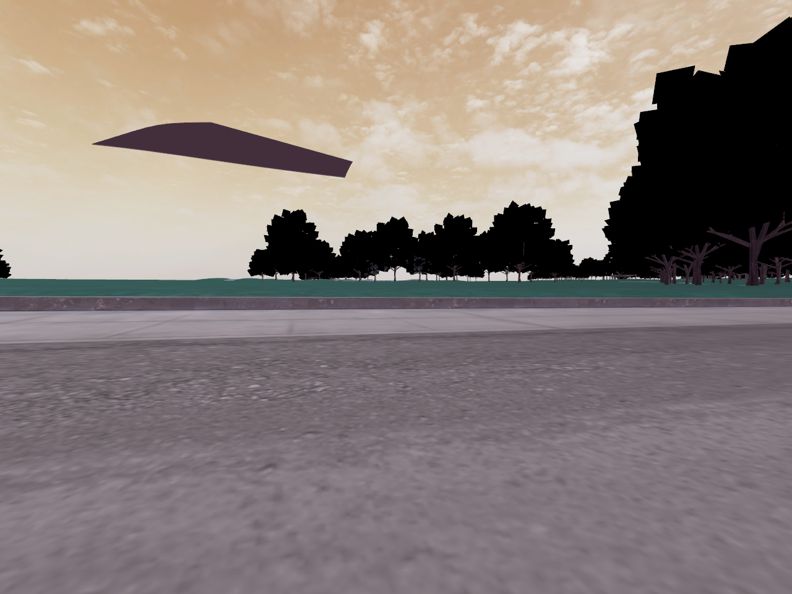

# 08 VIO：一次失败的研究案例

> 难度 L4 · 对应实验 E6（Issue #6，**保持 open**）· 场景 `vio.vins_mono`（status: unverified）
> ⚠️ 本章是**研究型挑战**，不是作业——因为它当前跑不通。我们完整记录失败，这比成功演示更有价值。

## 学习目标

- 理解单目 VIO 初始化的条件与失败模式
- 学习"输入链路逐项验证 → 定位问题域"的系统调试方法
- 理解仿真传感器与实机传感器的差距（sim2real 的第一课）

## 8.1 我们做了什么

[VINS-Fusion](https://github.com/HKUST-Aerial-Robotics/VINS-Fusion) ROS2 Humble 移植版编译集成（补丁 0017），
**输入链路全部验证正确**：

| 输入 | 验证结果 |
|---|---|
| 相机 | 1280×960 rgb8 @26Hz，内参 fx=fy=539.94 与配置一致 |
| IMU | 250Hz，含重力 10.4 m/s² |
| 外参 | body_T_cam0 按 光心系←机体系 严格推导 |
| 特征跟踪 | 正常（300 点） |

## 8.2 六轮尝试的失败记录

| 轮次 | 尝试 | 结果 |
|---|---|---|
| 1 | estimate_extrinsic=0/1 | 均报 `misalign visual structure with IMU`（视觉-惯性对齐失败） |
| 2 | 静态起飞激励 | 仍对齐失败 |
| 3 | 圆周激励 | 仍对齐失败 |
| 4 | 特征数提到 300 / 最小间距降到 10 | 仍对齐失败 |
| 5 | 视差阈值加大到 15 | 仍对齐失败 |
| 6 | estimate_td=1（在线时间偏移） | **直接崩溃**：OpenCV LK 金字塔断言 `prevPyr.size()==nextPyr.size()` |

**结论**：该 ROS2 移植版在"gz 合成图像 + 仿真 IMU"组合下无法完成单目视觉惯性初始化；
上游是为 RealSense D435i **实机**调校的。合成图像的噪声特性/纹理统计与实机不同，
仿真 IMU 的噪声模型也可能不满足初始化器的隐含假设。

## 8.3 方法论：失败为什么值得学

1. **先验证输入，再怀疑算法**：我们逐项确认了频率/内参/外参/重力/特征——把问题域压缩到"初始化器本身"
2. **单变量实验**：每轮只改一个因素，失败模式可归因
3. **诚实标注**：场景目录里 `status: unverified`，课程契约规定它**不得作为作业**
4. **保留现场**：日志 `logs/e6_vins5.log`、配置、补丁全部入库，可复现失败

## 8.4 后续可行方向（开放研究题）

- 双目配置（加第二路相机，绕开单目初始化）
- 换 VINS-Mono 官方 ROS2 移植版对比
- 走 PX4 `vehicle_visual_odometry` 外部里程计路线（px4-ros2-interface）
- 给 gz 相机加噪声模型/给 IMU 加真实噪声参数，逼近实机统计特性

## 练习（研究挑战，不计分）

1. 复现失败：`ros2 launch drone_sim vins_mono.launch.py`，观察 misalign 报错。
2. 用 `ros2 topic hz` 与 `echo` 独立验证相机/IMU 链路，写出你的验证清单。
3. 选一个 8.4 的方向做尝试，把过程记录成 issue——失败也欢迎。

[上一章](course/07-slam.md) · [下一章：反应式规划与避障 →](course/09-planning.md)
