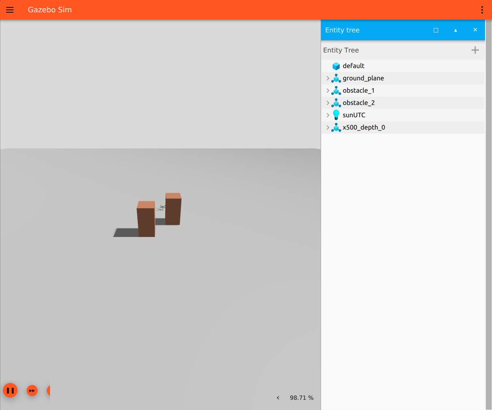

# 09 反应式规划与避障

> 难度 L5 · 对应实验 E7（Issue #7，已完成）· 场景 `plan.obstacle_avoidance`
> 实测：目标误差 **0.20 m**，与障碍最小距离 **2.05 m**

## 学习目标

- 理解"规划正确 ≠ 执行正确"：坐标系失配如何毁掉一个成熟的规划器
- 掌握自标定控制：不依赖任何航向/坐标约定假设的在线学习映射
- 深度相机避障的工程细节（地面回波过滤）

## 9.1 跑起来

```bash
# 栈: 深度相机机型 + 障碍场世界
bash scripts/run_simulation.sh xtd2 gz_x500_depth e7_obstacles

# 反应式规划器（新终端）: 从出生点飞到 (6, 0, 1.2)，途中两块障碍
ros2 run drone_sim planner_reactive --ros-args \
  -p px4_ns:=/x500_depth_0 -p target_x:=6.0 -p target_y:=0.0 -p target_z:=1.2
```



### 判分指标

| 指标 | 阈值 | 取数 |
|---|---|---|
| 目标误差 | < 0.8 m | 终点与目标 3D 距离 |
| 障碍最小距离 | > 1.0 m | 轨迹与障碍中心最近距离 |
| 到达 | ≥1 | 目标误差 < arrive_tol |

## 9.2 前史：ego-planner 为什么没用于交付

我们先集成了 [ego-planner](https://github.com/ZJU-FAST-Lab/ego-planner) Humble 版——
**规划段完全正确**（`/position_cmd` 与目标一致），但执行段被 PX4 局部系漂移困扰：
EKF 航向/原点重置，4 种坐标映射方案均未稳定收敛。

> 教训：上游规划器假设"里程计坐标系稳定"，而仿真 PX4 的局部系会重置。
> 集成代码保留在 `launch/ego_planner.launch.py` + `ego_bridge.py` 供研究参考。

## 9.3 自研反应式规划器（代码导读 `planner_reactive.py`）

三段式设计：

1. **启动自标定**：依次给机体系 ±x/±y 已知速度，用 **gz 世界位姿**测量实际位移，
   在线学习"机体系速度→世界速度"的 2×2 映射矩阵——**不依赖任何航向/坐标约定假设**
2. **目标吸引**：世界系比例控制飞向目标
3. **深度避障**：图像上半部检测障碍（过滤地面回波），遇障按左右净空选一侧，
   绕行方向用标定矩阵换算回机体系

自标定是本章精华：当两个坐标系的关系不可信时，**用实验测出来**，而不是猜约定。

## 9.4 故障实验室

| 坑 | 现象 | 修复 |
|---|---|---|
| PX4 局部系 vs gz 世界系失配 | 目标收敛不稳定/漂移 | 世界系真值 + 自标定 |
| 深度相机地面回波 | 把地面当障碍，不敢飞 | 只看图像上半部 |
| 无自标定直接飞 | 飞反/打转 | 先标定再执行 |

## 练习

1. 把目标改到 (6, 2, 1.2)，观察绕行方向选择。
2. 调 `safe_dist`（默认 1.2）到 3.0，预测并验证最小障碍距离变化（调参练习）。
3. 思考：自标定矩阵在飞机偏航 90° 后还成立吗？为什么？

[上一章](course/08-vio.md) · [下一章：行为树任务层 →](course/10-bt.md)
