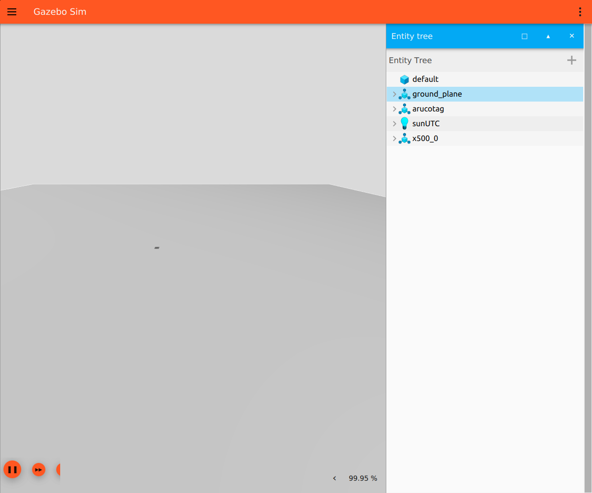

# 10 行为树任务层

> 难度 L5 · 对应实验 E10 · 场景 `mission.behavior_tree` · 预计 120 分钟

## 本章问题

到目前为止，你的任务逻辑都是**一段写死的代码**：

```text
起飞 → 飞到 A → 飞到 B → 降落
```

想改成"看到人就降落，否则继续巡逻"呢？加一个 `if`。再加"电量低于 20% 就返航"呢？再加一个 `if`。再加"三个航点任一到不了就跳过"……

很快你会得到一坨互相嵌套的判断，**改一处坏三处**，而且没人能一眼看懂"现在飞的是哪个分支"。

这一章把任务从**代码**变成**数据**：用一棵树描述任务，用 XML 配置，用现成的节点库拼装。

要解决四件事：

1. 行为树到底是什么，为什么它比状态机好维护。
2. `Sequence` 和 `Selector` 的语义差别（这是理解行为树的关键）。
3. 为什么"根节点用 Selector"是任务层的安全范式。
4. 这套东西的**已知缺陷**——我们有一个场景至今没能稳定触发。

第 3 点是本章最重要的设计思想，第 4 点是本章最诚实的地方。

## 学习目标

| 维度 | 学习前 | 学习后 |
|---|---|---|
| 任务建模 | 只会写顺序执行的代码 | 能用树形结构表达带条件与兜底的任务 |
| 复合节点 | 分不清 Sequence 与 Selector | 能画出两者的真值表 |
| 安全设计 | 失败就崩/卡死 | 会用根 Selector 兜底应急分支 |
| 节点实现 | 不知道 RUNNING 是什么 | 能解释 `tick` 与三态状态机 |
| 配置化 | 改任务就改代码 | 改 XML 即可换任务 |
| 工程诚实 | 只写"成功经验" | 能记录并说明"已知不工作的部分" |

## 前置知识

需要会第 2 章的状态机（`offboard_demo` 的 INIT/TAKEOFF/CIRCLE/LAND）、第 4 章的航点任务。不要求用过 py_trees。

**先跑，再懂。** 第 1 节先跑通一个方形任务，看到日志里每个节点的 SUCCESS；第 2 节再讲树的语义。

## 本章地图

| 步骤 | 你做什么 | 拿到的证据 |
|---|---|---|
| 1 | 跑 `mission_bt_square.xml` | 日志逐节点 SUCCESS |
| 2 | 看判分三项 | PASS |
| 3 | 读 XML，画出树结构 | 能标出根 Selector |
| 4 | 自己写一个 XML 任务 | 跑通并截图 |
| 5 | 理解已知限制 | 能说出哪一处没验证成功 |

---

## 1. 先让它按树飞（最小路径）

### 1.1 起仿真栈

```bash
bash scripts/run_simulation.sh xtd2 gz_x500 aruco
```

普通机型 + 带靶标的世界（本章不依赖特殊传感器）。

### 1.2 跑行为树任务

```bash
ros2 run drone_sim bt_mission --ros-args \
  -p px4_ns:=/x500_0 \
  -p mission_xml:=$(ros2 pkg prefix drone_sim)/share/drone_sim/config/mission_bt_square.xml
```

预期日志（逐节点）：

```text
[DEBUG] root_safety: 开始 tick
[DEBUG] mission/Takeoff: RUNNING
[DEBUG] mission/Takeoff: SUCCESS
[DEBUG] mission/waypoints/wp1: RUNNING
[DEBUG] mission/waypoints/wp1: SUCCESS
[DEBUG] mission/waypoints/wp2: SUCCESS
[DEBUG] mission/waypoints/wp3: SUCCESS
[DEBUG] mission/waypoints/wp4: SUCCESS
[DEBUG] mission/Land: SUCCESS
[INFO] 任务结束: SUCCESS
```

**关键在最后一行 `任务结束: SUCCESS`**——它表示根节点成功了，也就是整棵树成功了。

飞行画面：



**方形任务执行中：起飞 3m → 四个航点 → 自动降落。**

### 1.3 判分

```bash
python3 tools/grade.py --scenario mission.behavior_tree --runs 3
```

| 指标 | 阈值 | 怎么取数 |
|---|---|---|
| 根节点状态 | ≥ 1 | 日志出现"任务结束: SUCCESS" |
| 到达航点数 | ≥ 3 个 | 位姿进入各航点 0.6m 内的个数 |
| 结束状态 | disarmed | `arming_state == 1` |

**为什么判分看"日志里 SUCCESS 的条数"**：行为树的执行过程是节点逐个 tick，日志是唯一能证明"每个节点都真的跑到过"的证据。这也是行为树的一个好处——**执行轨迹天然可读**。

---

## 2. 刚才发生了什么（回头理解原理）

### 2.1 状态机为什么会失控

第 2 章的状态机是这样的：

```text
INIT → TAKEOFF → CIRCLE → LAND → DONE
```

五个状态，清晰。但任务一变复杂，状态数就**乘积式增长**：

| 需求 | 新增状态 |
|---|---|
| 起飞失败要重试 | +1（RETRY_TAKEOFF） |
| 电量低要返航 | +N（每个状态都要能进 RTL） |
| 航点失败要跳过 | +1（SKIP_WAYPOINT） |
| 超时要应急降落 | +N（每个状态都要能进 EMERGENCY） |

**问题不是状态多，而是"转移边"爆炸**：每个状态都要考虑"所有异常情况"的出口。**异常处理被复制到每一个状态里**，改一处就得改 N 处。

行为树的解法：**把"正常流程"和"异常兜底"分开**，用树的结构表达，而不是用状态转移。

### 2.2 行为树的三要素

**要素一：节点状态（三态）**

| 状态 | 含义 |
|---|---|
| `SUCCESS` | 做完了，成功 |
| `FAILURE` | 做不了/失败了 |
| `RUNNING` | 正在做，还没完 |

节点每次被"tick"（询问一次）就返回三个之一。**这是行为树与状态机最本质的区别**：状态机是"我现在在哪个状态"，行为树是"这次 tick 你完成了没有"。

**要素二：复合节点（控制流）**

| 节点 | 语义 | 记忆参数 |
|---|---|---|
| `Sequence` | **顺序**：子节点依次执行，全成功才成功，遇失败即失败 | `memory=True` 记住执行到第几个 |
| `Selector` | **选择**：子节点依次尝试，有一个成功就成功，全失败才失败 | `memory=False` 每次从头试 |
| `Parallel` | **并行**：多个子节点同时跑，按策略决定成败 | 策略参数 |

**要素三：叶子节点与装饰器**

- **动作**（Action）：`Takeoff`、`GotoWaypoint`、`Hover`、`Land`、`RTL`、`EmergencyLand`、`WaitArmed`
- **条件**（Condition）：`AltitudeAbove`
- **装饰器**（Decorator）：`Timeout`（子树超时则 FAILURE）

### 2.3 Sequence 与 Selector 的真值表

这两个是行为树的骨架，必须记牢。

**Sequence（与逻辑）**：

| 子节点结果 | Sequence 结果 |
|---|---|
| 全 SUCCESS | SUCCESS |
| 第一个就 FAILURE | FAILURE（后面的不执行） |
| 中途 FAILURE | FAILURE |
| 有 RUNNING | RUNNING（继续等） |

**Selector（或逻辑）**：

| 子节点结果 | Selector 结果 |
|---|---|
| 第一个 SUCCESS | SUCCESS（后面的不执行） |
| 全 FAILURE | FAILURE |
| 中途 SUCCESS | SUCCESS |
| 有 RUNNING | RUNNING |

**一句话记法**：

- `Sequence` 像"一步步做完"，**一步失败全盘失败**；
- `Selector` 像"挨个试办法"，**有一个能用就行**。

**为什么 `memory` 不一样**：

- `Sequence(memory=True)`：记住执行到第几个子节点，下次 tick 从那里继续（不然每个 tick 都从头跑）；
- `Selector(memory=False)`：每次从头试，因为"兜底分支"应该每轮都重新评估。

### 2.4 根 Selector：安全范式

看课程的 XML：

```xml
<mission name="square_mission" altitude="3.0">
  <selector name="root_safety">
    <sequence name="mission">
      <Takeoff altitude="3.0"/>
      <sequence name="waypoints">
        <GotoWaypoint name="wp1" x="3.0" y="0.0" z="3.0"/>
        <GotoWaypoint name="wp2" x="3.0" y="3.0" z="3.0"/>
        <GotoWaypoint name="wp3" x="0.0" y="3.0" z="3.0"/>
        <GotoWaypoint name="wp4" x="0.0" y="0.0" z="3.0"/>
      </sequence>
      <Land name="land"/>
    </sequence>
    <EmergencyLand name="emergency"/>
  </selector>
</mission>
```

**结构是**：

```text
Selector(root_safety)
├── Sequence(mission)      ← 正常任务
│   ├── Takeoff
│   ├── Sequence(waypoints) ← 四个航点
│   └── Land
└── EmergencyLand          ← 兜底
```

**语义是**：

> 先试正常任务；**如果任务链条任一环节 FAILURE，整个 `mission` Sequence 就 FAILURE，于是 Selector 去试第二个分支——应急降落。**

这就是"把异常处理从每个状态里抽出来，集中到树的一个分支"。

**为什么根节点必须是 Selector**：如果用 `Sequence([mission, emergency])`，那么 `emergency` 只有在 `mission` **成功之后**才会执行——逻辑完全反了。**Selector 的"或"语义才是兜底**。

> 这是一个非常容易犯的错，也是本章最值得记住的一条：**兜底分支要挂在 Selector 下，不是 Sequence。**

### 2.5 节点是怎么实现的：tick 与 RUNNING

以 `GotoWaypoint` 为例（简化）：

```python
class GotoWaypoint(py_trees.behaviour.Behaviour):
    def update(self):
        dist = self._distance_to_target()
        if dist < self.tolerance:          # 到了
            return py_trees.common.Status.SUCCESS
        if self._timeout_exceeded():       # 超时
            return py_trees.common.Status.FAILURE
        self._publish_setpoint()           # 继续飞
        return py_trees.common.Status.RUNNING
```

**要点**：

1. `update()` 每次被 tick 调用一次，**必须很快返回**（不能阻塞）；
2. 返回 `RUNNING` 表示"还在做"，行为树会在下一个 tick 继续调它；
3. **不要在 `update()` 里写循环等待**——那会阻塞整棵树。

这是行为树与"写顺序代码"最大的思维差异：**你要把"等待"表达成"返回 RUNNING"，而不是 `while` 循环**。

### 2.6 XML 是怎么变成树的

`bt_mission.py` 里的 `build_node()` 递归解析：

```python
def build_node(elem, iface, index=[0]):
    tag = elem.tag.lower()
    if tag == 'sequence':
        return py_trees.composites.Sequence(name=name, memory=True, children=children)
    if tag == 'selector':
        return py_trees.composites.Selector(name=name, memory=False, children=children)
    if tag == 'parallel':
        return py_trees.composites.Parallel(name=name, policy=policy, children=children)
    if tag == 'Takeoff':
        return Takeoff(...)
    if tag == 'GotoWaypoint':
        return GotoWaypoint(...)
    ...
```

**这就是"任务即数据"的实现**：XML 里的标签 → 对应的类实例。换任务 = 换 XML，不用改 Python。

### 2.7 py_trees 的一个坑：装饰器反复 initialise

**现象**：任务跑到一半"失忆"了——明明已经飞过第一个航点，又回头去飞它。

**原因**：`py_trees` 的装饰器（如 `Timeout`）在某些状态下会**重新调用子节点的 `initialise()`**，把子节点内部记的进度清零。

**规避**：

- 状态不要存在节点实例里（用外部对象/参数共享）；
- 或者用 `memory=True` 的复合节点，让"执行到第几个"由复合节点记住。

这一类"框架的隐含行为"是行为树实践中最容易踩的坑，比逻辑错误更难查。

### 2.8 三种典型结构：换个需求就换结构

行为树的价值在于"结构可组合"。看三个常见需求怎么表达。

**需求一：顺序执行（最常见）**

```xml
<sequence>
  <Takeoff/>
  <GotoWaypoint .../>
  <Land/>
</sequence>
```

**需求二：重试（失败后再来一次）**

```xml
<selector>
  <Retry num="2">
    <GotoWaypoint x="3" y="0" z="3"/>
  </Retry>
  <EmergencyLand/>
</selector>
```

**语义**：先试航点（最多 2 次），全失败则应急降落。

**需求三：并行监控（飞行的同时盯条件）**

```xml
<parallel policy="SuccessOnOne">
  <sequence>  <!-- 主任务 -->
    <Takeoff/>
    <GotoWaypoint .../>
    <Land/>
  </sequence>
  <sequence>  <!-- 监控：高度掉太多就失败 -->
    <AltitudeAbove meters="1.0"/>
  </sequence>
</parallel>
```

**注意 `policy`**：`Parallel` 的成败规则由策略决定（`SuccessOnOne` / `SuccessOnAll` / `SuccessOnSelected`）。选错策略，兜底就不会触发。

### 2.9 行为树与状态机的真实关系

一个常见误解：用了行为树就不用状态机了。

**实际上**：课程的每个叶子节点**内部还是状态机**。

```python
class GotoWaypoint(Behaviour):
    def update(self):
        # 内部其实有"接近中/已到达/超时"三种情况
        if arrived: return SUCCESS
        if timeout: return FAILURE
        return RUNNING
```

**分工**：

| 层 | 用什么 | 管什么 |
|---|---|---|
| **任务层** | 行为树 | 任务怎么编排、失败怎么兜底 |
| **控制层** | 状态机 | 单个动作怎么完成（预流/解锁/飞/判定） |

**为什么这样分工**：任务层需要"可配置、可读、可兜底"，状态机擅长"确定性流程"。硬把两者合成一种，要么任务不可配，要么控制太啰嗦。

---

## 3. 案例：四个真实问题

### 案例 1：500m 不可达航点没能触发兜底（已知限制）

**背景**：想演示"任务失败 → 自动应急降落"。做法是把一个航点设到 500m 外（明显不可达）。

**现象**：**没有稳定触发 FAILURE**。飞机一直朝那个点飞（RUNNING），而不是判定失败。

**原因要说准确**：`GotoWaypoint` **有**超时判据，但不是"判不可达"，而是"等 45 秒"：

```python
def __init__(self, ..., timeout=45.0):
    ...
def update(self):
    if rem < self.tol:            return SUCCESS
    if time.time() - self.started > self.timeout:  return FAILURE
    return RUNNING
```

**所以它最终会 FAILURE，只是要等 45 秒**（默认值）。原实验的观察窗口比 45 秒短，所以看起来"没触发"。

**这暴露的是另一类问题**：判据存在，但**响应太慢**——45 秒里飞机已经飞出去几百米了。

**这说明什么**：**行为树的兜底能力，取决于叶子节点能否正确返回 FAILURE**。框架没问题，节点实现有问题。

**这条已经写进 issue 的"已知限制"**，没有假装解决。这也是本章最诚实的部分。

### 案例 2：容差过紧，航点永远到不了

**现象**：某个航点一直 RUNNING，最后靠 `Timeout` 兜底才没卡死。

**原因**：到达容差设得比控制精度还小（比如 2cm），飞机在目标附近来回振荡，永远满足不了。

**修复**：容差要大于实际控制误差（参考第 4 章的 0.5m 量级）。

**教训**：**容差是"可接受"的阈值，不是"理想"的阈值。**

### 案例 3：多实例互相干扰

**现象**：同时跑两个 `bt_mission` 实例，行为混乱。

**原因**：共享了话题/参数/日志文件。

**处理**：单实例隔离（不同命名空间、不同 `log_file`）。这是 E10 的已知限制之一。

### 案例 4：Timeout 兜底救了任务

**现象**：给 `GotoWaypoint` 包了 `Timeout(10s)` 后，原本会卡死的任务变成了"10 秒后 FAILURE → 应急降落"。

**价值**：这说明**兜底不必完美**。就算叶子节点判不出"不可达"，一个时间上限也能把系统从"永远卡住"变成"安全失败"。

> 工程上这叫"**最坏情况有界**"：不要求每个判断都聪明，但要求最坏情况有兜底。

---

## 4. 进阶

### 4.1 逐段读 `build_node()`：XML 到树的映射

这个函数是"任务即数据"的核心，约 30 行。

**第一段：判断节点类型**

```python
def build_node(elem, iface, index=[0]):
    tag = elem.tag.lower()
```

**注意这一行没有做大小写转换**：

```python
tag = elem.tag          # 不是 elem.tag.lower()
```

**所以标签大小写严格敏感**：`<Takeoff>` 能认，`<takeoff>` 会抛 `ValueError: 未知节点类型`。

**这不是缺点**——**快速失败**比"猜你的意思"好。写错了立刻报错，比默默按默认值跑要安全（对比下一段要讲的属性默认值）。

**第二段：复合节点递归**

```python
if tag == 'sequence':
    children = [build_node(c, iface) for c in kids]
    return py_trees.composites.Sequence(name=name, memory=True, children=children)
if tag == 'selector':
    return py_trees.composites.Selector(name=name, memory=False, children=children)
```

**这是递归的核心**：先递归构造所有子节点，再包成复合节点。**树的深度不受限制**——你可以嵌套任意层。

**第三段：叶子节点**

```python
if tag == 'Takeoff':
    return Takeoff(iface, altitude=float(elem.get('altitude', 3.0)))
if tag == 'GotoWaypoint':
    return GotoWaypoint(iface, x=float(elem.get('x', 0)), ...)
```

**注意 `elem.get('x', 0)` 的默认值**：属性缺失时不报错，用默认值。这是"宽容"的另一面——**好处是容错，坏处是拼错了属性名不会报错**。

> **取舍**：宽容设计降低入门门槛，但会掩盖配置错误。生产环境更该"严格校验 + 明确报错"。

**第四段：名字去重**

`index=[0]` 这个可变默认参数是个小技巧（也是 Python 常见陷阱）：它让递归调用共享同一个计数器，从而生成唯一名字。

**为什么需要唯一名字**：`py_trees` 用名字标识节点，重名会导致日志分不清是哪个节点。

### 4.2 让执行过程可观察

行为树的一个优势是**执行轨迹天然可读**。三种观察方式：

| 方式 | 做法 | 适合 |
|---|---|---|
| **日志** | 每个节点打印状态变化 | 快速排查 |
| **可视化** | `py_trees_ros_viewer` 或 `rqt_py_trees` | 演示、教学 |
| **黑板上报** | 把关键状态写进 Blackboard，另起节点订阅 | 集成到监控 |

**课程用第一种**（`dlog`），因为它最简单，且日志可以事后分析。

**建议的日志格式**：

```text
[任务名/节点名] 状态: RUNNING → SUCCESS (耗时 3.2s)
```

**带上耗时**很重要——它能立刻暴露"哪个节点卡了很久"。

### 4.3 行为树的适用边界

| 适合 | 不适合 |
|---|---|
| 离散的任务步骤 | 连续轨迹跟踪（用规划器） |
| 带兜底的任务 | 高频控制回路（用状态机/控制器） |
| 需要可视化/可配置 | 需要全局最优（用搜索/优化） |

**判断标准**：如果任务的每一步都能说成"做完/没做完"，就适合行为树；如果它是"一直在调节某个量"，就不适合。

### 附录 B：三个可直接用的任务模板

下面三段 XML 只用 `build_node` 支持的标签（见附录 A），可直接存成文件跑。

**模板一：巡逻（方形 + 悬停观察）**

```xml
<mission name="patrol" altitude="4.0">
  <selector name="root_safety">
    <sequence name="mission">
      <Takeoff altitude="4.0"/>
      <sequence name="patrol_loop">
        <GotoWaypoint name="p1" x="4.0" y="0.0" z="4.0"/>
        <Hover seconds="3.0"/>
        <GotoWaypoint name="p2" x="4.0" y="4.0" z="4.0"/>
        <Hover seconds="3.0"/>
        <GotoWaypoint name="p3" x="0.0" y="4.0" z="4.0"/>
        <Hover seconds="3.0"/>
        <GotoWaypoint name="p4" x="0.0" y="0.0" z="4.0"/>
      </sequence>
      <Land/>
    </sequence>
    <EmergencyLand/>
  </selector>
</mission>
```

**用途**：巡检类任务的标准骨架——飞到点、停一下、拍/看、再走。

**模板二：带超时的关键航点**

```xml
<mission name="critical_wp" altitude="3.0">
  <selector name="root_safety">
    <sequence name="mission">
      <Takeoff altitude="3.0"/>
      <Timeout seconds="20">
        <GotoWaypoint name="far" x="10.0" y="0.0" z="3.0"/>
      </Timeout>
      <Land/>
    </sequence>
    <EmergencyLand/>
  </selector>
</mission>
```

**关键在 `<Timeout>` 包住单个航点**：20 秒内到不了就 FAILURE → 根 Selector 转应急降落。

**这是"最坏情况有界"的最小实现**——不要求判断"为什么到不了"，只保证"不会永远等下去"。

**模板三：分层检查（先看条件再执行）**

```xml
<mission name="guarded" altitude="2.0">
  <sequence name="precheck">
    <AltitudeAbove meters="0.5"/>
    <selector name="root_safety">
      <sequence name="mission">
        <Takeoff altitude="2.0"/>
        <GotoWaypoint name="goal" x="3.0" y="0.0" z="2.0"/>
        <Land/>
      </sequence>
      <EmergencyLand/>
    </selector>
  </sequence>
</mission>
```

**注意这和外层 `sequence` 的配合**：`precheck` 先做条件检查（高度是否已 > 0.5m），不满足就直接 FAILURE，**连起飞都不做**。

**为什么需要这种"前置守卫"**：如果飞机停在斜坡上、高度读数异常，直接起飞可能出事。**先检查再动作**，比"动作失败再兜底"更早止损。

**三个模板的共同点**：都用根 Selector 兜底。**这是本章唯一需要养成的肌肉记忆。**

---

## 常见误解

| 误解 | 实际情况 |
|---|---|
| "行为树就是状态机换个写法" | 状态机描述"在哪"，行为树描述"这次完成没"，异常处理方式完全不同 |
| "Selector 和 Sequence 差不多" | 一个是"或"（兜底），一个是"与"（步骤），搞反会出大问题 |
| "兜底挂在 Sequence 后面" | 必须挂 Selector，否则永远不执行 |
| "update() 里可以 while 等待" | 会阻塞整棵树，必须返回 RUNNING |
| "节点返回 FAILURE 就会停" | 要由上层节点决定：Sequence 会中止，Selector 会换分支 |
| "容差越小越好" | 小于控制精度就永远到不了 |
| "行为树能解决所有任务建模" | 它擅长离散任务编排，不适合连续控制（那是第 2 章的事） |

---

## 你可能卡在这里

| 现象 | 最可能原因 | 先跑这条命令 |
|---|---|---|
| 任务一直 RUNNING 不结束 | 某航点容差过紧 | 看该节点日志的距离值 |
| 失败后没有应急降落 | 根节点用了 Sequence 而不是 Selector | 检查 XML 最外层标签 |
| 节点反复 initialise | 装饰器重置了子节点状态 | 看日志是否重复"开始" |
| 报 XML 解析错误 | 标签大小写不符 | 对照 `build_node` 支持的标签 |
| `mission_xml` 找不到 | 路径没展开 | `ros2 pkg prefix drone_sim` |
| 到点后不前进 | 上一节点没返回 SUCCESS | 逐节点看日志状态 |
| 两个实例打架 | 共享话题/日志 | 加命名空间隔离 |

---

## 任务卡

### 任务卡 1：跑通并画出树结构

| 段 | 内容 |
|---|---|
| 1 要实现的功能 | 跑通方形任务，手画出完整树结构（含每个节点的类型） |
| 2 通信骨架/前置 | `mission_bt_square.xml`；根是 Selector |
| 3 AI 提示 | 先自己画，再问：<br>"我画的树是（贴结构）。请只指出：哪里画错了节点类型、哪里层级不对。**不要给我正确结构。**" |
| 4 执行步骤 | ① 读 XML ② 画出树 ③ 跑一次 ④ 对照日志的节点路径 ⑤ 修正你的图 |
| 5 验收标准 | □ 画出完整树 □ 标出根 Selector 与两个分支 □ 与日志节点路径一致 |
| 6 原理 + 扩学 | 教**XML 与树的对应**。扩学：`waypoints` 那层 Sequence 去掉会怎样？ |

### 任务卡 2：写一个自己的任务

| 段 | 内容 |
|---|---|
| 1 要实现的功能 | 起飞 → 三角形三个航点 → 悬停 5s → 降落，写成 XML 并跑通 |
| 2 通信骨架/前置 | 复制 `mission_bt_square.xml` 改；航点用 NED（z 为高度正值用法见第 4 章） |
| 3 AI 提示 | 先自己写 XML，再问：<br>"我自己写了这个 XML（贴内容）。请只检查：标签名是否被 `build_node` 支持、层级是否合理。**不要替我重写。**" |
| 4 执行步骤 | ① 写 XML ② 用 `mission_xml:=` 指向它 ③ 跑 ④ 看日志逐节点 ⑤ 截图 |
| 5 验收标准 | □ 五个节点都 SUCCESS □ 悬停确实约 5s □ 结束状态 disarmed |
| 6 原理 + 扩学 | 教**任务即数据**。扩学：把三角形改成菱形，只改 XML 就行吗？ |

### 任务卡 3：验证"根 Selector"的必要性

| 段 | 内容 |
|---|---|
| 1 要实现的功能 | 把根节点从 Selector 改成 Sequence，观察兜底是否还生效 |
| 2 通信骨架/前置 | 只改一个标签 |
| 3 AI 提示 | 先自己改并观察，再问：<br>"我把根从 selector 改成 sequence 后，任务失败时应急分支没执行（贴日志）。请只解释：为什么 Sequence 下兜底不生效？**不要给修复。**" |
| 4 执行步骤 | ① 改标签 ② 制造一次任务失败（用一个必然失败的航点） ③ 观察是否应急 ④ 改回 |
| 5 验收标准 | □ 能复现"兜底不生效" □ 能说出 Sequence 与 Selector 的语义差异 □ 改回后生效 |
| 6 原理 + 扩学 | 教**复合节点语义**。扩学：如果既想顺序执行又想兜底，应该怎么嵌套？ |

### 任务卡 4：用 Timeout 制造"有界失败"

| 段 | 内容 |
|---|---|
| 1 要实现的功能 | 给一个航点包 `Timeout(10s)`，让不可达的任务在 10s 后走兜底 |
| 2 通信骨架/前置 | 目标点设在明显不可达的位置（如 500m 外） |
| 3 AI 提示 | 先跑出行为，再问：<br>"我给航点加了 Timeout(10s)，10 秒后任务转入应急降落（贴日志）。请只说明：这解决了哪个问题、又留下了哪个问题。**各说一条。**" |
| 4 执行步骤 | ① 加 Timeout ② 设不可达目标 ③ 记录耗时与最终状态 ④ 对比不加 Timeout 的情况 |
| 5 验收标准 | □ 10s 后失败并兜底 □ 能说出"有界失败"的价值 □ 能说出它没解决的（例如仍浪费 10s） |
| 6 原理 + 扩学 | 教**最坏情况有界**。扩学：怎么让不可达判断更早发生？ |

### 任务卡 5：修好那个"没触发的兜底"（本章的"刺"）

| 段 | 内容 |
|---|---|
| 1 要实现的功能 | 自己设计一个"不可达"判据，让 500m 航点**稳定返回 FAILURE** |
| 2 通信骨架/前置 | **无 AI 区：本卡禁止使用 AI**。改 `GotoWaypoint.update()` |
| 3 AI 提示 | 本卡不使用 AI。卡住可查 [故障实验室](faq.md)、读 2.5 节的 update 结构、参考 4.1 节的"距离不再缩短"思路 |
| 4 执行步骤 | ① 读现有 `update()` ② 设计判据（如"连续 5s 距离减少量 < 0.1m"） ③ 实现 ④ 用 500m 目标验证 ⑤ 用正常任务回归 |
| 5 验收标准 | □ 500m 目标能稳定 FAILURE □ 正常任务仍 SUCCESS（没把好任务判死） □ 能说出判据的取舍 |
| 6 原理 + 扩学 | 教**兜底能力取决于叶子节点**。扩学：这个判据在绕障时会不会误判？ |

## ✅ 检查清单

- [ ] 我能说清行为树三态与状态机的本质区别
- [ ] 我能写出 Sequence 与 Selector 的真值表
- [ ] 我知道兜底为什么要挂在 Selector 下
- [ ] 我能解释 `update()` 为什么不能阻塞
- [ ] 我知道 `memory=True/False` 影响什么
- [ ] 我能把 XML 结构还原成树
- [ ] 我知道 500m 不可达那条为什么没触发，以及怎么修
- [ ] 我能关掉 AI，独立复现本章实验并回答追问

> AI 可以帮你检查 XML 与解释语义，但**不替你设计失败判据**；任务卡 5 为无 AI 区。
> 规则见 [AI 使用指南](AI_GUIDE.md)。

## 分层练习

**基础**

1. 写出 `Selector([A, B, C])` 在 A=FAILURE、B=RUNNING 时的返回值。
   > 要点：RUNNING（要等 B）。

2. 为什么 `Sequence` 用 `memory=True`，而 `Selector` 用 `memory=False`？
   > 要点：顺序流程要记住进度；兜底分支要每轮重评估。

3. `EmergencyLand` 挂在 `Sequence([mission, emergency])` 下会怎样？
   > 要点：只有 mission 成功后才执行，兜底失效。

**进阶**

4. 设计一个"电量低于 20% 就返航"的兜底，画出树结构。
   > 要点：根 Selector 下加 `Sequence([BatteryAbove(20), mission])` 分支，再挂 RTL。

5. 给 `Sequence(waypoints)` 加一个"任一航点失败就跳过"的语义，怎么改结构？
   > 要点：把每个航点包成 `Selector([GotoWaypoint, AlwaysSuccess])` 之类。

6. 用 `py_trees_ros_viewer` 或日志可视化树，观察 tick 顺序。

**挑战**

7. 设计一个"重试两次再放弃"的装饰器。
   > 要点：记住重试次数，失败时重置 child 的 `initialise()`。

8. 评估：什么任务适合行为树，什么任务应该回到状态机/连续控制？

---

## 自查 12 问

1. 行为树的三个状态是什么？
2. `RUNNING` 与"还没开始"有什么区别？
3. `Sequence` 遇到 FAILURE 会怎样？
4. `Selector` 遇到 SUCCESS 会怎样？
5. 为什么根节点要用 Selector？
6. `memory` 参数影响什么？
7. `update()` 里为什么不能写 `while`？
8. XML 标签是怎么变成节点的？
9. 装饰器 `Timeout` 的语义是什么？
10. 为什么会"失忆"（重复 initialise）？
11. 500m 不可达为什么没触发 FAILURE？
12. 什么是"最坏情况有界"？

---

## 小结与下一步

本章你把任务从代码变成了数据，也学到了行为树最重要的两个设计：

1. **三态 + tick**：节点只报告"这次完成没"，不维护复杂状态转移；
2. **根 Selector 兜底**：正常流程与异常处理分离，异常处理只写一次。

同时你看到了它的**边界**：兜底能力取决于叶子节点能否诚实返回 FAILURE。我们那个 500m 的案例至今没稳定触发——这类"框架没问题、实现没到位"的情况，在真实项目里比框架本身的坑更多。

下一步处理更严肃的问题：**如果程序自己出错了怎么办**。行为树管的是"任务失败后怎么办"，但如果是"节点崩了、飞出去了、越过围栏了"呢？第 11 章讲安全监督层——一个独立于任务的、专职保命的模块。

[上一章](course/09-planning.md) · [下一章：安全监督与地理围栏 →](course/11-safety.md)

---

## 附录：本章节点与 XML 速查

### 支持的 XML 标签

| 标签 | 类型 | 关键属性 |
|---|---|---|
| `<mission>` | 根容器 | `name`、`altitude` |
| `<sequence>` | 复合（与） | `name` |
| `<selector>` | 复合（或） | `name` |
| `<parallel>` | 复合（并行） | `name`、`policy` |
| `<Takeoff>` | 动作 | `altitude` |
| `<GotoWaypoint>` | 动作 | `name`、`x`、`y`、`z`、`tol`（默认 0.4）、`timeout`（默认 45s） |
| `<Hover>` | 动作 | `seconds` |
| `<Land>` | 动作 | `name` |
| `<RTL>` | 动作 | — |
| `<EmergencyLand>` | 动作 | `name` |
| `<WaitArmed>` | 动作 | `timeout`（默认 20s） |
| `<AltitudeAbove>` | 条件 | `meters` |
| `<Timeout>` | 装饰器 | `seconds` |

### 标准结构模板

```xml
<mission name="my_mission" altitude="3.0">
  <selector name="root_safety">
    <sequence name="mission">
      <Takeoff altitude="3.0"/>
      <!-- 你的任务节点 -->
      <Land/>
    </sequence>
    <EmergencyLand/>
  </selector>
</mission>
```

### 已知限制（来自 issue）

| 限制 | 影响 |
|---|---|
| 500m 不可达未稳定触发 FAILURE | 兜底分支可能不执行 |
| 多实例并行互相干扰 | 需单实例隔离 |
