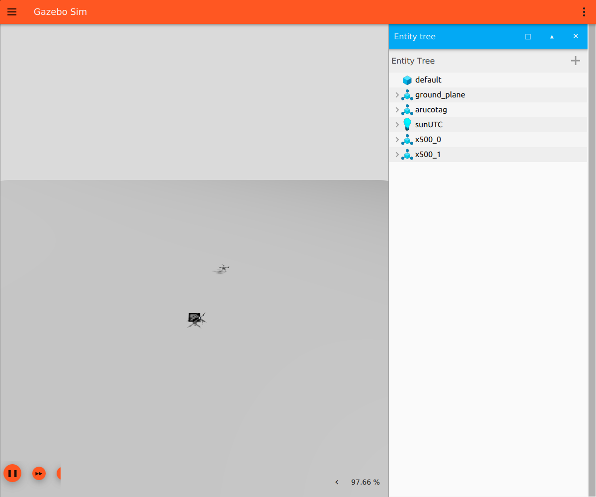

# 12 多机编队

> 难度 L6 · 对应实验 E3 · 场景 `multi.formation`
> **实测：双机同时起飞，队形误差 0.14–0.29 m** · 预计 150–180 分钟

## 本章问题

一架飞机的问题，你已经解决得差不多了。现在加第二架。

直觉上这是"复制一份跑两次"，但实际会撞上四个新问题：

1. **两个 PX4 实例怎么共存**？它们都叫 `/fmu/...` 不会打架吗？
2. **命令怎么发给指定的那一架**？如果两架都收到同一条"解锁"会怎样？
3. **两架飞机怎么知道彼此的相对位置**？各自的"原点"是同一个吗？
4. **队形怎么保持**？跟随者该飞向哪里。

第 3 点是本章最隐蔽的坑，而且**仓库旧文档在这里写错了**——本章会把真实情况讲清楚。

## 学习目标

| 维度 | 学习前 | 学习后 |
|---|---|---|
| 多机架构 | 以为多机就是多开一个终端 | 知道每架 = 独立 PX4 实例 + 命名空间 + 工作目录 + SYS_ID |
| 命令路由 | 不知道命令怎么找到目标机 | 理解 MAVLink 按 `MAV_SYS_ID` 路由，写错就被别的机吃掉 |
| 坐标系 | 以为所有飞机共用一个原点 | 知道**每架机体的局部原点在自己的出生点** |
| 编队控制 | 以为直接跟随就行 | 能写出"领航位姿 + 偏移"的目标生成与推进 |
| 参数隔离 | 没听过 `parameters.bson` | 知道多实例共享工作目录会互相覆盖参数 |
| 评估 | 看画面像不像 | 会用队形误差的中位数判断，并能区分两种口径 |

## 前置知识

需要会第 4 章的航点任务、第 2 章的 Offboard 三要素。多机部分涉及命名空间与实例编号，第 1 章与第 3 章都铺垫过。

**先跑，再懂。** 第 1 节用一条 launch 拉起双机，看到两架同时在飞；第 2 节再讲它们是怎么被隔离开的。

## 本章地图

| 步骤 | 你做什么 | 拿到的证据 |
|---|---|---|
| 1 | 一条 launch 起双机 | 两架模型同时出现在 Gazebo |
| 2 | 领航机飞正方形，跟随者保持编队 | 日志"编队误差 0.xx m" |
| 3 | 跑判分 | 队形误差 < 0.6m，两机起飞时间差 < 8s |
| 4 | 理解五重隔离 | 能列出每架机的独立资源 |
| 5 | 复现"2 号机不解锁" | 能定位到 `target_system` |

---

## 1. 先让两架一起飞（最小路径）

### 1.1 一条 launch 拉起双机

```bash
ros2 launch drone_sim multi_vehicle.launch.py num:=2 world:=aruco \
  px4_dir:="$PWD/PX4-Autopilot"
```

这一个命令做的事比看上去多：

| 动作 | 说明 |
|---|---|
| 起 2 个 PX4 实例 | `px4 -i 0` / `px4 -i 1`，各自独立进程 |
| 起 2 套命名空间 | `/x500_0`、`/x500_1` |
| 起 2 组 DDS 会话 | 各自的 `PX4_UXRCE_DDS_NS` |
| 在 Gazebo 里 spawn 两个模型 | 默认出生点 `x = i × 2.0`（0 号在 x=0，1 号在 x=2） |

**注意最后一行**：两架飞机不是叠在一起的，它们**相隔 2 米**。这个细节后面会变成一个坑。

### 1.2 领航机飞正方形

```bash
ros2 launch drone_sim waypoint_mission.launch.py prefix:=/x500_0 mission:=square
```

`prefix` 指定命名空间——这就是"命令发给哪一架"的 ROS2 层做法。

### 1.3 跟随者保持编队

```bash
ros2 run drone_sim formation_follower --ros-args \
  -p leader_ns:=/x500_0 -p follower_ns:=/x500_1 -p target_system:=2
```

预期日志：

```text
[INFO] 跟随机请求 Offboard + 解锁 ...
[INFO] 跟随机起飞至 5.0m
[INFO] 跟随机到达高度, 开始编队跟随
[INFO] 编队误差 0.24m | 领导(3.0,0.1,-5.0) 跟随(3.0,-1.9,-5.0)
[INFO] 编队误差 0.19m | 领导(3.0,3.0,-5.0) 跟随(3.0,1.1,-5.0)
```

**看第三行**：领导在 y≈0.1，跟随在 y≈-1.9，两者 y 相差约 2m——这正是 `offset_y` 的效果。

飞行画面：



**两架保持固定间隔飞行——不是一个在前一个在后，而是并排偏移。**

### 1.4 判分

```bash
python3 tools/grade.py --scenario multi.formation --runs 3
```

| 指标 | 阈值 | 怎么取数 |
|---|---|---|
| 队形误差 | < 0.6 m | 跟随者与（领航者 + 偏移）的中位距离 |
| 双机同时起飞 | ≥ 1 | 两机解锁时刻相差 < 8s |

本仓库实测队形误差 **0.14–0.29 m**，远小于 0.6m 阈值。

---

## 2. 刚才发生了什么（回头理解原理）

### 2.1 一架飞机 = 五份独立资源

多机的本质不是"多开一个终端"，而是**五份资源都要独立**：

```text
每架飞机 = 独立 PX4 实例（-i N）
         + 独立命名空间（/x500_N）
         + 独立工作目录（实例私有）
         + 独立 MAV_SYS_ID（= N + 1）
         + 独立 DDS 会话（PX4_UXRCE_DDS_NS）
```

| 资源 | 不独立的后果 |
|---|---|
| PX4 实例 | 两个进程抢同一个仿真接口，直接崩 |
| 命名空间 | 话题混在一起，命令发给谁说不清 |
| 工作目录 | **参数文件互相覆盖**（2.4 节） |
| MAV_SYS_ID | **命令被别的机吃掉**（2.3 节） |
| DDS 会话 | 两机数据串台 |

前两项是"起不来"的问题（容易发现），后三项是"起来了但行为不对"的问题（难发现）。

### 2.2 命名空间：ROS2 层面的隔离

第 1 章讲过推导规则：机型名去掉 `gz_` 加实例号。多机时：

```text
x500_0 → /x500_0/fmu/out/vehicle_status
x500_1 → /x500_1/fmu/out/vehicle_status
```

于是"飞哪一架"就是指定话题前缀：

```bash
ros2 launch drone_sim waypoint_mission.launch.py prefix:=/x500_0   # 0 号机
```

**这是 ROS2 层的隔离**——数据在话题层面就分开了。

### 2.3 MAV_SYS_ID：PX4 层面的路由

但还有一层：**PX4 内部的 MAVLink 消息路由**。

每条 `VehicleCommand` 都带一个 `target_system` 字段，PX4 只执行"发给自己的"命令：

```text
0 号机 SYS_ID = 1
1 号机 SYS_ID = 2
```

**所以给 1 号机的命令，`target_system` 必须是 2。**

写错会怎样？命令带 `target_system=1`，会被 **0 号机**接收并执行——现象是：**1 号机不动，0 号机莫名其妙重复解锁/降落**。

代码里这一行有醒目注释：

```python
self.declare_parameter('target_system', 2)    # 跟随机 MAV_SYS_ID = 实例号+1 (关键!)
```

**记住换算：`target_system = 实例号 + 1`**，因为 SYS_ID 从 1 开始、实例号从 0 开始。

### 2.4 `parameters.bson`：多实例共享目录的灾难

这是更隐蔽的一个（课程补丁 0010 修的就是它）。

PX4 启动时会把参数写进工作目录下的 `parameters.bson`。如果两个实例**共享同一个工作目录**：

1. 实例 0 启动，写入自己的参数；
2. 实例 1 启动，**读到实例 0 的参数**，然后在上面覆盖；
3. 实例 0 再读，拿到被污染的值。

结果：参数互相覆盖、行为错乱、甚至解锁失败——而且**日志里看不出明显错误**。

**修复**：每实例独立工作目录（`-w instance_N`）。

> 教训：**多进程共享状态**是分布式系统永恒的坑。凡是"写同一个文件"，先问"会不会有两个写者"。

### 2.5 跟随者的控制律

跟随者要做的很简单：**飞向"领航者位置 + 偏移"**。

```python
lp = self.leader_pos
goal = [lp.x + self.offset[0], lp.y + self.offset[1], lp.z + self.offset[2]]
```

然后**开环推进**目标点：

```python
d = [goal[i] - self.target[i] for i in range(3)]   # 目标与当前设定点的差
dist_sp = math.sqrt(sum(v * v for v in d))
if dist_sp > 0.02:
    step = min(self.speed * 0.1, dist_sp)          # 每拍最多走 speed×0.1
    self.target = [self.target[i] + d[i] / dist_sp * step for i in range(3)]
```

**为什么"推进设定点"而不是"直接把 goal 设为设定点"**：

- 直接设 `goal`，位置指令**瞬间跳变**，飞控会猛烈加速；
- 每拍限速推进，目标点平滑移动，飞起来更稳。

`step = min(speed × 0.1, dist_sp)` 里的 `0.1` 是控制周期（10Hz）。

**注释里有一句很重要**：

```python
self.declare_parameter('cruise_speed', 2.5)   # 需快于领导机以收敛队形
```

跟随者的速度必须**大于**领航机，否则领航机飞远了它追不上，误差越来越大。

### 2.6 最隐蔽的坑：各机的局部原点不一样（本章勘误）

仓库旧文档写的是"跟随机订阅领航机**世界系位姿**（`/x500_0/pose`）"。但**代码不是这样**：

```python
self.create_subscription(VehicleLocalPosition, f'{lns}/fmu/out/vehicle_local_position',
                         lambda m: setattr(self, 'leader_pos', m), sub_qos)
```

它订阅的是**领航机的局部位置** `vehicle_local_position`。

**为什么这很重要**：每架飞机的局部原点，**在它自己的出生点**。

| 飞机 | 出生点（世界） | 局部原点对应世界 |
|---|---|---|
| 0 号 | x = 0 | (0, 0, 0) |
| 1 号 | x = 2 | (2, 0, 0) |

所以"领航机的局部坐标"和"跟随者的局部坐标"**相差 2 米**。直接拿 `goal = leader_local + offset` 当跟随者目标，实际会偏 2 米。

**代码怎么圆回来的**？看默认偏移：

```python
self.declare_parameter('offset_x', -2.0)     # 负 2 米！
self.declare_parameter('offset_y', 2.0)
```

`offset_x = -2.0` **正好抵消出生点的 2 米间隔**：

```text
goal_x = leader_local_x + (-2)
       = (leader_world_x - 0) - 2
       = leader_world_x - 2
跟随者局部 x = 跟随者世界 x - 2
⇒ 目标世界位置 = leader_world_x   ✅ 对齐
```

**结论**：`offset` 的物理含义是"**期望队形偏移 − 出生点间距**"，不是"期望队形偏移"本身。

如果你改出生点布局（比如间距改成 3m），必须同步改 `offset_x`，否则队形整体偏移。

> 更稳的做法是用 `/pose`（世界系真值）算，不受出生点影响。这一条留作任务卡 5。

### 2.7 队形误差：两种口径

```python
err = math.sqrt((self.pos.x - goal[0]) ** 2 +
                (self.pos.y - goal[1]) ** 2 +
                (self.pos.z - goal[2]) ** 2)
```

注意：`self.pos` 和 `goal` **都在跟随者的局部系**里，所以这个误差是"跟随者离它的目标设定点有多远"，**不是"实际队形与期望队形的偏差"**。

| 口径 | 含义 | 用途 |
|---|---|---|
| 设定点跟踪误差 | 跟随者跟得上自己的目标吗 | 评估控制性能 |
| **队形几何误差** | 实际队形与期望队形的偏差 | 评估编队质量 |

判分用前者（数据好取）。严谨的编队评估应该用世界系算后者——任务卡 5 就是这个。

### 2.8 编队的三种控制方法

本章用的是"长机-僚机"，但这不是唯一做法。

| 方法 | 做法 | 优点 | 缺点 |
|---|---|---|---|
| **长机-僚机**（本章） | 僚机跟踪长机 + 偏移 | 简单、易实现 | 长机挂了全乱；僚机是"单向依赖" |
| **虚拟结构** | 定义一个虚拟几何中心，所有机跟踪各自在结构中的位置 | 队形稳定、抗单点故障 | 需要全局同步 |
| **一致性（consensus）** | 每机只和邻居交换状态，靠局部规则收敛 | 可扩展、无中心 | 收敛慢、分析复杂 |

**为什么课程选长机-僚机**：两机场景下它最简单，且**便于观察**——你能清楚看到"领航机飞哪、跟随者跟到哪"。

**什么时候该换**：机数 > 3、或长机可能失联、或队形要动态变化时，虚拟结构/一致性更合适。

### 2.9 通信拓扑：谁需要知道谁

两机时的信息流：

```text
跟随者 ←(订阅)── 领航机的 local_position
跟随者 ←(订阅)── 领航机的 vehicle_status
跟随者 ──(发布)── 自己的设定点
```

**关键点：这是单向的**。领航机**不知道**跟随者在哪。

| 后果 | 说明 |
|---|---|
| 领航机不会等跟随者 | 它按自己的任务飞 |
| 跟随者掉队无人知 | 只有地面的人能看出来 |
| 加第三架很简单 | 再加一个跟随者订阅同一个长机 |

**要双向知道怎么办**：加一个"编队状态汇总"节点，算最小间距、队形误差并报警。**这正是第 13 章做的事。**

### 2.10 队形误差的两个来源

分解一下误差构成，有助于定位：

| 来源 | 特征 | 怎么减小 |
|---|---|---|
| **跟踪滞后** | 领航机加速时误差变大，匀速时变小 | 提高跟随速度/加前馈 |
| **位置抖动** | 误差快速随机波动 | 滤波、降增益 |

**判别方法**：看误差与"领航机速度"的相关性。强相关 → 滞后；不相关 → 抖动。

**这条方法论适用于任何"跟随"问题**（第 13 章的集群跟随也一样）。

### 2.11 逐段读 `formation_follower.py`：198 行的四个状态

```text
INIT ──(解锁+Offboard)──> TAKEOFF ──(到高度)──> FOLLOW ──(长机降落)──> LAND ──(上锁)──> DONE
```

**第一段：起飞目标是"原点正上方"**

```python
# 本地坐标原点在出生点, 起飞目标为原点正上方 (不是世界系 spawn_x)
self.target = [0.0, 0.0, -self.alt]
```

**这句注释点出了 2.6 节的核心**：跟随者的局部原点在**自己的出生点**，所以起飞目标就是 `(0, 0, -alt)`，不是世界系的 `(2, 0, -alt)`。

**第二段：跟随时的朝向**

```python
self.target_yaw = math.atan2(lp.y - self.pos.y, lp.x - self.pos.x)
```

**让机头始终朝向长机**。注意 `atan2(Δy, Δx)` 的参数顺序——**先 y 后 x**，这是 `atan2` 的定义。

**写反了会怎样**：机头朝向偏离 90°，看起来"斜着飞"。

**第三段：降落判据是复合条件**

```python
if self.leader_status is not None and \
   self.leader_status.arming_state != VehicleStatus.ARMING_STATE_ARMED and \
   lp.z > -0.5:
    self.state = 'LAND'
```

**三个条件同时满足才降落**：

| 条件 | 含义 |
|---|---|
| 有长机状态 | 数据可用 |
| **已上锁** | 长机确实结束了 |
| `lp.z > -0.5` | 长机高度低于 0.5m（NED 下负值表示高度） |

**为什么第二个条件不够**：如果只看"上锁"，长机可能在**空中**因为异常上锁（失控停桨），此时跟随者跟着降落就是一起摔。

**加 `lp.z > -0.5` 是"位置 + 状态"的双重确认**——与第 6 章"连续 N 拍 + 容差"、第 16 章"解锁之后再上锁"是同一种思路：**单一条件容易被异常满足，复合条件更可靠**。

**第四段：`step = min(speed * 0.1, dist_sp)` 里的 0.1**

`0.1` 就是控制周期（10Hz 定时器）。`speed * 0.1` 是"这一拍最多走多远"。

**如果定时器频率改了而没改这个 0.1**，限速就会错——变成"每拍走 speed×0.1 米"但拍数变了，实际速度变成 `speed × 0.1 × 实际频率`。

**这是一个隐含耦合**：代码里的常数 `0.1` 依赖定时器周期。**更好的写法是读配置的周期**，或者用时间差 `dt` 计算。

---

## 3. 案例：五个真实故障

### 案例 1：2 号机不解锁

**现象**：跟随者日志反复"请求 Offboard + 解锁"，飞机不动；同时 0 号机行为异常。

**原因**：`target_system` 写成 1（而不是 2），命令被 0 号机吃掉。

**诊断**：

```bash
ros2 topic echo /x500_0/fmu/out/vehicle_status --once --field system_id
ros2 topic echo /x500_1/fmu/out/vehicle_status --once --field system_id
```

**修复**：`target_system = 实例号 + 1`。

### 案例 2：参数被另一个实例覆盖

**现象**：两机起飞高度不一致，或某个参数改了没生效。

**原因**：共享工作目录导致 `parameters.bson` 互相写。

**诊断**：看两机的实例目录是否分开（`-w instance_0` / `-w instance_1`）。

**修复**：每实例独立工作目录（补丁 0010）。

### 案例 3：队形越飞越散

**现象**：刚开始还行，领航机加速后跟随者越落越远。

**原因**：`cruise_speed` 小于领航机速度。

**修复**：跟随者速度设为领航机的 1.5–2 倍（同时受安全层 `max_speed` 约束）。

**权衡**：太大冲过头来回振荡，太小追不上。

### 案例 4：队形整体偏了 2 米

**现象**：两机保持队形，但整体位置与预期差一个固定量。

**原因**：改了出生点间距，没改 `offset_x`（2.6 节）。

**验证**：把两机世界坐标打出来算差，与 `offset` 对比。

### 案例 5：两机起飞不同步

**现象**：判分"双机同时起飞"失败——解锁时刻差超过 8 秒。

**原因**：两机解锁流程各自独立，一个先跑很久另一个才启动。

**修复**：同时启动两个任务；或加协调节点统一发解锁命令（进阶）。

### 案例 6：长机降落了，跟随者还在飞

**现象**：领航机完成任务降落，跟随者仍在 5 米高度悬停。

**原因**：跟随者的状态机里没有"长机结束"的判定，它只跟位置，不跟状态。

**代码里其实有这一条**：

```python
if self.leader_status is not None and \
   self.leader_status.arming_state != VehicleStatus.ARMING_STATE_ARMED and ...
```

**但它是"长机上锁后跟随者降落"**——如果长机只是降落但还没上锁，跟随者会看到"长机高度在下降"，于是一路跟到地面附近，风险很高。

**更好的判据**：长机进入 `LAND` 模式（`nav_state == 18`）就触发跟随者降落，而不是等上锁。

**教训**：**跟随者要跟"意图"，不只是跟"位置"**。

### 案例 7：三机时三架叠在一起

**现象**：三机编队，三架飞机挤在同一位置。

**原因**：三个跟随者都用了默认 `offset_x=-2.0`、`offset_y=2.0`——**没有区分**。

**这是 2.6 节那个"offset 含义"的直接后果**：offset 不是"队形偏移"，而是"队形偏移 − 出生间距"。每个跟随者的出生点不同，offset 就必须不同。

**正确做法**：

| 跟随者 | 出生点 | 期望相对长机的偏移 | 应设的 offset |
|---|---|---|---|
| #1 | (2, 0) | (0, +2) | (-2, +2) |
| #2 | (4, 0) | (0, −2) | (-4, −2) |
| #3 | (6, 0) | (−2, 0) | (-8, 0) |

**看出规律了吗**：`offset = 期望偏移 − (出生点 − 长机出生点)`。

**这就是"用局部坐标做跨机控制"的代价**——每加一架机，都要重算 offset。第 2.6 节说的"用 `/pose` 更稳"，正是为了消掉这个麻烦。

## 4. 进阶

### 4.1 队形几何：offset 到底怎么算

第 2.6 节说 `offset = 期望偏移 − 出生间距`。这一节把它算成表。

**计算步骤**：

1. 列出每架机的**出生点**（世界系）；
2. 列出你想要的**队形**（每架机相对长机的世界系偏移）；
3. `offset_i = 期望偏移_i − (出生点_i − 出生点_leader)`。

**举例**：长机在 `(0,0)`，跟随者出生在 `(2,0)`，想要"跟随者在长机右侧 2 米"：

```text
期望偏移 = (0, +2)
出生间距 = (2, 0) − (0,0) = (2, 0)
offset   = (0,2) − (2,0) = (-2, +2)
```

**这正好是代码的默认值 `offset_x=-2.0, offset_y=2.0`**——所以默认配置的队形是"并排、跟随者在 +y 侧"。

### 4.2 三机编队：两种常见队形

**队形 A：横排（跟随者都在 y 方向错开）**

| 机 | 出生点 | 期望偏移 | offset |
|---|---|---|---|
| 0（长机） | (0,0) | (0,0) | — |
| 1 | (2,0) | (0,+2) | (-2,+2) |
| 2 | (4,0) | (0,−2) | (-4,−2) |

**队形 B：三角形（一前两后）**

| 机 | 出生点 | 期望偏移 | offset |
|---|---|---|---|
| 0（长机） | (0,0) | (0,0) | — |
| 1 | (2,0) | (−2,+2) | (-4,+2) |
| 2 | (4,0) | (−2,−2) | (-6,−2) |

**看出规律**：`offset_x` 的绝对值随出生点 x 增大而增大（-2, -4, -6）。**每加一架机都要重算**——这就是 2.6 节说的"用局部坐标的代价"。

### 4.3 与第 13 章的分工

两章都在做"多机协同"，但目标不同：

| | 第 12 章编队 | 第 13 章集群 |
|---|---|---|
| 目标 | **保持固定几何关系** | **各自到达各自目标** |
| 冲突处理 | 不需要（队形不交叉） | 必须（航线交叉） |
| 核心机制 | 跟随 + 偏移 | 势场斥力 |
| 依赖 | 长机状态 | 邻居位置 |

**同一个"多机"，两种问题**。第 13 章的三机交叉，本质是"编队"的反面——它们不是要待在一起，而是要**安全地分开**。

### 4.4 编队能不能"去中心化"

本章是长机-僚机（有中心）。如果要无中心：

| 方案 | 做法 | 代价 |
|---|---|---|
| 虚拟结构 | 定义几何中心，各自算自己该在哪 | 需要共享"结构原点" |
| 一致性 | 每机只和邻居交换，靠局部规则收敛 | 收敛慢、需要通信拓扑稳定 |

**课程没做**，因为两机场景下长机-僚机已经足够，且**便于观察谁跟谁**。**教学场景优先"看得懂"，不是"最先进"**。

---

## 常见误解

| 误解 | 实际情况 |
|---|---|
| "多机就是多开几个终端" | 需要实例、命名空间、工作目录、SYS_ID、DDS 会话五重隔离 |
| "话题分开就够了" | PX4 层还要靠 `target_system` 路由 |
| "所有飞机共用一个坐标原点" | 每架局部原点在自己的出生点 |
| "offset 就是队形偏移" | 还要减掉出生点间距（本章勘误） |
| "参数文件不会互相影响" | 共享工作目录会互相覆盖 |
| "跟随者速度随便设" | 必须快于领航机才能收敛 |
| "队形误差就是两机距离误差" | 代码算的是设定点跟踪误差，口径不同 |

---

## 你可能卡在这里

| 现象 | 最可能原因 | 先跑这条命令 |
|---|---|---|
| 2 号机不解锁 | `target_system` 写错 | `ros2 topic echo /x500_1/fmu/out/vehicle_status --once` |
| 只有一架飞机出现 | `num` 没生效 | 看 launch 日志的 spawn 行 |
| 话题混在一起 | 命名空间没隔离 | `ros2 topic list \| grep x500` |
| 参数改了没生效 | `parameters.bson` 冲突 | 查实例工作目录 |
| 队形越飞越散 | 跟随速度不够 | 调 `cruise_speed` |
| 队形整体偏移 | offset 没扣出生间距 | 算两机世界坐标差 |
| 起飞不同步 | 任务启动时间差大 | 看两机解锁时间戳 |

---

## 任务卡

### 任务卡 1：跑通双机并验证五重隔离

| 段 | 内容 |
|---|---|
| 1 要实现的功能 | 起双机，验证实例/命名空间/工作目录/SYS_ID/DDS 五项都独立 |
| 2 通信骨架/前置 | `multi_vehicle.launch.py num:=2` |
| 3 AI 提示 | 先自己查，再问：<br>"我怎么确认两架飞机的 PX4 实例是独立的？我打算查（贴你的方法）。请只指出我漏了哪个维度的验证。**不要给命令。**" |
| 4 执行步骤 | ① 起栈 ② 查两机话题 ③ 查两机 SYS_ID ④ 查实例进程与工作目录 ⑤ 记录成表 |
| 5 验收标准 | □ 两机话题前缀不同 □ SYS_ID 分别为 1/2 □ 两个 px4 进程、两个工作目录 |
| 6 原理 + 扩学 | 教**多机五重隔离**。扩学：不隔离工作目录会先坏哪个参数？ |

### 任务卡 2：让队形误差达标

| 段 | 内容 |
|---|---|
| 1 要实现的功能 | 把队形误差压到 0.3m 以内，记录 3 次的中位数 |
| 2 通信骨架/前置 | 默认参数；真值可从两机 `vehicle_local_position` 读 |
| 3 AI 提示 | 先跑出数据，再问：<br>"我三次误差是（贴数）。请只判断：这是'跟随速度不够'还是'控制延迟'导致的？依据是什么？**只判断。**" |
| 4 执行步骤 | ① 跑 3 次 ② 记误差序列 ③ 调 `cruise_speed` 观察变化 ④ 找最优 |
| 5 验收标准 | □ 中位数 < 0.3m □ 能说出速度对误差的影响 □ 无持续振荡 |
| 6 原理 + 扩学 | 教**跟随速度与稳定性权衡**。扩学：速度过大会怎样？ |

### 任务卡 3：复现"命令被别机吃掉"

| 段 | 内容 |
|---|---|
| 1 要实现的功能 | 把 `target_system` 故意写成 1，观察现象并解释 |
| 2 通信骨架/前置 | 只改一个参数 |
| 3 AI 提示 | 先观察，再问：<br>"我把跟随机 target_system 设成 1 后，2 号机不解锁，0 号机出现重复解锁（贴日志）。请只解释：命令为什么被 0 号机执行？**一句话。**" |
| 4 执行步骤 | ① 改参数 ② 跑 ③ 记两机行为 ④ 改回 ⑤ 验证正常 |
| 5 验收标准 | □ 能复现不解锁 □ 能指出 0 号机异常 □ 能说出 SYS_ID 换算规则 |
| 6 原理 + 扩学 | 教**MAVLink 路由**。扩学：三机时 2 号机该写几？ |

### 任务卡 4：算清 offset 与出生间距

| 段 | 内容 |
|---|---|
| 1 要实现的功能 | 改成 `spawn="0,0;3,0"`（间距 3m），推导并验证新的 `offset_x` |
| 2 通信骨架/前置 | 出生点间距变了，offset 必须同步 |
| 3 AI 提示 | 先自己推，再问：<br>"出生间距从 2m 改成 3m，我推的 offset_x 是（贴值），推导过程（贴）。请只检查推导有没有漏项。**不要给结果。**" |
| 4 执行步骤 | ① 推导 ② 改 launch 与 offset ③ 跑 ④ 用世界坐标验证队形 ⑤ 记录 |
| 5 验收标准 | □ 世界系下队形间距符合期望 □ 能说出 offset 的物理含义 |
| 6 原理 + 扩学 | 教**跨机局部系比较必须补原点差**。扩学：用 `/pose` 能免掉这一步吗？ |

### 任务卡 5：用世界系重算队形误差（本章的"刺"）

| 段 | 内容 |
|---|---|
| 1 要实现的功能 | 不用现有"设定点跟踪误差"，改用世界系算**真实队形几何误差**并对比 |
| 2 通信骨架/前置 | **无 AI 区：本卡禁止使用 AI**。需要两机的世界坐标（`{ns}/pose`） |
| 3 AI 提示 | 本卡不使用 AI。卡住可查 [故障实验室](faq.md)、读 2.6/2.7 节、参考第 6 章"真值优先" |
| 4 执行步骤 | ① 同时录两机 `/pose` ② 算实际间距 ③ 与期望队形比 ④ 与日志"编队误差"对比 ⑤ 写差异原因 |
| 5 验收标准 | □ 两种口径都算出来 □ 能解释数值为何不同 □ 能说出哪种更能反映编队质量 |
| 6 原理 + 扩学 | 教**指标口径决定结论**。扩学：论文里报编队误差该报哪个？ |

## ✅ 检查清单

- [ ] 我能列出多机的五重隔离，并说出每重不独立会怎样
- [ ] 我知道 `target_system = 实例号 + 1` 的由来
- [ ] 我能解释 `parameters.bson` 冲突的机理
- [ ] 我知道每架飞机的局部原点在自己的出生点
- [ ] 我能推出 offset 与出生间距、期望队形的关系
- [ ] 我能解释跟随者速度为什么要快于领航机
- [ ] 我能区分"设定点跟踪误差"与"队形几何误差"
- [ ] 我能关掉 AI，独立复现本章实验并回答追问

> AI 可以帮你解释路由与坐标，但**不替你推导 offset**；任务卡 5 为无 AI 区。
> 规则见 [AI 使用指南](AI_GUIDE.md)。

## 分层练习

**基础**

1. 实例号 0/1/2 对应的 `target_system` 分别是多少？
   > 要点：1 / 2 / 3。

2. 为什么两架飞机的 `vehicle_local_position` 不能直接相减？
   > 要点：各自原点在不同出生点，差值含出生间距。

3. `cruise_speed=2.5` 相比领航机 1.5，为什么合理？

**进阶**

4. 去掉 `step = min(speed*0.1, dist_sp)` 的限速（直接跳到 goal），观察飞行品质。

5. 三机编队：两个跟随者不同 offset（如 (-2,2) 与 (-2,-2)），摆出三角形并验证。

6. 让两机中途交换角色（原跟随者变领航），需要改哪些参数？

**挑战**

7. 设计"世界系编队控制"版本：用 `/pose` 算目标，摆脱 offset 与出生点的耦合。

8. 如果两机的 EKF 原点都在飞行中重置，编队还能保持吗？给出分析与对策。

---

## 自查 12 问

1. 多机的五重隔离分别是什么？
2. `-i N` 控制什么？
3. `PX4_UXRCE_DDS_NS` 有什么用？
4. SYS_ID 与实例号的换算关系？
5. 命令被别机吃掉的根本原因？
6. `parameters.bson` 冲突为什么难发现？
7. 每架飞机的局部原点在哪？
8. offset 的物理含义（勘误后）是什么？
9. 为什么跟随者要快于领航机？
10. 为什么"推进设定点"而不是直接设目标？
11. 判分里的"队形误差"是什么口径？
12. 更严谨的编队评估该怎么做？

---

## 小结与下一步

本章你让两架飞机同时飞起来，也踩透了多机的四个新问题：**实例隔离、命令路由、参数共享、坐标原点**。

最有价值的是 2.6 节那条勘误：**文档说用世界系位姿，代码其实用局部位置，靠 `offset_x=-2.0` 抵掉出生间距**。不核对源码只按文档改参数，就会遇到"队形整体偏 2 米"却查不出原因的怪现象。

这也是课程反复强调的：**文档会错，源码不会**。凡是关键数值，都去读一遍代码。

下一步把规模再推大：三机在空域里交叉飞行。这会带来新问题——**谁先走、怎么避让**。第 13 章讲集群交叉。

[上一章](course/11-safety.md) · [下一章：三机集群交叉 →](course/13-swarm.md)

---

## 附录：本章参数与机制速查

### 节点参数（`formation_follower`）

| 参数 | 默认值 | 含义 |
|---|---|---|
| `leader_ns` | `/x500_0` | 领航机命名空间 |
| `follower_ns` | `/x500_1` | 跟随者命名空间 |
| `offset_x` | -2.0 | 队形偏移（**含出生间距补偿**） |
| `offset_y` | 2.0 | 侧向偏移 |
| `offset_z` | 0.0 | 高度偏移 |
| `takeoff_altitude` | 5.0 | 起飞高度 |
| `cruise_speed` | 2.5 | 巡航速度（须快于领航机） |
| `spawn_x` | 2.0 | 跟随机出生点（仅日志用） |
| `target_system` | 2 | 跟随机 SYS_ID = 实例号+1 |

### 启动参数（`multi_vehicle.launch.py`）

| 参数 | 默认 | 说明 |
|---|---|---|
| `num` | — | 飞机数量 |
| `world` | `aruco` | 世界 |
| `model` | `gz_x500` | 机型 |
| `px4_dir` | — | PX4 目录（必须传） |
| `spawn` | 空 | 出生点列表，如 `"0,0;3,0"`；空则 `x = i×2.0` |

### 隔离对照

| 层 | 机制 | 写错的后果 |
|---|---|---|
| 进程 | `px4 -i N` | 仿真接口冲突 |
| ROS2 | `/x500_N` | 话题串台 |
| 文件 | 实例工作目录 | `parameters.bson` 互相覆盖 |
| MAVLink | `MAV_SYS_ID = N+1` | 命令被别机执行 |
| DDS | `PX4_UXRCE_DDS_NS` | 数据串台 |
