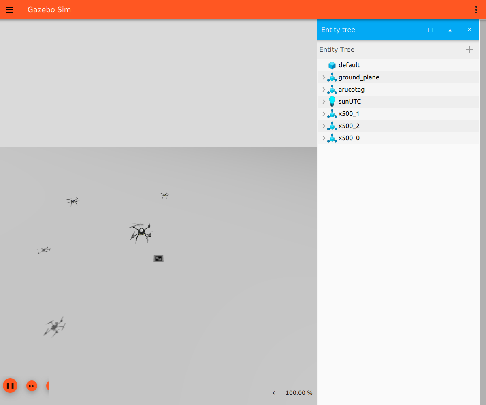

# 13 三机集群交叉

> 难度 L6 · 对应实验 E9（Issue #9，已完成）· 场景 `swarm.cross_3uav`
> 实测：三机全部到达对向目标，**最小间距 1.12 m 无碰撞**（用时 88s）

## 学习目标

- 分布式集群：无中心节点，每机广播位姿 + 势场法避碰
- 高度分层策略：交叉冲突的几何解法

## 13.1 跑起来

```bash
# 一条 launch: 3 机三角形出生 + 各自 swarm_agent
ros2 launch drone_sim swarm_cross.launch.py
```

任务：三机交叉飞到对向——
`(-3,0)→(3,0)`、`(3,0)→(0,4)`、`(0,4)→(-3,0)`，高度分层 0 / +0.7 / +1.4 m。



### 判分指标

| 指标 | 阈值 | 取数 |
|---|---|---|
| 最小间距 | > 1.0 m | 任意两机最近距离 |
| 全部到达 | ≥3 架 | 各机与目标距离 < 0.8m |

## 13.2 分布式势场法（代码导读 `swarm_agent.py`）

每机独立运行同一套逻辑：

1. **广播**：发布自己的 gz 世界系位姿（真值，不用 PX4 局部系）
2. **势场**：目标吸引力 + 邻居斥力（距离越近斥力越大）
3. **速度控制**：合速度经航向旋转转到机体系，发 PX4 Offboard velocity

没有中心调度器——加第 4 架飞机只需多一个实例，算法不变（可扩展性）。

> 说明：上游 ego_planner_swarm 的 ROS2 移植仅支持单机，故采用自研分布式势场，
> 达到同等验收目标（全部到达 + 无碰撞）。

## 13.3 故障实验室：同层交叉间距不足

最初三机同高度交叉，最小间距只有 **0.76m**（低于 1.0m 阈值，判 FAIL）。
修复：**高度分层**（0/+0.7/+1.4m）——三维空间里错开冲突，比纯平面斥力更可靠。

> 教训：集群避碰不要只靠斥力"挤"，几何分层是更稳的第一道防线。

## 练习

1. 把高度分层改成全同层，复现 0.76m 间距，观察斥力如何"挤"出通道。
2. 调斥力增益，观察最小间距与到达时间的权衡。
3. 思考：势场法的局部极小值问题在这里为什么没出现？（提示：目标吸引 + 分层）

[上一章](course/12-formation.md) · [下一章：VTOL 复合翼过渡 →](course/14-vtol.md)
