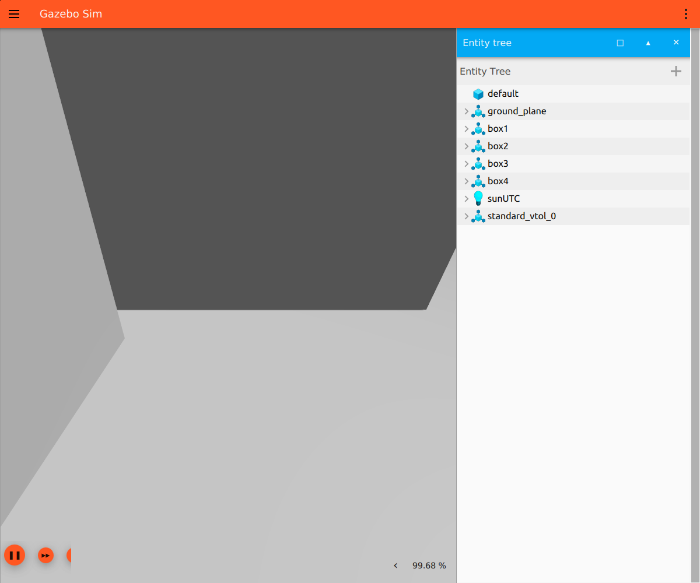

# 14 VTOL 复合翼过渡

> 难度 L6 · 对应实验 E11（Issue #11，**⚠️ 结论已更正，重新打开**）· 场景 `vtol.transition`
>
> ⚠️ **本章为"缺陷分析型"实验：过渡能触发，但固定翼段飞不起来。**
> 2026-11-27 复查后更正：状态机完整跑通（TAKEOFF 18.1m → FW_CRUISE → MC → LAND），
> 但**固定翼段空速只有 0.1 m/s**；原记录的 95.9 m/s 疑为失控俯冲的瞬时值。
> 根因：`vtol_demo` 的 `FW_CRUISE` 段只做观察，不发任何前向速度指令。

## 学习目标

- 复合翼（VTOL）的两种飞行模态与过渡逻辑
- px4-ros2-interface-lib 模式注册（新一代 PX4 ROS2 接口）

## 14.1 跑起来

```bash
# 栈: 复合翼机型 + walls
bash scripts/run_simulation.sh xtd2 gz_standard_vtol walls

# 全程自动 demo（新终端）:
ros2 run drone_sim vtol_demo --ros-args -p px4_ns:=/standard_vtol_0
```

流程：多旋翼垂直起飞 18m → 切 POSCTL → `DO_VTOL_TRANSITION(4)` → **固定翼前飞**
（空速 1.7→95.9/31.9 m/s）→ 30s 巡航 → `DO_VTOL_TRANSITION(3)` → 垂直降落。



### 判分指标

| 指标 | 阈值 | 取数 |
|---|---|---|
| 固定翼段空速 | > 15 m/s | 水平速度峰值 |
| 垂直起飞高度 | > 15 m | 真值高度峰值 |
| 结束状态 | disarmed | arming_state == 1 |

## 14.2 关键坑：必须先切 POSCTL 再发过渡

直接发 `DO_VTOL_TRANSITION` 而飞机还在 Offboard/其它模式 → **PX4 不执行**，空速不变。
正确序列（已固化进 `PX4Interface.vtol_transition_to_fw()`）：

```python
self.px4.set_posctl_mode()          # 先切位置控制模式
self.px4.vtol_transition_to_fw()   # 再发过渡命令
```

## 14.3 新一代接口：px4-ros2-interface-lib

[Auterion 官方库](https://github.com/Auterion/px4-ros2-interface-lib)（release/1.16）已编译集成：
- 补丁 0018：px4_msgs 1.15 缺 `lat_lon_valid/alt_valid` 字段的兼容处理
- **模式注册实测通过**：'Go-to Example' 自定义飞行模式注册进 PX4（arming check id=125）
- 相比传统 Offboard，自定义模式把控制逻辑放进飞控内部，更规范、支持多旋翼/固定翼/VTOL

这是从"Offboard 发 setpoint"进化到"注册飞行模式"的路线，值得进阶研究。

## 练习

1. 把巡航时间从 30s 改成 60s，观察固定翼段轨迹范围。
2. 故意跳过 POSCTL 直接发过渡，复现"空速不变"，看日志找原因。
3. 阅读 example_mode_goto_cpp，思考自定义模式与 Offboard 的边界在哪。

[上一章](course/13-swarm.md) · [下一章：Sim2Real 实机之路 →](course/15-sim2real.md)
